# How Photogram3D was built

Photogram3D runs a full photogrammetry pipeline from Blender's sidebar: COLMAP 4.2.1 solves the
cameras, OpenMVS 2.4.0 builds the depth maps, the mesh and the texture, and the add-on installs
both by itself. This document covers the problems met on the way, how each was found and
measured, what was tried, what was kept, and the tools written to solve or check them. The user
guide is [README.md](README.md).

Authors: Kruglov Iurii, Anthropic Claude AI. License:
[GNU General Public License (GPL)](https://www.blender.org/about/license/) v3 or later.

## Contents

1. [The shape of the add-on](#1-the-shape-of-the-add-on)
2. [Developing for Windows and NVIDIA GPUs without either](#2-developing-for-windows-and-nvidia-gpus-without-either)
3. [Folded camera solves: the path check](#3-folded-camera-solves-the-path-check)
4. [Symmetric objects: solving along the shooting order](#4-symmetric-objects-solving-along-the-shooting-order)
5. [Texture seams: a bug in OpenMVS's leveling, and blending them here](#5-texture-seams-a-bug-in-openmvss-leveling-and-blending-them-here)
6. [Windows, seen through logs](#6-windows-seen-through-logs)
7. [Depth maps on the GPU, and on the CPU and the GPU together](#7-depth-maps-on-the-gpu-and-on-the-cpu-and-the-gpu-together)
8. [Memory, disk and files left behind](#8-memory-disk-and-files-left-behind)
9. [The crop box, alignment and coordinates](#9-the-crop-box-alignment-and-coordinates)
10. [Video](#10-video)
11. [Photo formats, RAW files and phone DNGs](#11-photo-formats-raw-files-and-phone-dngs)
12. [Weakly matched photo sets](#12-weakly-matched-photo-sets)
13. [AI Features that never finished](#13-ai-features-that-never-finished)
14. [AI Polish without trusting the network blindly](#14-ai-polish-without-trusting-the-network-blindly)
15. [Splats and evened-out photos](#15-splats-and-evened-out-photos)
16. [Tests](#16-tests)
17. [Known limits and what comes next](#17-known-limits-and-what-comes-next)
18. [Version history](#18-version-history)

---

## 1. The shape of the add-on

A run is a chain of steps. Each step runs one external tool in a background thread, writes one
log file and reports progress parsed from the tool's output:

```
photos or video ─┬─ frames (FFmpeg: placed by the camera's movement, the sharpest nearby)
                 ├─ photos (RAW, HEIC, EXR … converted to JPEG)
                 │
features (SIFT on the GPU, or ALIKED) ─ matching ─ mapping ─ orient (up axis)
   mapping = incremental or global solver → weak-photo filter → path check
             → the other solver → solve along the shooting order (when needed)
undistort
depth maps: OpenMVS (CPU) │ COLMAP (CUDA) │ both at once ─ fusion (OpenMVS)
   └─ crop stage: the cloud, the cameras and a crop box go to Blender, the run stops
mesh (in the box) ─ refine ─ even out photos (optional) ─ texture ─ blend seams
   ─ Gaussian splats (optional) ─ import into Blender
```

Design decisions that shaped everything else:

- **The pipeline does not import `bpy`.** It takes a plain dict of settings, so the same code
  runs in Blender and in headless tests. Only `operators.py`, `ui.py`, `props.py`,
  `importer.py` and `legacy.py` touch Blender.
- **Resume by signature.** Every step stores a hash of everything its output depends on: its
  inputs, its settings and the hash of the step before. A rerun skips a step when the hash
  and the outputs are unchanged. Changing a setting reruns only the steps that depend on it.
  After a cancel or a crash, a run continues where it stopped. Some steps declare what they do
  *not* depend on: the splats train on the photos, not on the mesh, so a new crop box crops
  them again without retraining (0.3.6 fixed exactly that).
- **Runs and solves have identities.** With *Resume* off a run gets its own folder and its own
  collection. Each camera solve of a run gets an id; the scan in Blender and the saved alignment
  carry the id of the solve they belong to (section 9).
- **Every failure is explained.** `errors.py` reads the failed command, the end of its log and
  the settings, and says in plain words what most likely happened: a full disk, too little RAM,
  a missing Windows library, a locked file, photos that share too few features.

| Module | What it does |
|---|---|
| `pipeline.py` | the steps, the resume bookkeeping, the progress parsers |
| `solve_check.py` | the path check of a camera solve (section 3) |
| `walk.py` | the repair for folded solves (section 4) |
| `views.py` | picks the photos worth their cost for depth maps and texture |
| `roi.py` | OpenMVS's crop box format, dense clouds |
| `video.py`, `tracking.py` | frame selection; the camera that follows the video (one for each video in a joined scan) |
| `camera_track.py` | the camera on every frame of a video (section 10) |
| `join.py`, `joinrun.py` | two scans joined by points and refined on their clouds; the joined run made from both runs (section 4) |
| `formats.py`, `convert_images.py` | photo formats, RAW development, DNG lens shading |
| `prepare_images.py` | evening out exposure and vignetting from the solved scene |
| `blend_seams.py` | blending the texture's seams (section 5) |
| `polish.py`, `polish_ai.py`, `ai_normals.py` | surface polishing, classic and with MoGe-2 |
| `splats.py` | Gaussian splats with Brush |
| `tools.py`, `hardware.py` | downloading and checking the tools; GPU, RAM, presets |
| `runner.py`, `errors.py` | running tools with progress and cancel; explaining failures |
| `importer.py`, `operators.py`, `ui.py`, `props.py` | everything in Blender |
| `ai_backend.py`, `ai_features.py` | where AI Features run, the quick test, NVIDIA's libraries; the GPU runner for COLMAP's ALIKED and LightGlue (section 13) |
| `legacy.py` | carrying over the tools, settings and project files of development builds before 0.3.7 |

**Documents and figures.** Both documents are written for GitHub's Markdown and travel in the
add-on's zip as well, so every link and image is relative to them:

| Path | What |
|---|---|
| `README.md` | the user guide |
| `docs/manual/` | its screenshots, numbered in the order of its *Step by step* (Blender 5.2, the WRX photo set); local folder paths that named an old working folder and a parked car's number plate are pixelated |
| `docs/manual/video_managing_the_scene.jpg` | a still of the crop stage with a play button, linking to the video [*Photogram3D. Managing the scene*](https://youtu.be/ruF8eCvebvI) (GitHub's Markdown cannot embed a player) |
| `DEVELOPMENT.md` | this document |
| `docs/` | its figures: plots of the runs' COLMAP models and match databases, Cycles renders of the scans, the AW-249 overlays |

Two screenshots side by side are HTML `` tags with their own width in pixels (panels) or
49% (pairs of full windows); GitHub keeps `src`, `width` and `alt`. The screenshots are palette
PNGs when they show only the panel and JPEGs (quality 86, no chroma subsampling, so the text and
the arrows stay sharp) when they show the 3D view: 3.7 MB for the fifteen images, from 15 MB of
captures.

## 2. Developing for Windows and NVIDIA GPUs without either

The add-on was tested on two Windows laptops, a Ryzen 9 5900HX with an RTX 3070 (8 GB) and a
Ryzen 7 4800H with a GTX 1650 Ti (4 GB), both with 16 GB of RAM. Development ran on Linux with 2 CPU cores, 7.8 GB of
RAM, no GPU and no display. Most of the work below was shaped by that gap, which was closed in
four ways.

**Blender as a Python module.** Blender 5.2 runs as the `bpy` module, so the add-on registers,
draws its panels, imports results and installs as an extension without a window. COLMAP 4.2.1
and OpenMVS 2.4.0 were built from their release tags without CUDA, so every real step except
the GPU ones runs here.

**Scenes with a known answer.** Two scenes are rendered in Blender, with their true cameras and
surfaces saved alongside:

- a car-sized group of textured shapes (4.8 m across) on a textured floor, 50 photos from three
  rings of cameras (`make_scene.py`). Cameras, clouds and meshes are measured against the truth
  in millimetres. Its repeated shapes make it hard to solve on purpose;
- a gas mask stand-in on a box whose opposite faces are printed alike (`make_symmetric_scene.py`),
  made after the real gas mask folded (section 4): one walk of 40 photos.

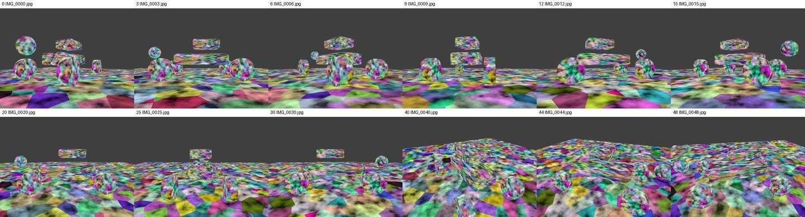

**Stand-ins with the real tools' interfaces.** Where something could not run here, a stand-in
with the same inputs, outputs, log lines and exit codes took its place, and everything around it
ran for real:

- `fake_colmap_cuda.py`, for COLMAP's CUDA depth maps: it writes COLMAP-format depth and normal
  maps converted from OpenMVS's maps of the same photos (`refmaps.py` makes those once from the
  crop-flow run's scene and keeps them, since the dense step deletes its maps once fused), prints
  COLMAP's log lines, skips maps that exist, and can crash on demand or fill the empty pixels
  with random guesses;
- a TextureMesh wrapper that crashes on demand, and OpenMVS's own "patch does not fit" stop;
- an ONNX model with MoGe-2's exact inputs and outputs that returns the true normals, clean or
  with realistic errors (`make_dummy_moge.py`);
- Brush, the splat trainer, on a software Vulkan driver.

**Real photo sets as the final test.** Every release was run on the two laptops on three sets
of phone photos (Pixel 7a): a Subaru WRX (42 photos, two laps around the car), a brick wall, and
a gas mask placed on a box. The logs of those runs were read line by line, replayed through the
progress parsers and turned into tests. Several bugs below were found only that way. For 0.3.7
the WRX photos were also reduced to 1080 × 1438, small enough for the whole pipeline to run on
the development machine (sections 3 and 13).

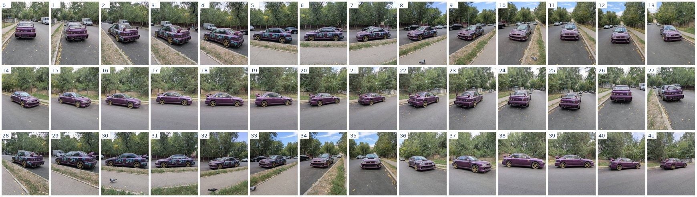

## 3. Folded camera solves: the path check

**The problem.** The first Windows run on the WRX photos gave three copies of the car, with
spikes between them. The global solver had laid the second lap on the first one rotated: five
"jumps" between shots taken 4 s apart. A car's left and right sides look alike, so photos
from opposite sides matched each other, and the solver believed those matches. The usual quality
number did not show it. The folded solve had a reprojection error of 1.45 px, against 1.12 px for
the correct one.

**The idea.** Phones and cameras name photos in shooting order, and video frames are in order by
definition. Consecutive shots must be close together, and a walk around an object keeps turning
the same way. `solve_check.py` walks the solved cameras in that order and counts *jumps* (a step
more than 5 times the median step, plus 2 for each photo missing in between) and *backsteps*
(turning back around the object). It scores a solve by the photos it placed and by those faults.

**What *Auto* does with it.** It solves with one solver (incremental for photos, global for
video) and checks the result. If the walk jumps or folds, or fewer than 60% of the photos are
placed, it runs the other solver and keeps the better result (since 0.3.10 both run for a video
of up to 300 frames; see below). On the same WRX matches the
incremental solver placed all 42 photos without a fold, and the path check has picked it since
0.2.0.

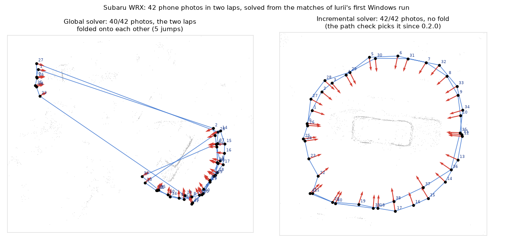

The same photos through the whole pipeline on the development machine, reduced to 1080 × 1438
(Normal preset, CPU only). *Auto* kept the incremental solve: 41 of 42 photos (one weakly
connected photo dropped), no fold, 3,674 points. The dense cloud had 316,407 points. The crop box
was put around the car by script, the way a user would place it: inside the ring of cameras,
along the points of the body standing above the road. Its axes come from the body itself, because
the ring is nearly round and its long axis was 34° off the car's. The box kept 43% of the cloud.
RefineMesh first decimated the 187,094 faces meshed in the box to 35,078 (its automatic
pre-decimation) and refined them to 44,746, textured with one 2048 px atlas. It took 32 minutes
on 2 cores, 21 of them in the depth maps, with the test suite running alongside.

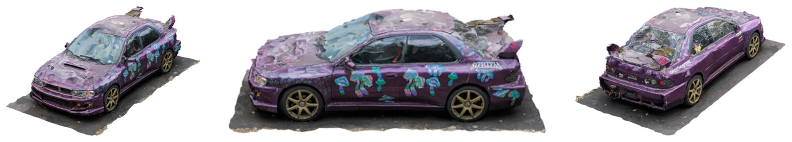

*The WRX set reduced to 1080 × 1438 (41 photos placed, Normal, CPU only): one car.*

**Misplaced single photos.** On the synthetic scene the global solver placed 4 of 50 cameras
wrongly (up to 1.1 m off) and the incremental solver 8. The misplaced photos share far fewer 3D
points with the rest, so photos below 30% of the median are dropped before the dense steps,
never more than 20% of the set.

**A fold behind dropped frames (0.3.10).** A 60 s walk round a GAZ-66 came out as two trucks
with 0.3.9, after 0.3.8 had solved the same walk right. 0.3.8 had kept 31 frames; its global
solve folded, the path check saw a jump between frames 029419 and 029862, and the incremental
solve that was then tried placed all 31 without a fold. 0.3.9 kept 60 frames (Auto's new floor of
one per second) and found them with AI Features. The global solver folded the walk again, but
the five frames at the fold (029430 to 029669) shared few points with the rest and were dropped
as weakly connected, and the check let the fold pass for two reasons. The jump across them, 17.9
median steps, was divided by the six shots it spans, which left 3.0 against a threshold of 5.
And the turn check skips walks that turn less than 90° round the object; it measured the turn as
the sum of all turns, and the fold turned back 138° over the 208° the walk had turned forward,
which left 70°. Both are changed. A step may be FOLD_JUMP_FACTOR (5) median steps long plus
GAP_ALLOWANCE (2) more for each shot missing in between, 15 for that step instead of 30. The way
round is the way most steps turn, and the turn covered is what the walk turns that way; across
missing shots a backward turn counts while the turn expected over them is at most 90°. Both
checks now find the fold at 029369 → 029729. The cameras of that run, read from its scene,
were checked with the new code, and so were the 92 solved models of the test runs: the verdict
changed only for one partial incremental model of the gas mask (24 of 41 photos), which was
never the chosen one. A finished run is checked again with the new check when it is continued,
and solved again if it folds.

The 60 frames were then given features and matches as in that run (ALIKED at 1600 px with the
runner, LightGlue on all 1,770 pairs on the CPU; 1,662 pairs verified) and solved by the
mapping step of each version (`test_mapping_gaz66.py`). The global solve folded
again and dropped four of the same five frames; on this database it also broke at two other
places, so 0.3.9's check caught it too and tried the incremental solver, while 0.3.10's found
the third fold across the dropped frames as well. Both then used the incremental solve: 60 of 60
frames, 16,331 points, a 309° turn round the truck without a backward step, as in the right 0.3.8
solve. With the folded cameras of that run written in as a 0.3.9 run's solve, Reconstruct with *Resume*
found the fold and solved again (60 of 60, no fold).

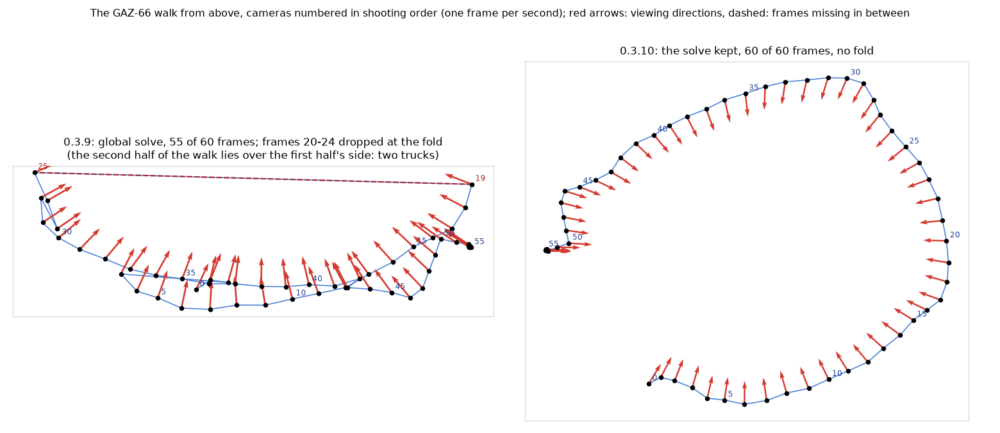

**A bent solve that no check sees (0.3.10).** While testing this, the rendered walk of
`test_camera_track.py` failed: the scan sat 57 px from the footage. Its global solve was bent:
after the best similarity fit to the true cameras they were up to 1.3 m off, smoothly along the
walk, with no jump or backward turn for the path check to see. The global solver turned out to
depend on the random draws of COLMAP's match check: features and matches made three times on
the same frames had the same features and matches but 56,450 to 56,595 inliers, and the global
solves of the three databases came out right (within 2 mm), folded (6.6 m off, two jumps that the
check caught) and bent; each database gave the same solve every time. The incremental solver was right
on all of them (within 3 mm), with more points and observations and a lower reprojection error:

| Solve of the rendered walk | Off the true cameras | Points | Observations | Reprojection error |
|---|---|---|---|---|
| global, right | 2 mm | 7,586 | 32,257 | 0.35 px |
| global, folded | 6.6 m | 7,544 | 30,294 | 0.48 px |
| global, bent | 1.3 m | 6,624 | 26,467 | 0.59 px |
| incremental (each database) | 3 mm | 7,605–7,612 | 32,234–32,268 | 0.29 px |

So for a video of up to 300 frames (`BOTH_SOLVERS_MAX`, the default Max Frames) *Auto* now runs
both solvers and keeps the better solve (`solve_check.score`: more photos placed, a fold counting
as ten missing photos, or as a fifth of the photos placed in a set of more than 50 (0.3.14; a
tenth above 100 in 0.3.13), then more observations, then more 3D points), which picks the
incremental solve over the bent and the folded one. Until 0.3.11 the 3D points came right after
the photos, and a fourth database of the same frames gave a bent global solve (1.4 m) with more
points than the right incremental one, 7,936 against 7,670: the scan sat 65 px off the footage.
The bent solve had more but shorter tracks (3.9 against 4.2 photos per point), fewer
observations (31,152 against 32,344, the sum of the track lengths) and a higher reprojection
error (0.55 against 0.30 px). Over the candidate solves of every test run, ranking by
observations changed the choice for that walk only. The second solve takes seconds here (5–6 s for these 21 frames) and a few
minutes for a few hundred. Photos keep the old rule: the incremental solver comes first there,
and on the synthetic scene it once placed 47 photos with 9 of them wrong and no jump the check
could see, which would outscore a right global solve of 44. Otherwise, and above 300 frames,
the other solver runs when the first one's path jumps or folds, places fewer than 60%, or
leaves three or more shots in a row out of the walk (`GAP_RETRY`): frames missing in a row are
where a fold hides.

**Several photos from one spot, and photos stored on their side (0.3.11).** A walk round a Mi-8
helicopter (260 phone photos) came back from 0.3.10 with a warning of 8 folds. Its cameras, read
from the scene of that run, showed 2: the starboard stretch of the walk lay over the port side
(section 4). The other 6 were plain steps to the next spot. Most spots had two to four photos
taken a few centimetres apart, so about half of all steps were that small, and the median step
(0.21, in the solve's units) sat between them and the steps between spots (0.41); every walk to the
next spot then measured five to seven medians. `path_jumps` now takes the median over the moves
only: steps shorter than a tenth of the 90th-percentile step (`SAME_SPOT_SHARE`) are shots from
the same spot and stay out of it. The same cameras then show exactly the 2 real folds, a made-up
walk of 1 to 4 shots per spot passes (0.3.10 reported 39 folds on it), and its folded version is
still found at the junction.

The turn check had a second fault on these photos. It takes up as the mean of the cameras' down
axes, assuming upright photos; a phone held upright stores the picture on its side, and COLMAP
solves it as stored, so for all 260 photos that "up" was a horizontal direction, 89° off. On a
right solve of the same photos (section 4) it reported five backward turns. COLMAP keeps each
photo's gravity from its EXIF orientation (`pose_priors`, section 11), so `solve_check._cameras`
now turns each camera upright about its viewing axis first (`upright_rotation`), as the importer
does for display. With that, the right solves pass. Before taking it, a rule that ignored
backward turns near the point the cameras look at was tried against the same solves; with the
gravity in place it changed no verdict on any of the 126 models below, so it was dropped.

Both changes were run over the solved models of the test runs (126 now, the Mi-8 solves of
section 4 among them): the verdict changed for 12 right Mi-8 solves (two of them one side each;
0.3.10: 1 to 16 folds, now none) and for nothing else. An earlier run of the upright test also
had an incremental solve of the WRX photos stored on their side that 0.3.10 flagged (one backward
turn of 179°, from the horizontal "up") and 0.3.11 passes; its cameras were within 1.5% of the
ring's size of the right WRX solve.

**Tried and dropped.**

- *Matching only neighbouring shots.* On the WRX photos it split the walk in two. On the
  synthetic scene it gave a fold-free model with half its cameras wrong.
- *COLMAP's `view_graph_calibrator`* for photos without a focal length. It estimated a focal
  length 67% too long and the solve collapsed. Without it, the global solver refined the default
  guess to within 0.1%.

## 4. Symmetric objects: solving along the shooting order

**The problem.** The gas-mask set shows a gas mask placed on a box printed alike on opposite
sides: helmets left and right, a logo front and back. Both solvers fold these photos (in one
Windows run, the incremental solver placed 31 of 41 photos with a fold, and the global solver 38
with two breaks). The path check saw it, but with both results folded there was nothing good to
switch to: the dense cloud held two masks facing each other. The task: match the two groups of
cameras so they fit the order in which the photos were taken.

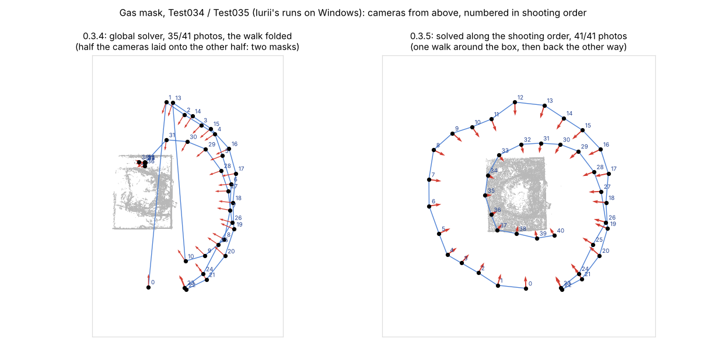

**What was tried first, and why it was not enough.**

- *An epipolar test with a free translation:* check each pair's matches against the cameras.
  This is degenerate for a symmetric object: a half turn about the vertical axis, combined with
  a vertical shift, explains every flipped match, so the flipped pairs pass.
- *A full relative-pose test* (rotation and translation together) rejects the bad pairs, but
  also rejects good loop closures. Over a long walk the positions drift, and the first and last
  photos then disagree in position even though they are a true pair.
- *Solving with nearby pairs only* (photos taken a few shots apart). It cannot fold, but on its
  own it is fragile. On the synthetic scene, with repeated objects, it broke apart. On the gas
  mask a single weak pair (24 matches, saying the camera turned 76° where its neighbours said 43°)
  cut the walk in two.
- *Working on the two groups directly*: solving each group alone and merging them through the
  photos taken next to each other, or linking one group to the rest only through those photos.
  Both need to know where each group starts and ends and how many groups there are, which a
  fold only roughly tells. The check below needs neither.

**What works (`walk.py`).** Rotations are far more robust than positions on weakly matched
photos, and a symmetric object's wrong pairs are off by about half a turn. So the repair judges
pairs by rotation only:

1. **Turn the cameras along the walk.** Take the photo pairs taken at most *W* shots apart, with
   *W* chosen so the band covers about 100° of walking (*W* = 100° ÷ the median turn per shot,
   between 3 and 15). Consecutive pairs are always kept. Other pairs are kept only if they have
   at least max(30, half the median of the consecutive pairs) inlier matches, which keeps out
   weak pairs like the gas mask's shots 27 and 29. COLMAP's `rotation_averager` turns the
   cameras from these pairs alone, with the lens of the solve that placed the most photos.
   Photos from opposite sides are never in the band, so these rotations cannot fold. They are
   only used if they look sane:
   no consecutive turn above max(60°, 3 × the typical turn × the gap), and at least 60% of the
   photos placed.
2. **Judge every matched pair.** Each pair's own two-view geometry in COLMAP's database says how
   far the camera turned between its two photos:

    - for an essential or fundamental matrix, *E = K<sub>b</sub><sup>T</sup> F K<sub>a</sub>* is
      decomposed and the rotation that puts the matched points in front of both cameras is kept;
    - for a homography (a flat scene), *H<sub>n</sub> = K<sub>b</sub><sup>−1</sup> H K<sub>a</sub>*,
      scaled by its middle singular value and signed so the points lie in front, is compared with
      the rotation directly.

    A pair whose own turn differs from the turn between the two cameras of step 1 by more than
    1 radian (57°) has matched look-alike views of different sides. Its matches are left out.

3. **Solve again** with every other pair, with both solvers, and keep the best result by the
   path check.

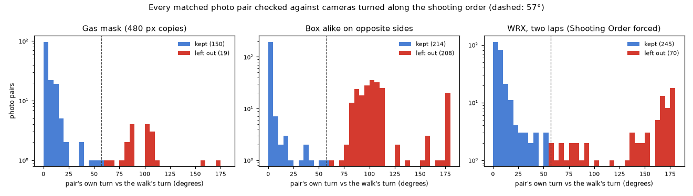

Most pairs agree with the walk within 20°. The pairs left out are more than 57° off, up to half
a turn, and are mostly pairs that matched one side of the object to the other.

One more case appeared on the gas mask. Four photos of its dark right side share so few points
that the weak-photo filter of section 3 would drop them as misplaced. Their rotations agree with
the photos taken next to them (1.5–5° off, against 10–26° for the truly misplaced photos of the
synthetic scene). So a weak photo is kept when its median disagreement with the pairs at most two
shots away is under 8°.

**Results.**

| Photo set | Before | Pairs left out | After |
|---|---|---|---|
| Box alike on opposite sides (rendered, 40 photos) | both solvers fold half the walk onto the other half | 208 | 40/40 placed, every camera within 3.0 mm of the truth (median 1.4 mm) |
| Gas mask, phone JPEGs at 480 × 639 | incremental 24/41, global 37/41 with two breaks | 19 | 41/41, no fold |
| Gas mask, full-size JPEGs on Windows (1650 Ti) | incremental 31/41 folded, global 38/41 with two breaks | 29 | 41/41, no fold, one mask; about 20 min from features to texture |
| WRX, the repair forced (no fold before) | — | 70 | 42/42; 313 of 315 pairs judged as a check against the correct solve does |
| Synthetic scene, the repair forced | — | — | the rotations failed the sanity check (30 of 50 placed); the usual result was kept |

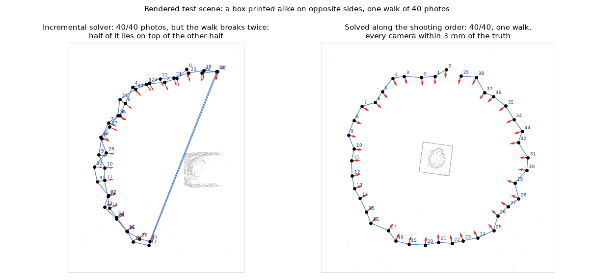

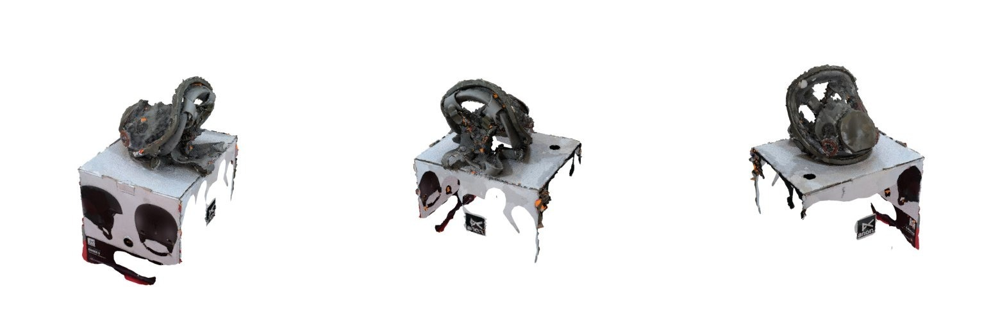

*The gas-mask set (41 photos, Normal, the GTX 1650 Ti laptop): one mask on the box.*

**Tools built for it.** `walk.py` (the band, the rotation averaging, the pair check with
vectorized cheirality, and copies of COLMAP's database with pairs removed), the rendered box
scene, and `test_mapping_walk.py`, which solves the box and the gas mask from scratch and checks
the box's cameras against the truth.

**When the band does not hold the walk: the fold turned back (0.3.11).** On the Mi-8 photos, with
matches made here from 1443 × 1080 copies, the repair above was skipped: the rotations from the
band placed 126 of the 260 photos (the walk has several photos per spot, and the band's nearby
pairs did not join up round the tail and the nose), short of the 60% it needs. In the run on
Windows (Ultra: up to 8,192 features at 3,200 px) it did run: it left out 253 pairs, and both
solvers then placed all 260 photos, but the check of 0.3.10 reported 11 and 13 folds in them
(the three the log names for each were steps between spots, section 3), and they scored below
the folded incremental solve.
Whether they were right is not known; their cameras were not kept in the scene. Both solvers had laid the starboard stretch of the walk over
the port side, facing the same way as the port cameras (port and starboard cameras 30° apart on
average, against 149° in a right solve). The number "85" and a red star are painted on both
sides and read the same way from either side, so 141 photo pairs matched a port view to a
starboard view (matches made here from 1443 × 1080 copies: SIFT, 2,426 verified pairs).

That is the situation section 4 set aside under *working on the two groups directly*: a fold
tells only roughly where each group starts and ends. The path check's folds now tell it well
enough for a guess. `walk.turned_guide` takes the best solve and turns every second stretch of
the walk between its folds half a turn about the vertical (up from the cameras' gravity, as
above): a side laid over the opposite side faces the same way as the cameras there, and half a
turn makes it face its own side again. The pairs are checked against those cameras exactly as in
step 2, and both solvers run again (`pipeline._solve_turned`; at most `TURN_MAX_FOLDS` = 6 folds,
beyond which no guess is made).

The first run of it was not enough. The global solver came out right, but the incremental one
laid 28 starboard photos over the port side again, and the path check found 4 faults in it. The
cause: 12 pairs of front views, starboard front against port front 132 shots later, passed the
rotation check with 8° to 57°. Views that face along the object's plane of symmetry have a
look-alike rotation close to the true one; only the position tells them apart. A check of the
pairs' translation directions against the guide separated half of them (6 of the 12 off by more
than 90°, as were fewer than 5% of the true long-range pairs), and it needs the guide's
positions, which a guess about turning gives only roughly. So the turned part now joins the rest only
along the walk: `walk.far_links` leaves out the pairs that link a turned photo with one not
turned when the two were taken more than the band's width apart. That removed those 12 and 2
more.

| Mi-8 photos, matches made here | Photos placed | Folds | Port and starboard cameras |
|---|---|---|---|
| 0.3.10: incremental solve, used | 233 / 260 | 2 (10 reported) | on the same side |
| 0.3.10: global solve | 237 / 260 | 2 | on the same side |
| 0.3.11: turned back, global solve, used | 256 / 260 | 0 | each on its own side |
| 0.3.11: turned back, incremental solve | 246 / 260 | 0 | each on its own side |
| turned back without leaving out far links: incremental | 247 / 260 | 4 | 28 starboard over the port side |

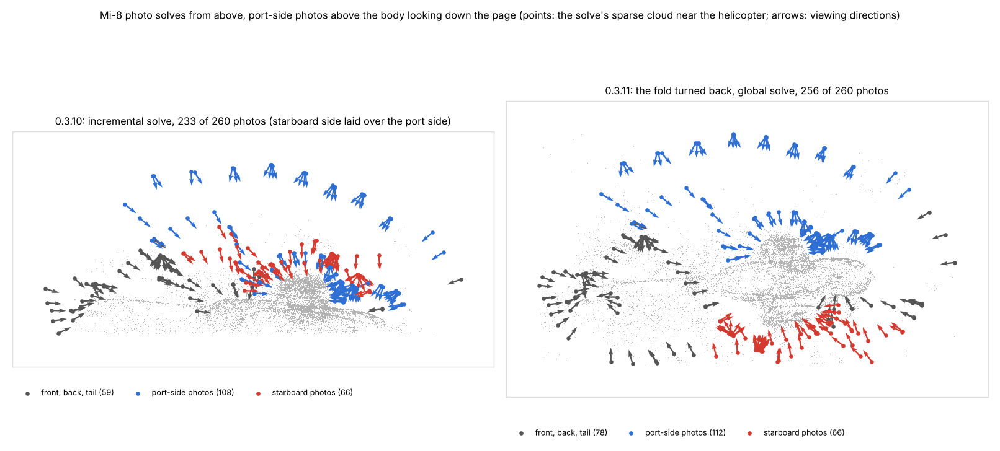

The repair left out 151 pairs that disagreed with the turned cameras (129 port to starboard, the
rest within one side) and 14 far links (12 port to starboard). Every port-to-starboard pair was
gone, and the two sides were joined by the walk round the tail and the nose. Started from the
incremental solve's folds instead of the global one's, the repair gave the same: the incremental
solver placed 247 photos without a fold, each side on its own side.

COLMAP's global solver draws at random, and in 0.3.13's tests its turned-back solve twice placed
258 photos with photos 164–168 off the walk: the path check found the fold (a step of 5.3 and
5.9 times the median), but with a fold counted as ten missing photos the solve still outscored
the incremental one, 246 photos without a fold, and was used with a warning. In the runs before
it had placed 256 and 257 photos without a fold. In 0.3.13 a fold cost a tenth of the photos
placed when that was more than ten (26 photos for the Mi-8 set), so the solve without the fold
was used. A tenth was too little for a video of the AW-249 in a user's test of 0.3.13: 69 frames,
every solve folded once with 11 frames laid over the other side, and with those 11 turned back
both solvers placed 58 without a fold; at ten photos a fold the folded 69 still won (59 against
58). Since 0.3.14 a fold costs a fifth of the photos placed when that is more than ten
(`solve_check.fold_penalty`: 14 for 69 frames, 52 for the Mi-8 set), and the 58 are used; sets of
up to 50 photos keep ten. A solve without a fold now loses only when it places under four fifths
of what the folded one places, and a fold's doubled surface is worse than that.

**Turned by hand: Re-solve From Cameras (0.3.11).** A guess can be wrong (a fold that is not half
a turn, folds found in the wrong place), and the user can see which cameras are wrong. The
operator reads every photo camera of the scan as it stands in the viewport
(`importer.scene_camera_poses`: the camera's place under the scan root, the importer's upright
turn taken off, so the scan's own alignment does not matter), and writes them into a new run as
its guide (`colmap/guide`, a COLMAP text model with the lens of the run it came from), with the
list of cameras turned more than 20° from the solve (`turned.txt`). The camera step of that run
checks the pairs against the guide, leaves out the far links of the turned cameras, and runs both
solvers, nothing else; the guide is part of the step's signature, so Build Mesh and Reconstruct
on the run reuse the solve and another guide solves again. Only the cameras' directions are
used. On the look-alike box (`test_resolve_cameras.py`), the 20 cameras of the global solver's
fold, turned by 200° (half a turn and 20° off, a rough hand) and moved round the box, left 208
pairs that disagreed with them and 1 far link out; both solvers then placed 40 of 40 photos
without a fold, and the incremental solve used was within 3.0 mm of the true cameras (median
1.4 mm). Turned by 170° instead: median 1.5 mm. `test_scene_cameras.py` checks the Blender side
on the WRX photos stored on their side: the poses read back match the solve (within 0.02°, the
32-bit floats of Blender's matrices), and six cameras turned with *R Z 180* in the viewport are
exactly the ones the new run's guide lists as turned.

**Two sources of one object: joined by points (0.3.13).** Two videos of an AW-249 helicopter
were to make one scan: one filmed along the starboard side to the tail under an overcast sky, the
other along the port side from the nose in sunshine, the rotor blades parked at other angles, so
filmed at different times. Each video solves on its own, in coordinates of its own; the question
was how to put the two solves together. Matching across the sources was tried first, as COLMAP
does it with both videos in one database: SIFT features (up to 4,096 per frame) on 68 and 51
frames at 1920 × 1080, the frames of each video matched along it, and every frame of one video
against every frame of the other. Along each video the verified pairs had a median of 338 and 694
matches. Between the videos 760 of the 3,468 pairs passed the geometric check, 33 of them with 30
matches or more and none with 100; those 33 came from 10 and 9 frames, and their matches lay on
the rotor head and on markings painted alike on both sides. Solved together, 118 of the 119
frames were placed, with the starboard walk laid over the port side (the side views of the two
videos 40° apart, against about half a turn in truth). A similarity fitted through the matched
points, each video solved on its own, laid the sides over each other in the same way. It is the
problem of this section between two sources instead of within one, without its remedy: two
videos have no shooting order between them, and a symmetric object fits its own mirror image as
well as the truth, so nothing in the matches tells such a join from the right one.

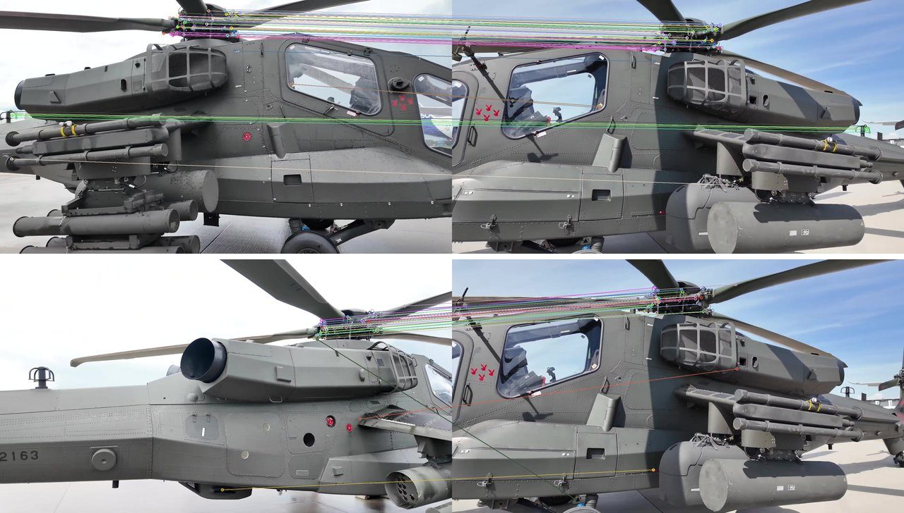

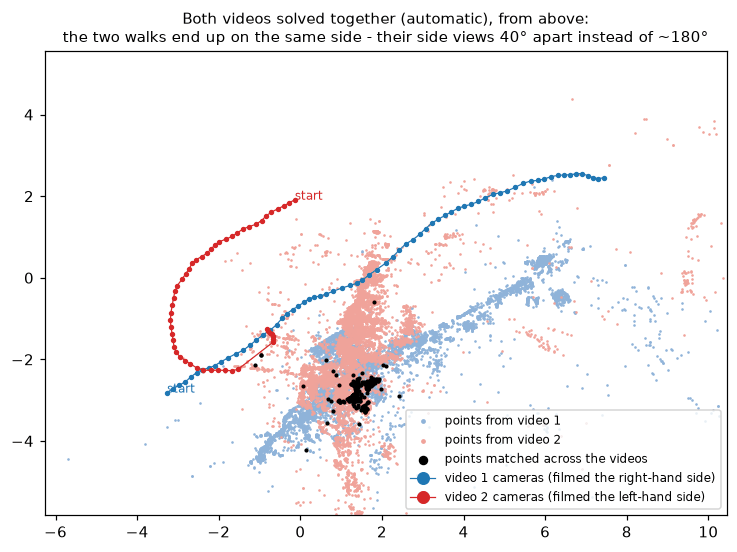

So the join is the user's, by points (`join.py`): the same spots marked on both scans, three or
more and not on one line. The similarity (scale, rotation, translation) comes from least squares
(Umeyama 1991), and each pair's distance after the fit is listed. One wrong click pulls the fit
towards itself, so its own distance says little; each pair is therefore also left out in turn,
and a pair is named as doubtful when the others then agree among themselves (their RMS drops
below half) and it lies more than 3 times farther off than the farthest of them. **Refine** then
runs ICP with scale on the dense clouds: pairs farther apart than a limit are left out (3 times
the points' RMS or 1% of the scan's size to start with, then 3 times the median distance of the
pairs kept), which leaves out what only one scan has and what moved between the shoots, and the
control points stay in the fit with 5% of the weight, so that a small overlap cannot slide along
itself. On the synthetic scene against itself in other coordinates (`test_join_scans.py`: scale
0.6, turned 70° about a slanted axis, moved), with five points each clicked up to 0.5% of the size
off, the join brought the second cloud within 0.29% of the size of the first (median distance
between the same points), and Refine, keeping 94% of the points, within 0.014% in 7
iterations. Sharing a fifth of the object only, the points marked there: 0.18%, then 0.023%,
refined on the third of the moved points that overlap. A point marked on another spot was
named; in the fit with it, its distance was 23% of the size and the others' 9%, since the fit
pulls towards a wrong click, and without it the others agreed.

**One mesh from both (`joinrun.py`).** Meshing each scan and merging the meshes would leave two
surfaces wherever the scans overlap. The two runs are instead put together as one OpenMVS scene,
without computing a depth map again. Its COLMAP model holds the first run's cameras and points
as they are and the second's moved through the join, *T* = *W*<sub>A</sub><sup>−1</sup>
*W*<sub>B</sub> from where the two scans stand in Blender (refused when it is not a similarity: a
scan stretched or mirrored by hand), the second's photos renamed (`j2_…`: two videos name their
frames alike, by frame number; `j3_…` for a third scan joined onto a joined one). Its dense cloud holds both runs' OpenMVS clouds, the second's
points moved and the photo numbers in each point's list raised by the first run's photo count.
ReconstructMesh needs those lists: they say which space between a camera and a point is empty.
The numbers line up because InterfaceCOLMAP numbers a scene's photos in the order of the model's
`images.bin` (`ImportScene` in OpenMVS's `apps/InterfaceCOLMAP`), the order in which each run's
dense cloud was made and the joined model is written. Mesh, refinement, Even Out Photos, texture
and Blend Seams then run as in any run. The crop box has the axes of the first scan's box and
holds both scans' boxes: each video's cloud often covers one side only, and the box fitted to it
could cut the other side off. Checked in 0.3.13 on the synthetic scene against a copy of itself
in other coordinates; since 0.3.14 (the copy stalled the graph cut, below) `test_join_run.py`
joins the two halves of the crop-flow run's photos, the even and the odd ones, each half with its
own dense cloud and the odd half in other coordinates: every camera came back where the solve had
it within 1.1 × 10<sup>−15</sup> of their span, the odd half's points within 1.4 × 10<sup>−8</sup>
of the cloud's size, 91% of the points shared photos, and the mesh of the joined run lay on the
mesh the run had made from all 44 photos in the same box (median 0.084%, 90% 0.135% of its
size), in 15 s of meshing and 35 s of texturing. `test_join_build.py` presses the buttons in
Blender with each half's box around a different end: the join passed on was the inverse of the
transform within 7.4 × 10<sup>−7</sup>, the box held both ends (the whole object, within
10<sup>−6</sup> of its size), Complete Joining brought in one scan with the 368,341 points and
the 44 cameras of both, and Build Mesh made its mesh where the first scan is, on the two clouds
(median 0.025%, 90% 0.059% of the size), from one end of the object to the other. Pressed again,
both reused every step.

**Complete Joining (0.3.14).** In 0.3.13 the button meshed the joined run at once, in a box
made from both scans' boxes, and imported the finished mesh. A user who had joined the two AW-249
videos could not tell how to go on from the joined clouds, and asked for a joined scan of its
own: one cloud, the cameras of both videos and a crop box to fit, align to the ground and
scale like any scan's. *Complete Joining* now runs the joined run to its crop stage
(`build_joined` with `crop_stage`): the join step, then the crop stage's own step, which shows
the joined cloud with the box made from both boxes as the user's box. The importer brings it in
as any crop stage, as a new scan in its own collection where the scan joined onto is (the place
is written into the joined run's folder once per join, so an alignment of the joined scan
stands when the button is pressed again), and the two scans are hidden. The join step writes
everything the run needs into the folder (`photogram3d_join.json`: both runs, their solves,
the join, the photo counts, the scan's name and the photos stored on their side), and
`pipeline.build` hands a folder holding it to `build_joined`. So Build Mesh, *Without Crop* and
Resume on the joined scan continue it like any run, whatever photos or video the panel names,
and `validate` asks for no input. A joined scan can be joined onto again; its photos stored on
their side come from that file, since it has no COLMAP database. Two checks keep the joined
scan true to its sources: Build Mesh refuses when a source was solved again since the join
(its cameras are elsewhere: the points must be placed and joined again), and when a source's
dense cloud was made again (its file changed), the join step is redone and keeps the box
Build Mesh saved.
*Re-solve* refuses on a joined scan with the reason. `test_join_run.py` and
`test_join_build.py` run the whole flow (below). On the two AW-249 videos, both made again with
*Dense Region: Full* (section 9), Complete Joining gave one scan of 689,121 points with the 62
cameras of both, and Build Mesh, in the box drawn for 0.3.13 lengthened to the end of the tail,
713,470 faces in 7 minutes here:

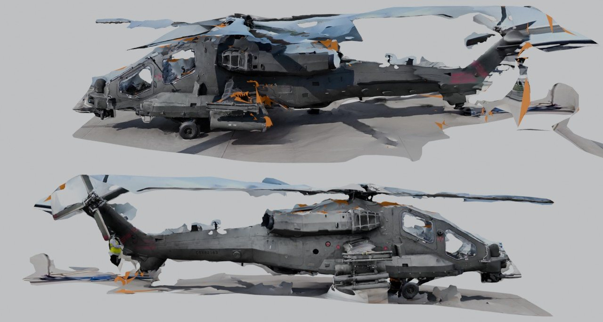

**Photos shared where the two clouds overlap (0.3.14).** The test of the joined run in 0.3.13
joined the synthetic scene's run with a copy of itself in other coordinates. Run again for
0.3.14, its mesh step did not end: ReconstructMesh was in the graph cut (`IBFS::augment`, OpenMVS
2.4's max-flow with float capacities) after half an hour, and the joined input of 0.3.13's test,
whose cut had taken 4.5 s on 3 November (another machine, a 2.8 GHz CPU), stalled the same way on
this one (2.1 GHz). Variants on the synthetic scene's run, its photos and its crop box:

| Dense cloud | Cameras | Graph cut |
|---|---|---|
| the run's own | one set | 2.6 s |
| twice | one set | 3.3 s |
| twice, the copy moved by 0.1% of the size and seen by its own photos | two sets, at the same places | did not end |
| the run's own, every second point seen by the second set | two sets, 2% of the span apart | did not end |
| the run's own, every point seen by both sets | two sets, 2% apart | 1.5 s |
| two halves: the even and the odd photos of one solve, each with its own cloud, joined back exactly | the halves | 1.1 s on one solve of the scene; did not end on another (the crop-flow run's), also with fewer points inserted (`-d 4`), on one thread or without the quality term |
| the two AW-249 videos | two videos, opposite sides | 11 s |

So two sources that saw the same surface, each point seen only by its own source's photos, can
stop the graph cut from ending, and it ends quickly when the points there carry the photos of
both. After merging the clouds, the join step gives each point the photos (and weights) of the
other source's nearest point when that lies within two point spacings of the first source and
faces the same way (`joinrun.share_photos`). On the stalled halves 336,286 of 368,341 points got
photos and the cut took 1.2 s; on the doubled cloud with two camera sets the whole mesh took
31 s; on the AW-249 join it changed 1,229 points and nothing else (mesh 45 s). A scan joined
with an exact copy of itself, every camera twice at one place, still stalls; two real sources
never share a camera's place. `test_join_run.py` now joins the two halves.

The same user found the *Onto* field empty and no button under it. Blender keeps only pointers
to the strings of a dynamic enum's items, so the list a callback returns must stay alive as long
as Blender may read it. In 0.3.13 the property's getter built the list again on every read, the
strings of the earlier list were freed, *Onto* read garbage and resolved to no scan, and the
panel stopped before the join's results and the button. The list now lives in the module and
is replaced only when the scans change (earlier lists are kept too, a few dozen at most), and
when *Onto* names no scan the scan the active one was joined onto is taken.

**The joined scan's video cameras (0.3.15).** The same user joined the two AW-249 videos, got
one scan with both clouds and the photo cameras of both, and found no camera following either
video. The importer made a tracked camera only from a video run's result (its `frames_json`),
and a joined run is a run of photos. The join step now lists the videos of both runs
(`pipeline.run_videos`): for a video run its folder, video, `frames.json`, the solve with the
video's lens and distortion and that solve's id; for a joined run joined onto again the ones in
its join file. The second run's videos get the join's matrix (composed with their own for a
joined run), and the list goes into the result and the join file. The importer makes one tracked camera
per video (`<scan>_video_camera_<video name>`): its keys, from the video's camera track (every
frame) or its solved frames, are moved by the matrix, the place by the whole similarity and the
turn by its rotation (`key_camera` keeps no scale), and the camera is drawn at the joined scan's
scale. Each camera keeps its run's folder, the matrix and the solve's id. The first video's
camera becomes the scene camera and gives the scene its frame rate and render size; the others
widen the frame range. Blender shows frame n of any movie clip at scene frame n + 1, so each
camera meets its own footage whatever the other video's rate (a different rate only changes how
fast that one plays). *Track Every Frame* on a joined scan tracks the selected video camera: the
track is made in that video's own run folder, with its frames and lens, and its keys go through
the stored matrix; it refuses when that run was solved again since the join, since the new
solve's coordinates are not the ones the matrix starts from. A join file of 0.3.14 has no list:
`pipeline.joined_videos` then reads it from the two runs, so Build Mesh on such a scan brings the
cameras, and the panel shows *Add Video Cameras* on any scan without its tracked cameras (also
one imported with *Tracked Camera* off).

`test_join_videos.py` joins the synthetic video's run (47 tracked frames) with a copy of it put
in other coordinates (scale 0.6, turned 70° about a slanted axis, moved), its camera track moved
likewise, and imports the crop stage. On every third tracked frame the second video's camera was
within 7·10<sup>−8</sup> of the scene's size of the first (float precision), and both lay on the
joined scan's photo cameras of their frames (the first run's and the second's, renamed `j2_`).
Without the matrix the second camera was 85% of the scene's size off, with its inverse 177%; the
test fails on both. Tracked again, both kept that agreement and the frame range stayed. On the
AW-249 joined scan made with 0.3.14, *Add Video Cameras* made `1+2_1_video_camera_1` and `_2`,
keyed on their 32 and 30 solved frames (these runs have no camera track), with the two videos
behind them; at those frames each camera was on the joined scan's photo camera of the frame (0
and 5·10<sup>−8</sup> of the scan's size; 0.0000°), and the scene ran over frames 10–632 at
30 fps. Seen through each camera at a solved frame in the middle of its video, the joined mesh
lies on the footage (the frame undistorted with the video's solved lens, the mesh rendered from
the camera and laid over it at 55%, its outline in cyan):

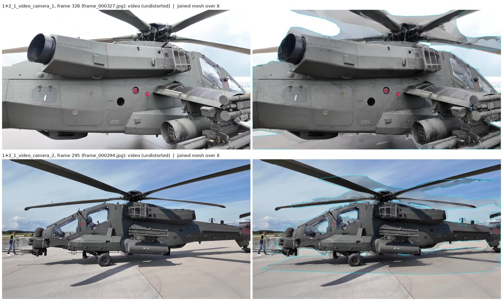

**On the two AW-249 videos.** Each video went through Reconstruct with *Stop to Crop* at Normal
(Auto frames): 32 of the first video's 33 frames placed and 342,585 dense points, 30 of the
second's 30 and 276,903. Five spots were marked on both, here from pixels picked in two to four
frames of each video and triangulated with the run's cameras, standing in for clicks on the
clouds: the nose turret, the front of the lower nose sensor, the top of the rotor hub and two
fittings on top of the tail boom. The rays met within 0.2–4.5 px, except at the rotor hub in the
second video (5–17 px: a parked blade crosses it there). Join: scale 0.529, the points 0.23–0.33%
of the scan's size apart and the rotor hub 0.93%, and the two videos' cameras on opposite sides
(their mean view directions 166° apart, against 40° for the automatic attempt above). It showed
three faults, all fixed:

- *A right point named as misplaced.* Without the rotor hub, the four points lie at the two ends
  of the helicopter, nearly on one line (their spread across it 2–4% of their spread along it).
  Left out in turn, the other three agree among themselves whatever the turn about that line, so
  in 107 of 200 tries on such points, each coordinate off by 0.3% of their spread (standard
  deviation), a right one was named. Points left nearly
  on one line (spread under 10%) now judge none (0 of 200), and the panel says when all the
  points are nearly on one line: the turn about it is then uncertain.
- *Refine made the join worse.* It kept 14% of the points, ran all its 40 iterations, and the
  clouds came no closer (median 0.847% → 0.841% of the size) while the points moved from
  0.23–0.33% to 0.6–1.6% apart. Two sides share little surface, their nearest points are mostly
  not the same spots, and the fit slid. A refinement now counts only when the clouds' median
  distance (over the pairs within the starting limit, the same samples before and after) drops
  to 75% or less; otherwise the points' join stays, and the message says so. Here: 0.740% →
  0.757%, kept as joined. The synthetic refinements above count (0.29% → 0.014%, 0.18% →
  0.023%), and clouds that share a flat floor only are not refined.
- *Refine took 330 s*, with Blender not responding. A k-d tree search far from the cloud visits
  much of the tree: 240 µs against 11 µs near it, and most of the moved cloud was far from the
  other. Only the points with a fixed point in their grid cell of the limit's size, or in a
  neighbouring one, are searched now: 16 s on the two videos, 11 s on the synthetic scene.

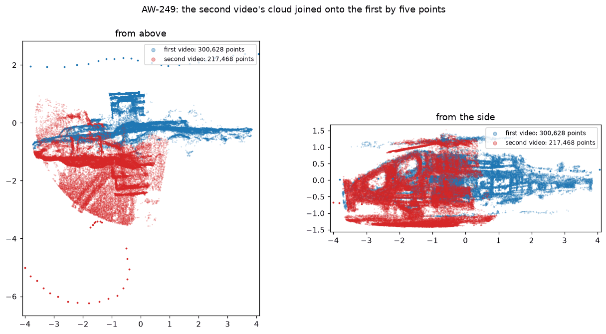

Build Joined Mesh, with a box drawn around the helicopter on the joined clouds (the second
scan's box deleted), took 5 minutes here: 62 photos and 619,488 points joined (9 s), the mesh
from about 0.5 million points inside the box (49 s), the texture (217 s; 621,526 faces, two 4096
px pages) and Blend Seams (25 s), which took the steps across the seams, many of them between
overcast and sunny photos, from 0.30 to 0.04 stops (median; 90%: 1.67 → 0.47). The joined mesh
left 8.4% of its surface without a photo (TextureMesh's orange), against 15.7% for the second
video's own mesh in the same box. Refinement was skipped: with twice the photos, the 8 GB of this
machine allowed it only at half resolution, where Auto skips it (the second video's own run
refined at full resolution, in 16 minutes).

## 5. Texture seams: a bug in OpenMVS's leveling, and blending them here

**The symptom.** The first WRX texture had black and rainbow blotches. A later run on full-size
photos crashed TextureMesh with an access violation (0xC0000005) right after it chose its views.

**Finding it.** It looked like another effect of the fold, but it was not. On the synthetic
scene, with OpenMVS's default settings, 10–13% of the textured texels came out pure black at
960 × 720. When the same photos were scaled to 16 MP, 42.5% came out black, with red, green and
blue blobs. With seam leveling off, no texel was black at either size. Under Valgrind, seam leveling read memory
outside the photos. The cause: `TImage::sample` is given the colour type where it expects the
pixel type, so OpenMVS reads the 8-bit photos as if each pixel were three 32-bit floats. The seam
colours it computes are garbage, the corrections paint the blotches, and near the bottom of a
large photo the read runs past the end of the image. The fix is one line in OpenMVS's development
branch (commit `610562a`, 14 October 2026), not yet in a release.

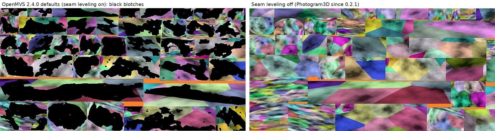

**What Photogram3D does.** Both leveling passes stay off. At 16 MP the atlas then took 15 s
instead of 2 min 43 s. If texturing still fails, it is retried once with half-size photos, and
after that the untextured mesh is kept, so there is always something to import. When one patch
does not fit the chosen texture size, OpenMVS stops instead of splitting it, so the pages are
sized to hold a whole photo. The UVs were checked by rendering an imported four-page atlas
through three solved cameras with the texture as emission: the renders matched the photos (a
mean difference of 3 of 255 levels, correlation 0.99).

**What it left: light and dark patches.** With leveling off, every patch keeps the brightness
of its photo. A phone exposes every photo by itself, and a Mi-8 scan of 260 phone photos
(exposed between EV 5.6 and 10.2, the middle 80% within 2.0 stops) showed it as light and dark
patches with sharp edges. The fix in OpenMVS's development branch is not released, so 0.3.12
blends the seams itself after TextureMesh (`blend_seams.py`), with the global leveling of
Waechter, Moehrle and Goesele (*Let There Be Color!*, ECCV 2014), the method OpenMVS implements:

- Every texture vertex (a mesh vertex in one patch; on a seam it has one per patch) gets a
  correction g, the log2 of a gain on linear light per colour channel, so that
  Σ w (f_a + g_a − f_b − g_b)² over the seam samples + 0.1 Σ (g_i − g_j)² over the edges inside
  the patches + ε Σ g² is least. f_a and f_b are the colours on either side of a seam, averaged
  over four points along the half of each seam edge next to the vertex; w are Huber weights
  (0.2 stops), so a reflection or a shadow only one side shows counts less.
- Solved by conjugate gradients in two parts: one gain per patch first (ε times the patch's
  vertex count), then what is left over the vertices. Solved over the vertices alone, a gain
  that a whole patch needs only creeps in from its seams, a few vertices per iteration.
- The corrections are interpolated over each triangle into the texture pages, 512 rows at a
  time, and spread three texels beyond the triangles, over the border TextureMesh leaves around
  each patch (photo content, then its orange "empty" colour). Faces TextureMesh found no photo
  for have all three texture coordinates on one texel and take no part.
- numpy and Pillow only, in a separate process like `prepare_images.py`. The OBJ is read 64 MB
  at a time, a run of lines of one kind at once (`numpy.fromstring`): TextureMesh writes three
  texture coordinates per face, 18 million lines for 6 million faces.

The weights were chosen on the synthetic scene's texture with every patch given its own
exposure (random gains of 0.5 stops in brightness and 0.1 per colour), against the texture as
TextureMesh made it. With ε = 0.001 the seams were blended as well, but the gains drifted over
the mesh where the seams differ for other reasons (the photos see the surface a little
differently): on the texture as made, the texels changed by 0.043 stops (median), and of the
damage 0.067 stops were left. ε = 0.01 with Huber weights from 0.2 stops gave 0.027 and 0.055.
A larger ε (0.1, Huber weights from 0.5 stops) changed the texture as made less (0.019) but left
more of the damage (0.095). Merging the samples of each pair of patches into a median, and
taking a dead zone of 0.05 stops off every difference, did not help. On a texture of Ultra's
size (4.8 million faces, six 8192 px pages) the step took 7 minutes on this machine's two cores
with other work running, and at most 1.7 GB of memory.

On the Mi-8 photos (Draft, 1443 × 1080 copies, 299,597 faces) the median step across the seams
went from 0.53 to 0.26 stops, and the 90th percentile from 2.23 to 1.16, in 18 s. *Even Out
Photos* found 3.15 stops between the darkest and the brightest photo, but alone took the median
only to 0.48 stops; with blending, 0.25. The steps left there differ with the viewpoint, not with
the exposure of whole photos.

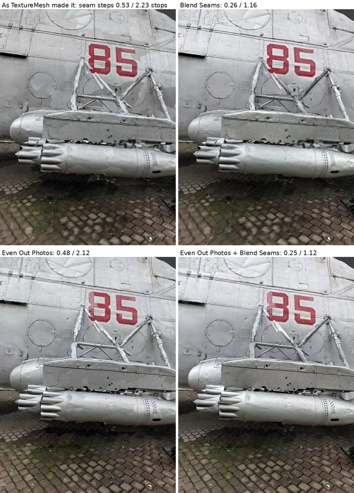

## 6. Windows, seen through logs

These came from the Windows test runs and their logs, and from reading the Windows downloads
themselves; each was reproduced or checked here.

- **No live output from OpenMVS.** On Windows, OpenMVS writes to a private console that cannot be
  piped, and that console is paused while it computes. Photogram3D follows each app's own log
  file instead, on every system. The parsers were replayed on the real WRX logs (the depth-map
  step gave 118 steady progress updates).
- **A missing runtime.** COLMAP 4.2.1 is built with Visual Studio 2026 and needs the Visual C++
  runtime 14.51 or newer. Older runtimes fail with 0xC0000135 or 0xC0000139. The **Install
  Visual C++ Runtime** button starts Microsoft's official installer, and the error explanation
  for those codes points to it.
- **OpenMVS's CUDA build cannot run on either laptop.** The official Windows CUDA download has
  kernels for compute 8.9 only (RTX 40 series) and no PTX fallback. The GTX 1650 Ti is 7.5 and
  the RTX 3070 is 8.6, so OpenMVS runs on the CPU. COLMAP's CUDA build covers sm_75 to sm_120,
  with the CUDA runtime linked into the executable, so only the NVIDIA driver is needed.
- **A crash in matching with AI features (0xC0000409).** COLMAP 4.2.1's LightGlue matcher throws
  "Guided matching not supported for LightGlue", and High, Ultra and Full turned guided matching
  on. Guided matching is now used with SIFT only.
- **Command-line length.** Writing the chosen video frames with one FFmpeg expression stops
  fitting Windows' 32,767-character command line at about 2,700 frames (section 10).
- **Paths and sync folders.** COLMAP and OpenMVS can fail on folders with non-Latin characters
  (on a Russian Windows, Google Drive's folder is *Мой диск*). Sync clients upload the depth maps while OpenMVS
  replaces them, and OpenMVS does not check whether its delete and rename worked. The panel warns
  about both and recognises Google Drive, OneDrive, Dropbox, iCloud Drive and Yandex Disk
  folders, including their localised names.
- **Watchdog resets.** Single GPU steps of up to 3 s in COLMAP's consistency pass did not trip
  Windows' 2-second display-driver watchdog (TDR) on the RTX 3070.

## 7. Depth maps on the GPU, and on the CPU and the GPU together

**COLMAP on the GPU.** COLMAP's CUDA PatchMatch writes the depth maps, OpenMVS imports them and
fuses them with its usual fusion, so everything after the depth maps is the same as on the CPU
path. OpenMVS does the fusion because it was clearly better: from the same depth maps, COLMAP's
own `stereo_fusion` kept 167k points at a median 1.9 mm from the true surface, against OpenMVS's
430k at 0.8 mm. On the RTX 3070 at Ultra, though, the GPU path was *slower* than the CPU: 62 min
against 46. COLMAP's single consistency pass took 51 s per photo, against 2 × 11.5 s for
OpenMVS's two.

**Both at once.** The slow part is the first pass, which was 27.5 of 46 min on the WRX photos. The
CPU + GPU option shares that pass and keeps OpenMVS's faster consistency passes. Both tools skip
a photo whose output exists, so each one claims photos as it starts them. When OpenMVS logs
"Reference image N paired", empty COLMAP map files are put in place for that photo. When COLMAP
logs "Processing view i / n for NAME", an OpenMVS map holding a claim marker is put in place.
The faster tool simply takes more photos. OpenMVS is stopped as soon as it starts its first
consistency pass, which only writes new files until its end, so the first-pass maps are complete.
A second OpenMVS run then does both consistency passes and the fusion over every photo. On the
WRX at Ultra the CPU did 19 photos and the GPU 23. The first pass took 14.5 min instead of 27.4,
and the whole step 33 min instead of 46.

Measured before it shipped, with the GPU stand-in:

- splitting OpenMVS's step in two is harmless: 429,843 and 430,335 points, 0.770 and 0.771 mm;
- the shared cloud matched the CPU path's (435,745 points, 0.775 mm);
- cancel and resume, COLMAP crashing mid-step, and COLMAP's unfiltered guesses (random depths in
  36% of the pixels) all ended with a full and accurate cloud;
- replaying the real Windows logs caught a bug before release: COLMAP frames the line as
  `=== Processing view 1 / 42 for NAME ===`, and the trailing `===` had become part of the photo
  name.

**Two tools, two roundings.** The gas mask's first CPU + GPU run used no GPU maps ("0 on the GPU").
COLMAP and OpenMVS round the size of a resized photo differently: for photos undistorted to
2401 × 3200, COLMAP made 1201 × 1600 maps at 1600 px and OpenMVS expected 1200 × 1600. Both resize
rules were copied into a C++ program: they disagree on 1,002 of 6,606 sizes. Photogram3D now picks
the nearest size both agree on (1599 px for the gas mask) and says so in the log.

**Memory.** COLMAP's first pass held about 2.6 GB of the RTX 3070 at 3200 px and needs about
5 GB at 4624 px. On the 4 GB card the hybrid runs up to about 3100 px, and above that the CPU
works alone.

## 8. Memory, disk and files left behind

- **RefineMesh.** The WRX run peaked at 7.8 GB for 168.6 MP of images, about 46 bytes per pixel.
  The budget of 0.2.x (25 MP per GB of RAM) would have let a large photo set need more than all
  the RAM. It is now 13 MP per GB, which keeps refinement near 60% of the RAM.
- **ReconstructMesh.** Its Delaunay step needed 7.2 GB for 4.0M points (1.8 GB per million).
  Above a share of the RAM, nearby points are merged first, and the log says so.
- **Disk.** Full needs about 27 GB of free disk at its peak (estimated from the Ultra runs). The
  free space is checked before the depth maps start.
- **Old depth maps crash the dense step.** DensifyPointCloud, and COLMAP too, reuse every depth
  map they find, whatever size made it. Switching *Quality* keeps the camera solve and so the
  folder: a 960 px run on 640 px maps crashed within seconds (0xC0000005 on Windows). Maps made
  with other settings are now deleted first. Maps that are cut short or mislabelled are detected
  and computed again, and the finished ones are kept: 121 estimates instead of 132 after a
  cancel.
- **Moved projects.** The solve was remembered by absolute path, so a moved project solved
  everything again and lost its mesh. Paths are now stored relative to the project, and old
  absolute ones are re-rooted, including Windows forms such as `D:\GDRIVE\Мой диск\...`.

## 9. The crop box, alignment and coordinates

How the crop stage is used on a real scan (the ground leveled on three wheels, the real size from
two wheel centres 2.5 m apart, the box placed round the car) is shown in the video
[*Photogram3D. Managing the scene*](https://youtu.be/ruF8eCvebvI) (YouTube) and in the
screenshots of README's *Step by step* (step 2.7), both on the WRX photo set.

- **OpenMVS's box format** (15 numbers: a world-to-box rotation, the centre and the half lengths)
  was read from OpenMVS's source and confirmed by meshing inside a box turned 30°. Every mesh
  vertex was inside the box, and the mesh filled it.
- **32-bit round-off.** Blender keeps object matrices in 32-bit floats, so a box read back
  differs from the saved one in the last digits (19 of 20 random boxes after Align Ground or
  Set Scale). Written as is, that would change the meshing step's signature and rebuild the
  mesh for nothing. A difference that is only round-off keeps the saved box. The box is read
  from its eight corners, so applying its transform (Ctrl+A) changes nothing.
- **Ground and scale.** Three ground points level the floor (median 1.3 mm off on the synthetic
  scene). When they are three corners of a rectangle, such as three wheels, the origin goes to its
  centre. Two anchors and a distance set the scale (camera distances then matched the truth
  within a median 0.5 mm). The alignment is saved in the project, so every later import arrives
  aligned.
- **Which solve the box belongs to (0.3.5).** In 0.3.4, *Re-solve Without Selected* followed by
  Build Mesh lost the list of left-out photos. Build Mesh then solved the cameras again and
  meshed in other coordinates than the cloud and the box. Now each solve has an id, written in
  the project and carried by the scan in Blender and by the saved alignment. A new solve gets its
  own root instead of joining the old scan, and the old box and alignment are dropped. Build Mesh
  refuses to run when it would have to solve the cameras again.
- **The scan of the earlier solve (0.3.12).** A Mi-8 run continued with *Resume* after 0.3.11
  found its fold came into the scene next to the folded scan: two clouds (2 million points shown
  each), two sets of cameras (237 and 260), and every photo loaded a second time
  (`IMG_….jpg.001`), since each import loaded the photos afresh in case a run had rewritten them.
  The folder holds only the new solve, so `importer.retire_earlier_solves` now removes what the
  earlier scan of the same folder has that fits nothing any more (cloud, cameras, crop box,
  markers, splat preview, tracked camera) and its root and collection; a mesh of it stays with its
  root, in its collection renamed *(earlier solve)* and excluded from the view layer. Scans
  without a solve id and other folders are left alone. The camera photos are loaded with
  `check_existing` and read again only when the file's time or size changed since (kept on the
  image). `test_reimport.py` imports the crop stage of three solves of one folder, with another
  folder of the same photos beside them.

- **OpenMVS's own region of interest (0.3.14).** DensifyPointCloud of OpenMVS 2.4 guesses a
  region of interest unless told otherwise (`--estimate-roi 1.1`): a box around the sparse
  points the cameras aim at, scaled by 1.1. It weights the choice of each photo's partners by it
  (points inside count 1, outside 0.7) and trims the fused cloud to it (`--crop-to-roi 1`); the
  scene file keeps the box, and ReconstructMesh crops to it as well. Photogram3D used these
  defaults until 0.3.13. On the second AW-249 video, filmed along the cockpit with the tail far
  off at the edge of the frames, 86% of COLMAP's points were inside the guess, and the trim
  removed 60,277 of the 337,180 fused points: COLMAP had about 450 points on the tail boom beyond
  its last fitting, and the dense cloud none. With the guess off (`--estimate-roi 0`) the same
  depth maps fused to 334,083 points, 11,134 of them on the boom beyond that fitting, the tail
  rotor and the fin included, and nothing was trimmed. Before the trim, the cloud with the guess
  had 3,097 points (0.9%) more: the partners chosen without its weights differ a little. The
  time did not grow (20 min here, against 25 min with the guess): every photo gets a depth map
  either way. *Dense Region* now defaults to *Full* (no guess); *Automatic* is the guess,
  with *Region Size* as its scale. The densify signature has the region only when it differs
  from 1.1, so the runs made before 0.3.14 (whose signature has none) reuse their cloud with
  *Automatic* at 1.1 and make it again with *Full*. `test_dense_region.py` runs both on the
  synthetic scene. The crop stage's first box (`fit_crop_box`: 0.5–99.5 percentiles of the
  cloud on each axis) then holds the background too: on the two AW-249 videos it came out two
  and six times as long as with the guess, for the points far off (the box made with the guess
  held 87% and 94% of the *Full* clouds, twice its size 98% and 97%). A tighter fit would cut
  off exactly what *Full* is for (the tail beyond the last fitting is 3.3% of the second
  video's points), so the box stays whole and the user moves its sides in.

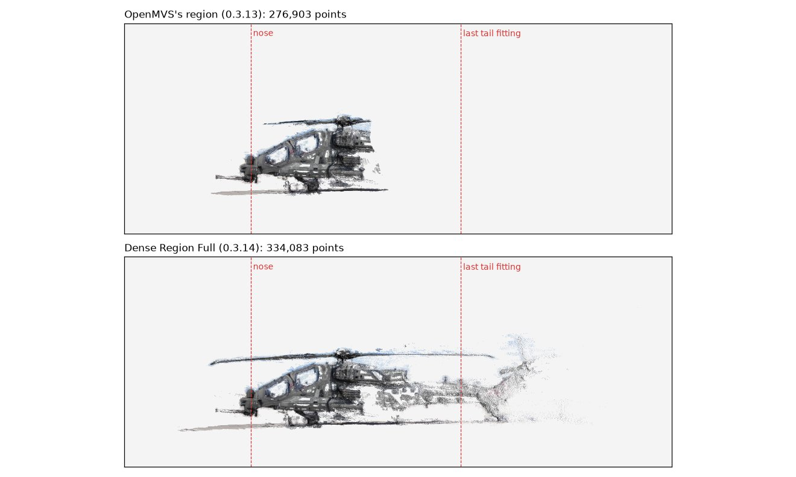

## 10. Video

- **Frames you can check.** The test videos show their own frame number as a block pattern, so
  each written file can be read back and compared with the frame its name claims. This caught two
  bugs. With B-frames, packets arrive in decoding order, so the last frames of a range were lost.
  An early version also matched frames with the wrong tolerance.
- **No frame limit.** 0.3.3 wrote the chosen frames with one select expression listing every
  frame. Past about 2,700 frames it no longer fit Windows' 32,767-character command line (and
  FFmpeg's expressions have no `||` to shorten it). Frames are now written in groups, each from
  its own seek point. All 3,000 frames of a 250 fps test took 14 s, and the longest command was
  3,293 characters.
- **The camera that follows the video.** The solved frames become keyframes of one camera, with
  the video undistorted behind it. Blender's lens conventions were measured by undistorting a
  test image with one bright dot in the compositor against COLMAP's models. The principal point
  counts y from the bottom, and Blender's Brown model takes OpenCV's tangential terms as p1 = p2
  and p2 = −p1 (0.1–0.6 px apart; with the terms as named, 4–19 px).
- **How many frames, and which (0.3.8).** A fixed rate (2 per second by default) gave too many
  frames where the camera barely moved and too few where it moved fast, and its sharpest frame
  per window could still be blurred when the whole window was. *Auto* measures the movement in
  the same pass that measures the blur: FFmpeg writes a 128 px grey copy of every frame next to
  `blurdetect`'s output, and phase correlation between frames 0.2 s apart gives how far the whole
  picture shifted (a share of the frame, so portrait and landscape count alike). Frames are
  placed at even steps of movement, 12% of the frame, with at least one every 2 s, 30 frames up
  to Max Frames. At each place the cost of a frame is its blur against the sharpest frames within
  1 s, plus a penalty for bad exposure and for distance from the place. When the best one is
  still blurred, the search widens to almost the next place. On a test pan with a known speed
  profile the measured movement was within 12% of the truth (the difference is the hand shake
  added to the video), the frames were evenly spaced at both speeds, and no blurred or dark frame
  was kept (`test_video_auto.py`). Run through the whole pipeline on the synthetic scene's 50
  photos played as a 10 fps video, Auto first kept only 28 frames: the picture jumped further
  than a spacing between some frames, and a place with no frame near it was skipped. The frames
  left out are now added where the movement between kept frames is largest, so at least 30 are
  kept whenever the video has them.
- **The tracked camera slid against the footage (0.3.9).** A scan of a GAZ-66 from a 60 fps phone
  video showed the scan drifting against the footage and meeting it again. The timing was right:
  the frames lay on the video's 1/60 s grid, and rendering a video that shows its own frame
  numbers through Blender's compositor confirmed that Blender shows clip frame n at scene frame n
  + 1, counted from the video stream's first timestamp (`movie_read.cc` seeks to the stream's
  start plus n over FFmpeg's guess of the frame rate). The cause was the keys: Auto kept 31
  frames in 58 s, a median 1.97 s (118 frames) apart, and Blender interpolates a smooth curve
  between keyframes while a hand-held camera bounces with each step. The camera track solves the
  camera on every frame instead (`camera_track.py`): FFmpeg writes every frame of the range at
  the solved frames' size, so the solved frames come out again pixel for pixel and keep their
  names; COLMAP finds SIFT features on them with the lens fixed to the solved one
  (`camera_params`, so it is a prior and never refined) and matches each frame with the frames 1,
  2, 3, 5, 8 and 13 after it and with the two solved frames around it. The solved frames go into
  a text model with their poses; `point_triangulator` (poses fixed: it sets
  `fix_existing_frames`) makes 3D points from their matches, and `image_registrator` places every
  other frame against those points (P3P with RANSAC, then the pose refined on its inliers); a
  second round makes points from the placed frames next to the ones left out and places those.
  (In 0.3.9 the second round triangulated with every placed frame and adjusted the points over
  all of them: 11 of the 26 minutes of a run on 3,600 GAZ-66 frames, for 91 frames left out. Now
  it takes the placed frames within 15 frames of a missing one and the solved ones, skips the
  adjustment, and keeps the first round's places: on the rendered walk tracked from three solved
  frames it triangulated 48 frames instead of 166, 8 s instead of 26 s, and the scan sat as far
  from the footage, median 0.90 px against 0.92 px.) COLMAP
  4.2.1's `image_registrator` places each frame against the points it is given and makes no new
  ones, so every frame is also matched to the solved frames directly. SIFT is used whatever the
  reconstruction used: it runs on the CPU and in COLMAP's CUDA build, and the track's database is
  its own. On the rendered hand-held walk (500 frames, keys 1 s apart) the track placed every
  frame, and the scan stayed within 0.48 px of the footage, against 10.0 px (median) and up to
  26.0 px with keys on the solved frames. Of its 357 s on two cores, features took 187 s,
  matching 152 s, triangulation 2 s and the placing 10 s.
- **Frame numbers as Blender counts them (0.3.9).** FFmpeg's `-ss` times count from the
  container's start; Blender counts a clip's frames from the video stream's start, at FFmpeg's
  guess of the rate (`r_frame_rate`, unless that is above 210 and the average below 70). A video
  whose stream starts after the container's zero (an audio track first, an edit list) had its
  frames named and keyed too late by that offset (3 frames for 0.1 s at 25 fps); the five phone
  videos of the logs start at zero, so they were not affected. Frames are now numbered from the
  stream's start, keyed at 1 + (t − start) × rate, fractional for a variable frame rate, and a
  range that runs to the end includes the offset.
- **Auto on real walks (0.3.9).** Four of five walks round vehicles ended at Auto's floor (30–37
  frames for 35–72 s), each with folds or frames dropped as weakly connected; the fifth got 152
  frames for 77 s and solved cleanly. Phase correlation of the whole picture follows what fills
  most of the frame, and walking round an object it is the object, which stays in the middle: on
  the rendered walk it measured 0.64 of the rate the view turned. The 75th percentile of nine
  half-size parts at 3 × 3 places measured 0.91. A part resolves shifts up to half its size, a
  quarter of the frame per 0.2 s (1.25 frames per second); beyond that its shift wraps round and
  looks small, so the larger of the parts' and the whole picture's speeds is taken, which kept
  pans of 0.3 to 2.4 frames per second exact (parts a third of the frame wide, tried first, read
  a 1.2 frames per second pan as 0.35). Auto uses the parts, keeps at least one frame per second
  instead of every 2 s, and writes its choice into the frames log, where the logs of these walks
  did not have it.
- **Too many frames.** A video gives frames a fraction of a degree apart. Above 300 solved photos
  the depth maps use photos at least 5° apart, and above 60 the texture uses photos about 20°
  apart, while every 3D point stays seen by two kept photos. On a 600-frame solve that kept 110
  and 35 photos.

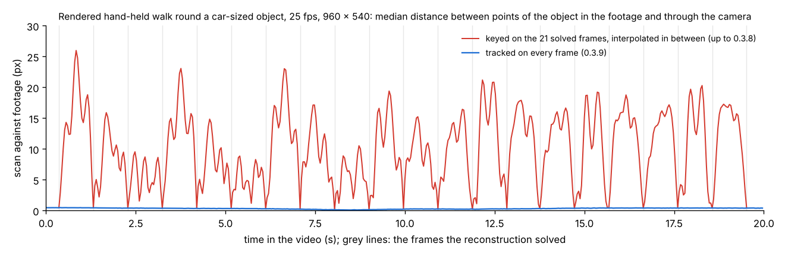

*The rendered hand-held walk of `test_camera_track.py`: points of the object in the footage
against the same points through the tracked camera. Keyed on the solved frames only (red), the
scan meets the footage at each solved frame (grey lines) and drifts away between them; tracked on
every frame (blue), it stays within half a pixel.*

## 11. Photo formats, RAW files and phone DNGs

- RAW files are developed with one exposure for the whole set, so the photos stay consistent.
  TIFF, HEIC, AVIF, EXR, PSD and others are converted to JPEG in a separate Python process. Their
  libraries (about 16 MB) are installed on first use.
- **Phone lens shading.** Phones store their vignetting and colour-shading correction in the DNG
  as gain maps. LibRaw does not apply them, so the corners came out dark and tinted. Photogram3D
  applies them to the mosaic first, as Adobe's DNG SDK does. A synthetic DNG whose lens loses 60%
  of red and 35% of blue in the corners came out at 1.003 of the centre's brightness with no
  tint; without the maps it was 0.66 and tinted.
- **The focal length of DNGs.** Phone DNGs have no 35 mm focal length, so COLMAP guessed 1.2
  times the width (5549 px for the gas-mask DNGs, about 3340 px true). A DNG now takes it from
  its JPEG twin. Phones save each shot twice, and that pair is otherwise used as one photo.
- **Mixed sizes.** COLMAP skips every photo whose size differs from the first one of a shared
  lens, so photos of different sizes each get their own.
- **Photos stored on their side (0.3.9).** A phone held upright stores a landscape picture and an
  EXIF orientation (6 for the Pixel's portrait DNGs, which the converter copies). COLMAP 4.2.1
  keeps the pixels as stored, takes a gravity direction from the tag (x = 1 for these: down is
  the stored picture's right) and solves the camera as stored, so the camera came into Blender
  lying on its side. Turning the background picture by 90° in the camera's settings looked wrong
  because Blender scales the picture to the camera frame before it turns it (`overlay_camera.hh`:
  translate × rotate × scale), and the frame stayed landscape. The importer now turns each such
  camera about its viewing axis by the photo's quarter turns k (from the gravity in COLMAP's
  database, or the photos' EXIF when there is no database), with the intrinsics of the turned
  picture (k = 3: u' = h − v, v' = u, so f'x = fy, c'x = h − cy, c'y = cx) and the background
  turned by −k × 90° with *Fit* and a scale of the long side over the short side, which then
  fills the turned frame exactly. Blender keeps one frame size per scene, so a handler gives the
  scene the frame of the scene camera whenever another Photogram3D camera becomes the scene
  camera. COLMAP's `model_orientation_aligner` (IMAGE-ORIENTATION) takes the consensus of every
  stored picture's y axis as down (`EstimateGravityVectorFromImageOrientation`) and ignores the
  gravity it read: for portrait photos stored on their side that axis is level, and on the test
  set the scene came out on its side. The orient step now runs the same consensus on each photo's
  own down direction and applies the rotation with `model_transformer`; without the photos' turns
  it reproduces COLMAP's rotation to 4e-07. On the WRX photos stored the phone's way, every
  camera's view agreed with COLMAP's projection of the turned photo within 0.001 px, and the
  turned cameras' up axes leaned at most about 15° from world up, the photos' own downward tilt
  (up component at least 0.966).

## 12. Weakly matched photo sets

The gas mask photos share only 42–55 3D points per photo; the WRX photos share 260. OpenMVS picks
partner photos for each depth map by a score built from the shared points and drops partners
below 2.0. On the gas mask, 24 of 37 photos got no partner and so no depth map, and the cloud had
holes. The synthetic scene was thinned to 39 points per photo to reproduce this. With a minimum of
0 (only OpenMVS's relative 3% rule left), every photo kept 4 to 8 partners. The cloud covered more
of the true surface within 1 cm (76.6% against 72.2%) and was closer to it (median 1.01 mm against
1.16). With all 197 points per photo both settings gave the same cloud, so the lower minimum is
used only on weak sets.

## 13. AI Features that never finished

**The problem.** A run of 0.3.6 on the WRX photos with *AI Features* (ALIKED features, LightGlue
matching) on the 5900HX + RTX 3070 laptop: feature extraction took 31.8 min, about 45 s per
photo. Matching then showed no progress at all and was cancelled after more than an hour.
SIFT on the same photos takes about 1.5 min for both steps.

**Finding it.** The logs showed three things, and COLMAP's own models (downloaded from COLMAP's
releases, with the checksums COLMAP expects) were run here in ONNX Runtime to measure each:

- *The GPU attempt.* Both steps first crashed on the GPU (0xC0000409): COLMAP's ONNX Runtime
  1.30 CUDA provider needs NVIDIA's cuBLAS 12, CUDA runtime 12 and cuDNN 9, and the COLMAP
  download has none of them (as NVIDIA's packages, about 1.3 GB). The steps then ran again on
  the CPU, which cost only seconds but explained nothing.
- *ALIKED's memory.* COLMAP runs ALIKED as one model over the whole photo, and its memory grows
  with the pixels: 4.0 GB at 1600 px here, out of memory (8 GB) at 2400 px. At the 3200 px of
  High it needs about 16 GB, so the 16 GB laptop swapped: 45 s per photo.
- *LightGlue's memory.* On the CPU, COLMAP's matcher starts one LightGlue model per CPU thread,
  16 on the 5900HX. One model at the 4096 points per photo that 0.3.6 asked for peaked at
  1.27 GB (14.7 s per pair on one thread here), so 16 of them needed about 20 GB: Windows
  swapped, and matching all but stopped. At COLMAP's own default of 2048 points one model takes
  0.43 GB and 3.9 s per pair, 3.7 times faster. And with 42 photos, the whole of exhaustive
  matching was one block of 861 pairs, which logs nothing until it ends: no progress either way.

**The fix (0.3.7).**

- Without NVIDIA's libraries next to COLMAP (or on PATH), the AI models are not tried on the GPU,
  and the log says why.
- ALIKED finds 2048 points per photo (COLMAP's default) on photos reduced to 1600 px (1280 px
  below 12 GB of RAM).
- LightGlue runs as many models at once as fit in half the RAM, at most one per CPU thread (16
  at 2048 points on a 16 GB laptop: 7 GB).
- Matching goes in blocks of 10 photos, so the progress bar moves (25 blocks for 42 photos).

**Measured.** The WRX photos reduced to 1080 × 1438, on the 2-core, 8 GB development machine
(so ALIKED at 1280 px and 2 LightGlue models at once):

| | SIFT, 1600 px | AI Features |
|---|---|---|
| Features | 95 s | 110 s |
| Matching | 66 s | 52 min, in 25 blocks |
| Photos placed | 41 of 42 | 42 of 42, no fold |
| 3D points | 3,689 | 14,084 |

AI Features placed every photo and gave 3.8 times the 3D points. From the time per pair here, 16
models on a 16-thread laptop should match these photos in about 5 minutes; that is an estimate,
not a measurement.

**On the GPU of any make (0.3.9).** On a GPU, ALIKED and LightGlue take a fraction of a second
per photo and per pair. Since the add-on is meant for any computer, three paths are offered and
the user chooses, or lets a quick test choose:

- *GPU (DirectML).* `ai_features.py` runs COLMAP's two model files with ONNX Runtime DirectML on
  any DirectX 12 GPU, as AI Polish runs MoGe-2, in its own process. This works because both files
  use only standard ONNX operators (opset 17): ALIKED's deformable convolution is exported as
  plain gathers and grid sampling, and DirectML has no deformable-convolution operator. The
  runner does what COLMAP does around the models, read in COLMAP 4.2.1's source: the photo
  decoded as stored, reduced so its long side fits (each side rounded, filtered over the
  reduction), turned upright from its EXIF orientation and back, padded to a multiple of 32 by
  repeating the edge, keypoints converted from ALIKED's [-1, 1] to COLMAP's pixel-corner origin
  and scaled to the full photo; for LightGlue the pixel-centre origin, the same upright turn and
  a minimum score of 0.1. COLMAP then reads the photos itself (`feature_importer`: cameras, EXIF
  focal length and gravity exactly as its extractor), the descriptors go into its database as
  ALIKED's, and `geometric_verifier` checks the runner's matches. Checked against COLMAP on the
  CPU: 98.7% of the keypoints within 1 px (the rest differ by OpenImageIO's and Pillow's
  resampling), 4,163 matches against 4,146, 3,965 inliers against 3,945.
- *GPU (NVIDIA libraries).* COLMAP's own path, with cuBLAS, cuDNN and the CUDA runtime from
  NVIDIA's packages on PyPI (1.3 GB, checked by SHA-256, unpacked into the tools folder and put
  on COLMAP's PATH after its own folder). cuFFT, which the CUDA provider loads only for FFT
  operators, is left out (287 MB). Downloaded only when the user asks, with NVIDIA's license
  named first.
- *CPU.* COLMAP as set up in 0.3.7.

**Test AI Speed** runs ALIKED at 1280, 1600, 2048 and 2400 px on the GPU until a size fails, then
LightGlue on one pair, and the same at one size on the CPU, where LightGlue is timed on one
thread and divided by the number of models COLMAP runs at once (with NVIDIA's libraries
installed, COLMAP's own GPU path is timed on four views too). It estimates each device's time for
the current photos (photos times the time per photo, plus pairs times the time per pair), and
*Automatic* takes the fastest; on the GPU, ALIKED then gets the largest size that ran. A computer
not tested yet is tested by its first run with AI Features, as a step of that run. A runner that
fails during a run hands over to COLMAP on the CPU; the features it already wrote stay usable,
since they are COLMAP's own format.

**When a part does not work (0.3.10).** On the GTX 1650 Ti laptop both GPU paths failed, each
differently:

- *ONNX Runtime did not load.* Test AI Speed stopped at its setup with "python.exe failed (exit
  0xC0000005: access violation)": Blender's Python crashed while loading ONNX Runtime DirectML
  1.24.4, which loads on the other laptop with the same Blender. A crash inside a DLL leaves no
  Python error, so the log could not say where. Now each ONNX Runtime is loaded with Python's
  `faulthandler` on and prints each step (numpy, onnxruntime, Pillow), so a crash shows where it
  happened and with which Python stack; a version that does not load gives way to the next
  (DirectML 1.22.0, 1.20.1, then the CPU-only 1.24.4 and 1.20.1; all run the opset 17 models).
  The quick test no longer stops when a part fails: without the runner, DirectML is reported as
  not working and the CPU is timed with COLMAP itself on four views; the GPU and the CPU runs of
  the runner are separate processes, so a GPU crash leaves the CPU timing, and the GPU is tried
  once more at the largest size that worked. A test in which nothing worked makes *Automatic* use
  the CPU (until then it guessed DirectML). Checked with stand-ins (`test_ai_robust.py`): a pip
  that installs a crashing package first, a runner whose GPU test aborts.
- *cuDNN found no kernel.* With NVIDIA's libraries, COLMAP's ALIKED stopped on its first photo:
  "CUDNN_FE failure 8: HEURISTIC_QUERY_FAILED ... No valid engine configs" in the deformable
  block's offset convolution, then 0xC0000409; the step ran again on the CPU (2.1 s per photo)
  and LightGlue then ran on the GPU. cuDNN 9 compiles some of its kernels at run time with
  NVRTC, CUDA's runtime compiler: its `cudnn_graph64_9.dll` (9.27) loads `nvrtc64_%d_0.dll` and
  otherwise reports "Could not open libnvrtc for runtime linking", and the engines that need it
  are left out of the heuristics' list. ONNX Runtime's own GPU package lists
  `nvidia-cuda-nvrtc-cu12` among the CUDA libraries it needs, and the 0.3.9 download left it out.
  NVRTC 12.9 is now part of the download (76 MB; `nvrtc64_120_0.dll` and its builtins, next to
  cuDNN on COLMAP's PATH), and an install made by 0.3.9 gets only NVRTC added. Whether this
  gives ALIKED a kernel on that laptop is for its next test to show; ONNX Runtime's own tests on
  Turing GPUs hit the same "no valid engine configs" for convolutions with cuDNN 9.8
  (onnxruntime issue 26274).

## 14. AI Polish without trusting the network blindly

MoGe-2 predicts a normal map per photo in a separate process (a driver crash cannot take Blender
down), on any DirectX 12 GPU through DirectML. The predictions are projected onto the mesh with
the solved cameras, behind a z-buffer and a back-face test, and averaged. Three checks guard the
result:

- the network's axis convention is checked against the scan, and the result is rejected when
  they disagree (real photos fed to the stand-in were rejected at an agreement of 0.11);
- vertices seen by fewer than 2 photos are left alone, and so are vertices where the photos
  disagree with each other;
- the result is a shape key, to compare before applying.

With realistic prediction errors, a scan with 5 mm bumps went from a median 2.65 mm and 15.5°
off to 1.16 mm and 4.7° (classic polishing: 1.81 mm and 9.0°). The real network's accuracy on
real photos has not been measured: its weights could not be downloaded here.

## 15. Splats and evened-out photos

- **Gaussian splats** are trained by Brush 0.3.0 on any DirectX 12 or Vulkan GPU. What the module
  relies on was read in Brush's source and checked by running it: where it looks for cameras and
  photos, how a single `.ply` replaces the starting splats, the PLY layout it exports, and its
  log lines. The splats are cropped to the box after training, so a new box only crops them
  again. On the synthetic scene, after 2,000 steps the held-out photos were matched at 23.8 dB
  PSNR.
- **Even Out Photos** fits each photo's exposure, white balance and vignetting from the solved
  scene: *log I = log L(point) + log E(photo) + log V(radius)*, by robust alternating means. A
  point is seen at different places in different photos, so exposure and vignetting separate.
  Test photos given ±0.6 stops and 30–50% darker corners came out within 0.3% of each other, with
  the corners at 1.00–1.01 of the centre. Until 0.3.11 the photos were evened before they were
  undistorted, and the depth maps were made from the evened copies, so turning the option on for
  a finished run redid the depth maps: on the Mi-8 run at Ultra, four hours, against 40 minutes of
  texture. The depth maps do not need it: OpenMVS compares patches by normalised
  cross-correlation (COLMAP's PatchMatch likewise), with each patch's mean and spread taken out,
  which a photo's exposure and a smooth vignetting do not change. Since 0.3.12 the step evens
  the undistorted photos after the mesh, for the texture and the splats only; like the splats,
  they do not depend on the mesh, so a new crop box does not even them out again. The
  undistorted photos of the test kept their shading (exposure spread 0.25 in log units), and the
  copies evened out from them had none left (0.000–0.004).

## 16. Tests

57 test scripts, run before every release (`tests/`). They fall into five groups:

| Group | Tests |
|---|---|
| Camera solving | `test_pipeline_front`, `test_ai_features` (AI Features on the WRX photos), `test_ai_backends` (the GPU runner against COLMAP, the NVIDIA download, the quick test), `test_ai_robust` (the quick test and the AI setup when a part fails), `test_mapping_synth`, `test_mapping_wrx` (the WRX matches), `test_mapping_walk` (the box and the gas mask), `test_mapping_gaz66` (the GAZ-66 walk that 0.3.9 folded), `test_mapping_mi8` (the Mi-8 photos that 0.3.10 folded: the fold turned back), `test_solve_check` (the path check on made-up walks and on the GAZ-66, Mi-8 and WRX cameras), `test_resolve`, `test_resolve_cameras` (Re-solve From Cameras on the look-alike box), `test_solve_identity` |
| Dense, mesh, texture | `test_crop_flow`, `test_blend_seams` (patches exposed differently, the WRX texture, the step), `test_join_run` (two runs made one, one of them in other coordinates: the crop stage, Build Mesh, the box kept), `test_dense_region` (Full against OpenMVS's region), `test_hybrid_dense`, `test_hybrid_log_replay`, `test_colmap_gpu_emulated`, `test_size_agreement`, `test_depth_map_reuse`, `test_weak_views`, `test_texture_fallback`, `test_texture_import`, `test_views` |
| Input | `test_video_auto`, `test_camera_track` (a rendered hand-held walk), `test_video_extract`, `test_video_select`, `test_video_formats`, `test_video_flow`, `test_formats`, `test_formats_plan`, `test_dng_shading`, `test_even_photos`, `test_max_size` |
| Blender side | `test_ui_draw`, `test_upright_cameras` (portrait photos stored the phone's way), `test_scene_cameras` (cameras read back for Re-solve From Cameras), `test_ground_align`, `test_join_scans` (two scans joined by points, a misplaced point, a small overlap), `test_join_build` (Complete Joining and Build Mesh from the panel), `test_join_videos` (a joined scan's camera for each video, moved by the join; Add Video Cameras on a scan joined before), `test_moved_project`, `test_reimport` (a run solved again, imported again), `test_splats_import`, `test_splats_flow`, `test_splats_ply`, `test_ai_polish`, `test_ai_operator`, `test_ai_runtime`, `test_errors` |
| Packaging | `test_install_extension`, `test_installer_layout` (the real Windows release zips), `test_legacy`, `test_move_from_legacy` (development builds before 0.3.7) |

The figures in this document are plotted from the COLMAP models and match databases of the runs
named in their captions. The scans are rendered with Cycles: the gas mask from the run on the
GTX 1650 Ti laptop, the WRX from the run on the development machine.

## 17. Known limits and what comes next

- **A partly wrong solve can pass the path check.** In one incremental solve of the synthetic
  scene, 9 of 47 placed cameras were misplaced, but the largest step was only 3.3 times the
  median, below the threshold of 5. The scene's legitimate jump between camera rings is 3.6
  times, so lowering the threshold would flag correct solves.
- **Not measured here:** the real MoGe-2 network, the Visual C++ installer, the GPU options on
  the 1650 Ti, Brush on a real GPU, and RAW files from real cameras. The README lists these under
  *Not tested here*.
- **Auto frames measure the picture, not the camera.** A camera walking straight towards the
  object shifts the picture little, so it gets fewer frames (at least one per second); a close-up
  orbit shifts it less per degree than a wide view, so it gets more. The measure of 0.3.9 was
  checked on a rendered walk and on pans; the real walks of the logs ran with the 0.3.8 measure.
- **The camera track on real footage.** It was measured on a rendered video. A phone's rolling
  shutter, which COLMAP does not model, may leave a small sway in fast pans, and its time on the
  test laptops' GPUs is not measured yet.
- **AI Features on a real GPU.** The runner was checked on ONNX Runtime's CPU provider against
  COLMAP. On the GTX 1650 Ti laptop, ONNX Runtime DirectML 1.24.4 crashed while loading in
  Blender's Python, and COLMAP's NVIDIA path found no cuDNN kernel for ALIKED (its LightGlue ran
  on the GPU); whether an older DirectML build loads there and whether NVRTC gives cuDNN its
  kernel is for the next test to show (section 13). DirectML's speed and the photo size that fits
  in 4 and 8 GB are not measured yet.
- **The fold turned back is a guess.** It assumes the solver laid one stretch of the walk over
  the opposite side, half a turn about the vertical, between two folds the path check found.
  A fold of another kind, or folds found in the wrong place, give a wrong guess; the path check
  then judges its solves like any other, and Re-solve From Cameras is the way to say it by hand.
- **Parts that do not join.** When the pairs left between two parts of a walk are too few, a
  solver returns them as separate models and only the largest is kept (on the Mi-8 photos,
  turning only the starboard cameras and not the front ones with them split the walk into 165 and
  67 photos). Scans are joined by points (section 4), but between runs: the photos of the other
  part need a run of their own (a folder of their own) to be joined to the first.
- **A joined scan shows what moved twice.** Each run's cloud keeps what it saw: rotor blades
  parked at other angles appear in both places in the joined mesh. Refine leaves them out of its
  fit, the mesh does not. Where the light differed (overcast and sunny) Blend Seams evens out the
  brightness across the seams; the shadows of the sunny side stay in its photos. Gaussian splats
  are not trained for a joined run. Refinement reads both runs' photos: on the 8 GB here Auto
  skipped it for the two AW-249 videos (62 photos of 1928 × 1080, allowed at half resolution
  only); 16 GB allows them at full resolution.
- **The join is not proposed.** Matching across the sources failed on a symmetric object (section
  4), but once the points have joined two scans the matches between them could be checked
  against that join, the few right ones kept, and both solves adjusted together (one bundle
  adjustment over both runs' cameras); a guess of the join to start from, shown for the user to
  accept, could come from the clouds' shapes. Neither is built yet.
- **Seam blending is global only.** It evens out brightness and colour across the seams,
  smoothly over each patch. OpenMVS's leveling also has a local pass that blends a strip along
  each seam in the texture (Poisson editing), which takes out what still differs along a seam: a
  reflection, the sharp edge of a shadow, a texture that does not quite line up. The blending
  also changes a texture without exposure differences a little (0.026 stops, median, on the
  synthetic scene). Once OpenMVS releases its fix, its leveling can be compared with this one.
- **Next:** image-based lighting (HDRI) from the scan.

## 18. Version history

| Version | What changed |
|---|---|
| up to 0.2.0 | the pipeline, the tool installer, AI Polish, video; the path check and the weak-photo filter |
| 0.2.1 | texture seam leveling off (the OpenMVS bug), texturing retries, the untextured fallback |
| 0.2.2 | texture images loaded fresh on import |
| 0.3.0 | the crop stage and crop box, ground alignment and scale, Ultra, the memory budgets for meshing and refinement |
| 0.3.1 | depth maps on the GPU with COLMAP; old depth maps deleted |
| 0.3.2 | depth maps on the CPU and the GPU together; moved projects |
| 0.3.3 | Full, ground on three wheels, the disk check |
| 0.3.4 | video without a frame limit, runs in their own folders, the tracked camera, error explanations, photos spread for the texture, RAW and other formats, *Re-solve Without Selected*, depth-map sizes both tools agree on |
| 0.3.5 | solving along the shooting order, solve ids and the Build Mesh guard, the DNG focal length, weak partners, Even Out Photos, Max Photo Size, Topaz, Gaussian splats |
| 0.3.6 | a new crop box no longer retrains the splats |
| 0.3.7 | AI Features finish on the CPU (section 13); Topaz Photo AI removed (not free); the author and license note in every file |
| 0.3.8 | video frames chosen automatically by the camera's movement, the sharpest near each place |
| 0.3.9 | AI Features on any DirectX 12 GPU (own runner), on NVIDIA's libraries or on the CPU, chosen by a quick test or by hand (section 13); upright cameras for portrait photos and the up axis from their EXIF orientation (section 11); the camera on every frame of a video, frame numbers as Blender counts them, Auto measured on parts of the picture with one frame per second at least (section 10) |
| 0.3.10 | the path check no longer lets a fold hide behind dropped frames; both solvers run for a video of up to 300 frames and the better solve is kept, and the other solver also runs when frames are missing in a row (section 3); Test AI Speed and the AI setup go on when a part fails, NVRTC for cuDNN (section 13); a faster second round of the camera track (section 10) |
| 0.3.11 | the path check: several photos from one spot no longer read as jumps, and photos stored on their side get their own up; solves that place as many photos are compared by their observations before their points (section 3); when every solve folds, the fold is turned back as a guess and solved again, the turned part joined to the rest only along the walk; *Re-solve From Cameras* solves along cameras turned by hand (section 4); a run is never forked into its own folder |
| 0.3.12 | the texture's seams blended (section 5); Even Out Photos after the depth maps, for the texture and the splats only (section 15); a run solved again replaces the scan of the earlier solve in Blender, a mesh of it kept aside, and the photos already loaded are reused for the new cameras (section 9) |
| 0.3.13 | two scans of one object (two videos, two days) joined by points: the fit with each point's distance and a misplaced point named, the refinement on the clouds, and one mesh from both runs without computing depth maps again, inside a box holding both crop boxes (section 4); a fold costs a tenth of the photos in sets of more than 100 (section 4) |
| 0.3.14 | *Dense Region*: OpenMVS's own region of interest, which cut a helicopter's tail off a video's cloud, is off by default (*Full*) and can be chosen with its size (*Automatic*, section 9); *Complete Joining*: the joined scan at its crop stage, in its own collection, continued by Build Mesh like any scan (section 4); the *Onto* field kept (section 4); a fold costs a fifth of the photos in sets of more than 50 (section 4) |
| 0.3.15 | a joined scan has a tracked camera for each video it was joined from, moved by the join; Track Every Frame on the selected one, refused when its run was solved again; *Add Video Cameras* for a scan without them, such as one joined with 0.3.14 (section 4); README: screenshots of every step and the video of the crop stage (`docs/manual/`, section 1) |
