# Photogram3D for Blender 5.2

Photos or a video → textured mesh, using **COLMAP 4.2.1** (camera solving) and **OpenMVS 2.4.0**
(depth maps, meshing, refinement, texturing), run from Blender's sidebar. The tools are
downloaded and set up by the add-on itself. Optional **AI Polish** uses a local normal-estimation
network (MoGe-2) to clean up the surface.

Authors: Kruglov Iurii, Anthropic Claude AI · License: [GNU General Public License (GPL)](https://www.blender.org/about/license/) v3 or later

How it was built, the problems met on the way, the measurements and the tools written to solve
them are described in [DEVELOPMENT.md](DEVELOPMENT.md).

---

## Install

Blender 5.2 on Windows 10 or 11 (64-bit). The tools the add-on installs are Windows builds; on
Linux or macOS, install COLMAP and OpenMVS by other means and set their paths in the add-on's
preferences (the development tests run this way on Linux; macOS is untested).

1. Download `photogram3d-0.3.15.zip` from the
   [Releases](https://github.com/IuriiKruglov/photogram3d/releases/latest) page. Blender 5.2 →
   *Edit › Preferences › Get Extensions* → **⌄** (top right) → *Install from Disk…* → the zip
   (or drag the zip into the Blender window).
2. *Preferences › System › Network*: enable **Allow Online Access** (needed for the downloads).
3. 3D Viewport → **N** → **Photogram3D** tab → **Install Tools**.
   Downloads into the extension's user folder (change it in the add-on preferences, ideally to a
   path with only Latin characters):

   | Component | Download | Notes |
   |---|---|---|
   | COLMAP 4.2.1 (CUDA build) | 395 MB | chosen automatically when an NVIDIA GPU is found; the non-CUDA build is 122 MB |
   | OpenMVS 2.4.0 | 21 MB | CPU build |
   | FFmpeg 8.1 | ~160 MB | only for video input (can be switched off in preferences) |
   | Brush 0.3.0 | 159 MB | only for *Gaussian Splats*, downloaded the first time they are used |

4. If a tool doesn't start (error 0xC0000135 / 0xC0000139), press **Install Visual C++ Runtime**.
   COLMAP 4.2.1 is built with Visual Studio 2026 and needs Microsoft's latest v14 runtime
   (14.51 or newer). The button downloads Microsoft's official installer and starts it with an
   administrator prompt. Then press **Check Tools**.

## Step by step

[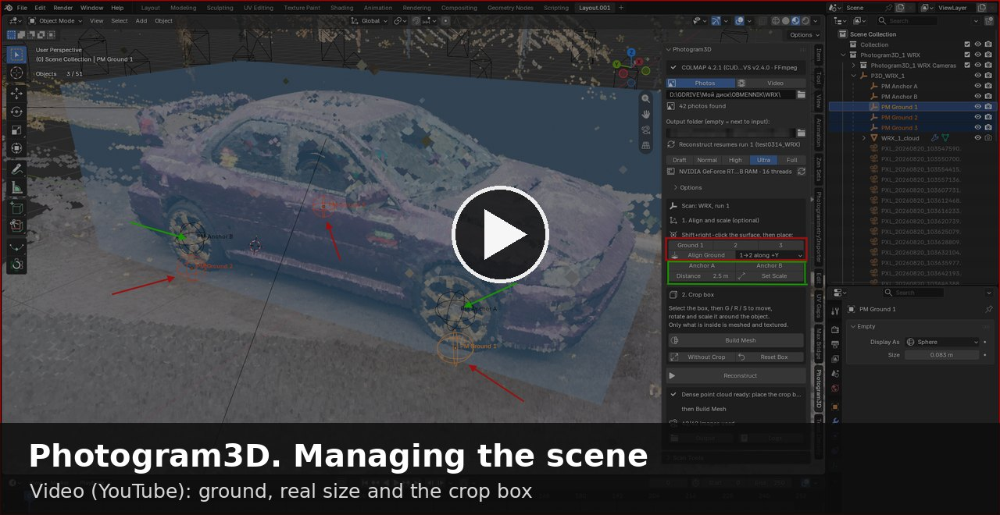](https://youtu.be/ruF8eCvebvI)

The video [*Photogram3D. Managing the scene*](https://youtu.be/ruF8eCvebvI) (YouTube) shows the
crop stage of step 2.7 on the WRX photo set: leveling the ground, the real size from two points,
and the crop box. The screenshots below are of the same set, in Blender 5.2.

### 1. First start

1. Install the add-on and its tools as described in *Install* above. When the tools are ready,
   the top box of the **Photogram3D** tab (3D Viewport → **N**) reads *COLMAP 4.2.1 (CUDA) ·
   OpenMVS 2.4.0 · FFmpeg*.
2. The line with the computer's CPU, RAM and GPU is what the add-on detected; **↻** detects again.
   The Quality preset and the memory limits follow from it.
3. *Edit › Preferences › Add-ons › Photogram3D* holds what applies to every project: the tools
   folder (**Install / Repair**, **Check Tools**), paths to existing installs of COLMAP, OpenMVS,
   FFmpeg or Brush, where *AI Features* run (*AI Features On*; **Test AI Speed** times this
   computer's GPU and CPU; **Download NVIDIA Libraries** for NVIDIA's own GPU path), and the
   AI Polish model.

   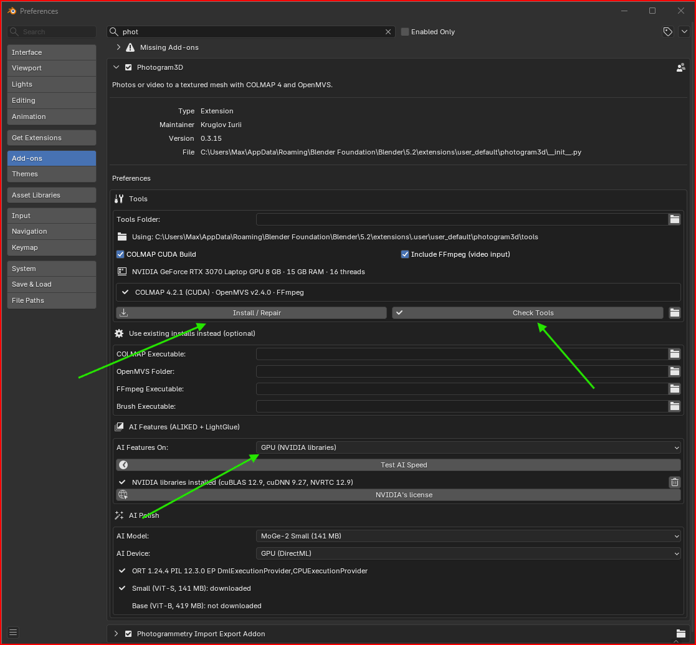

### 2. Photos to a textured mesh

1. **Shoot** (see *Capture tips*): walk round the object at one or two heights, each photo
   overlapping the previous one by most of the frame, the object sharp and well lit. Portrait and
   landscape photos can be mixed; the photos' own EXIF orientation is used.
2. **Input:** *Photos*, then the folder. The panel counts the photos it will use and the ones it
   converts to JPEG first (RAW, HEIC, TIFF, EXR, ...).
3. **Output folder:** empty means a folder next to the photos, `<folder>_photogram3d`. The line
   under it says whether Reconstruct continues an earlier run there or starts a new one.
4. **Quality:** *Normal* suits 16 GB laptops; *Draft* checks a photo set in a few minutes;
   *High*, *Ultra* and *Full* need the crop box and time (see *Presets*).
5. **Options** (collapsed) are needed only in particular cases: *AI Features* for weakly
   textured objects, *Camera Solver: Shooting Order* for objects that look alike from opposite
   sides, *Depth Maps* to use the NVIDIA GPU, *Even Out Photos* for uneven exposure, *Max Photo
   Size* for very large photos, *Gaussian Splats* for splats besides the mesh. Under *Run*:
   *Resume*, *Stop to Crop*, *Import When Done*, *Import Cameras* and *Photos in Cameras* (all on).

   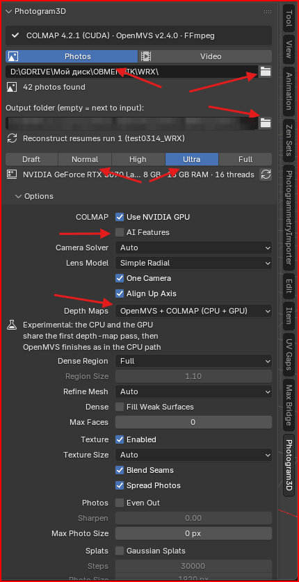 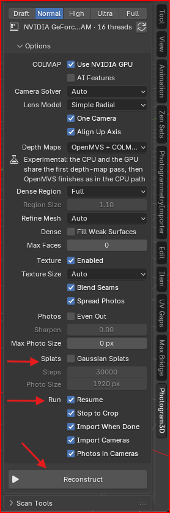

6. Press **Reconstruct**. The panel shows the step (for example *Step 8/9: Dense point cloud
   (OpenMVS)*), its progress, the total progress with the elapsed time and the last log lines.
   Blender stays usable; **Cancel** stops the run, and **Logs** opens the run's log folder.

   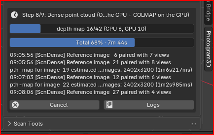

7. **Crop stage.** After the dense point cloud the run stops and imports the cloud, the cameras
   and a blue see-through **crop box**. The panel names the scan (*Scan: WRX, run 1*). The video
   at the top of this section shows the three steps below.

   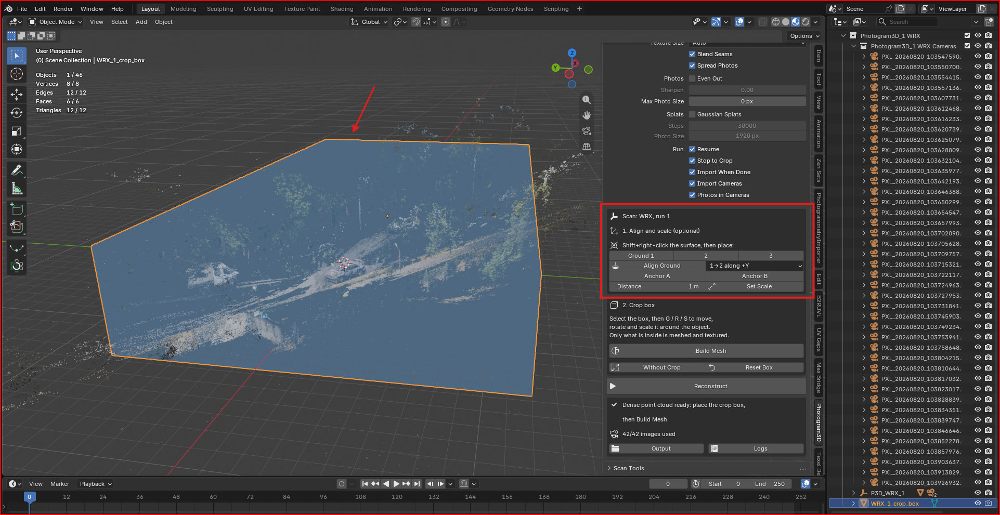

   1. *Align and scale* (optional). Shift+right-click a point of the ground to put the 3D cursor
      there and press **Ground 1**; the same for **2** and **3**, then **Align Ground**: the ground
      becomes the XY plane. The menu beside it says which way Ground 1 → 2 then points: for a car,
      Ground 1 under a front wheel, Ground 2 under the rear wheel of the same side and *1→2 along
      +Y* make it face −Y, like Blender's front view. For the real size, place **Anchor A** and
      **Anchor B** on two points whose distance is known, enter it as **Distance** and press
      **Set Scale**.

      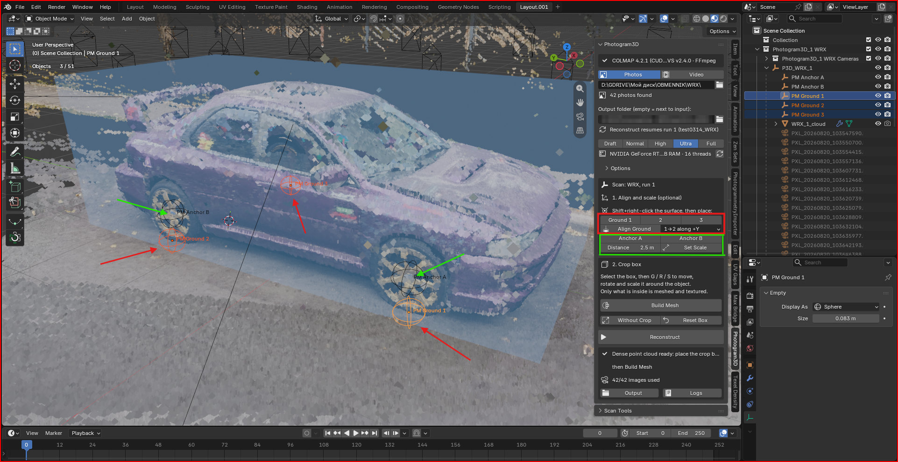

   2. Select the crop box and move, rotate and scale it (G, R, S) round the object. Only what is
      inside is meshed and textured. **Reset Box** fits it to the cloud again.
   3. Press **Build Mesh** (or **Without Crop** to mesh everything).

      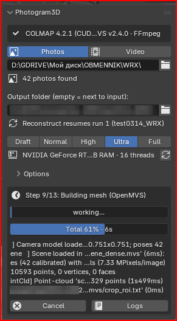

8. **Result.** The textured mesh is imported under the scan's root (`P3D_WRX_1`, in the
   collection `Photogram3D_1 WRX`), with one camera per photo in `Photogram3D_1 WRX Cameras`. The
   cloud and the crop box are hidden (the eye in the Outliner shows them again); the ground and
   anchor points stay.

   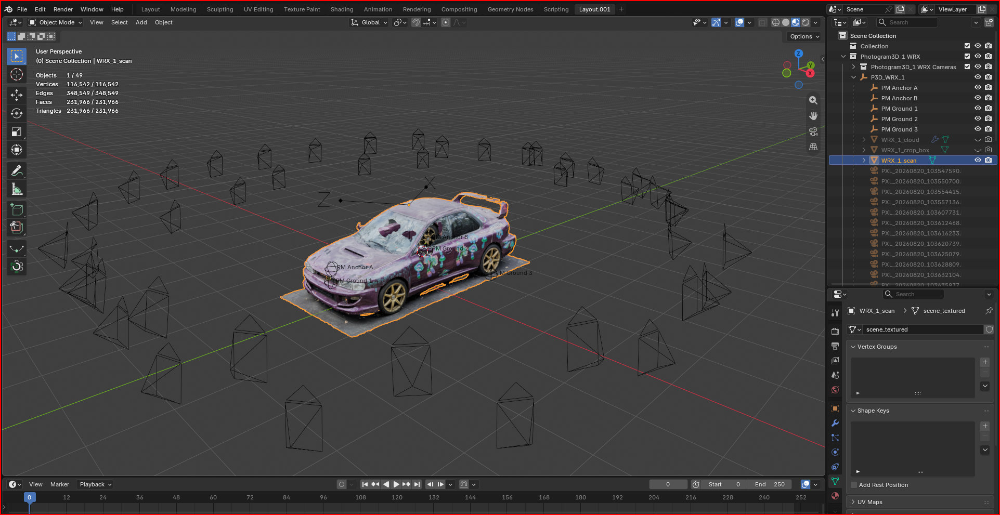

   In Solid shading the mesh shows its shape without the texture:

   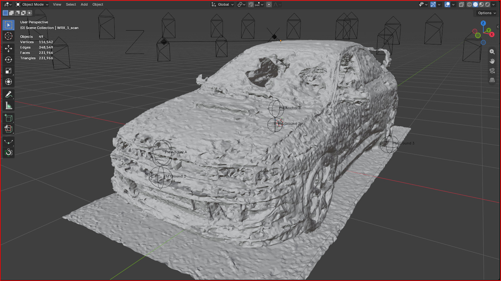 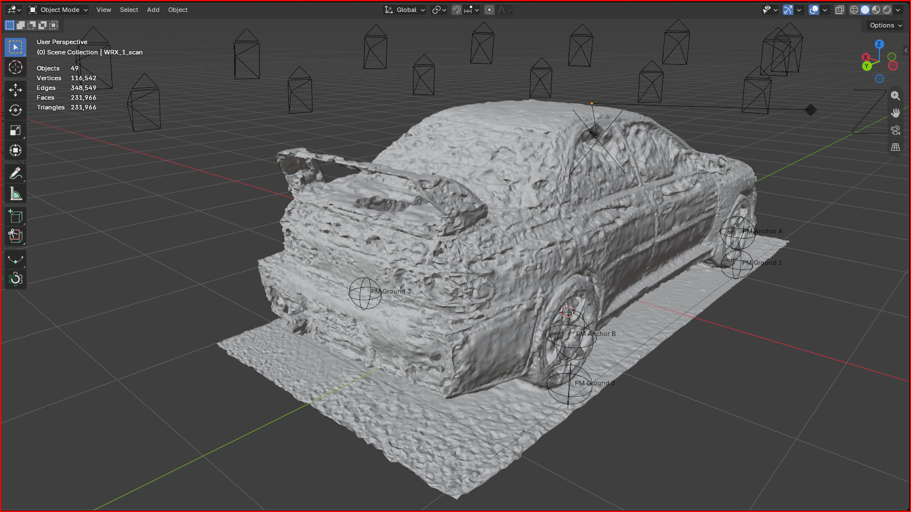

   Each camera shows its photo behind the scan: select a camera and press Ctrl+Numpad 0 to look
   through it. A photo taken holding the phone upright gets an upright camera with a portrait
   frame, and the scene's frame size follows whichever camera is the scene camera.

   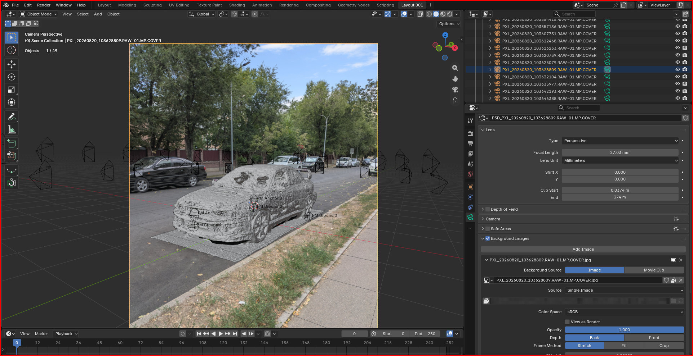

   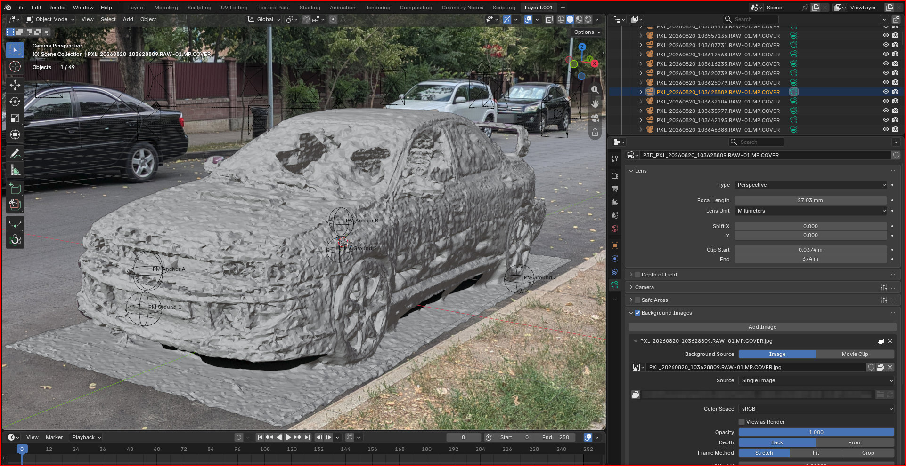 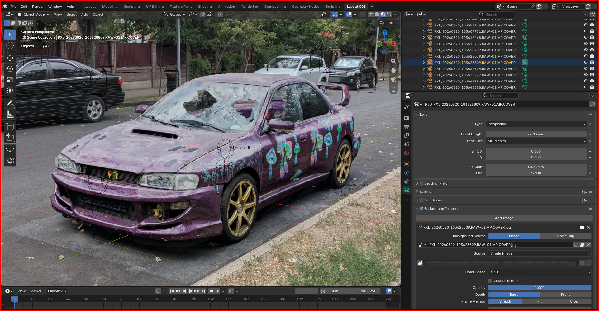

9. **Afterwards**, with an object of the scan selected, the panel offers:
   - *Align and scale* again at any time (nothing is recomputed); **↺** undoes it.
   - **Re-solve Without Selected**: select misplaced cameras (named after their photos) to solve
     the cameras again without them, as a new run next to this one.
   - **Re-solve From Cameras**: turn misplaced cameras roughly the way they should face (a side
     laid over the other side: select them, then *R Z 180*), then solve the cameras again along
     the cameras as they now stand, as a new run next to this one.
   - **Turn Cameras Upright**, shown for scans imported before 0.3.9 whose cameras of portrait
     photos lie on their side.

   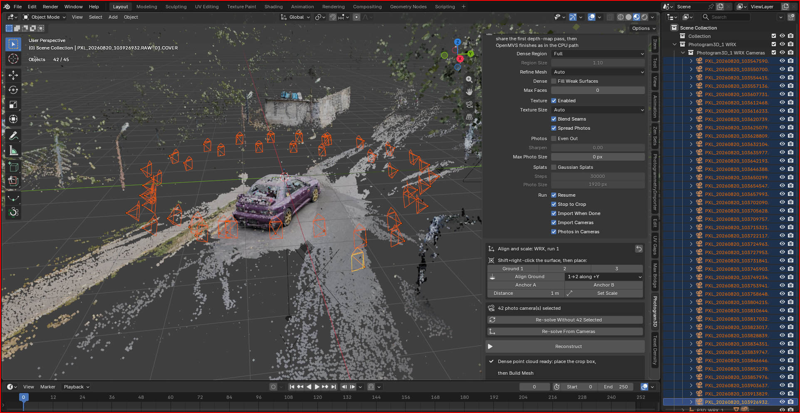

10. **Scan Tools** (a panel of its own in the tab) work on the active mesh: **Polish Surface**
    smooths the surface while keeping creases, **AI Polish** recovers detail from normals
    estimated on the photos (see *AI Polish*), and **Set Real Scale** (*Scale from 2 vertices*)
    sets the real size from two vertices selected in Edit Mode.
11. **Export** with Blender's own exporters (*File › Export*: glTF, FBX, OBJ, USD). The texture
    atlas is `mvs/scene_textured_material_00_map_Kd.jpg` in the run's folder.

### 3. Video to a textured mesh and a camera that follows it

1. **Input:** *Video*, then the file. The panel shows its size, frame rate and length.
2. **Start** and **End** (seconds) choose the part to use; End 0 is the end of the video.
3. **Frames:** *Auto* chooses frames by the camera's movement (the default, up to **Max
   Frames**), *Per Second* takes the sharpest frame of each 1/fps second, *Every Frame* takes
   all. The panel shows how many photos that gives.
4. **Tracked Camera** (on) adds a camera that follows the video. **Camera Track** says where its
   keys come from: *Every Frame* (the default) places the camera on every frame of the part used,
   so it follows the footage; *Every 2nd Frame* halves that time for 50–60 fps videos; *Solved
   Frames* keys it only on the frames the reconstruction used and interpolates in between.
5. **Reconstruct**, crop and **Build Mesh** as for photos. With a camera track, a step *Tracking
   the camera on every frame* runs after the cameras are solved.
6. The tracked camera (`Gas_mask_1_video_camera`) becomes the scene camera. The scene gets the
   video's frame rate and frame range, and the video plays behind the scan, undistorted with the
   solved lens: press Numpad 0, then Space to play.
7. A scan imported without a camera track shows *Tracked camera: N solved frames, interpolated*
   in the panel; **Track Every Frame** places it on every frame of the video afterwards, in the
   background, without computing the scan again.

### 4. Runs and files

- With *Resume* on, Reconstruct continues the newest run of the output folder and reuses its
  finished steps; with *Resume* off it starts a new run in a new folder (`_2`, `_3`, ...),
  imported into its own collection.
- **Import Result** imports a finished run again (for example into another .blend file).
- **Output** and **Logs** under a finished run open its folder. A run's folder holds the photos
  or frames used (`photos`, `frames`), COLMAP's database and solved cameras (`colmap`), the
  undistorted photos (`dense`), OpenMVS's cloud, meshes and texture (`mvs`), the camera track of
  a video (`track/track.json`) and one log per step (`logs`).

## In detail

1. Choose **Photos** (a folder) or **Video** (a file).
2. Pick a **Quality** preset → **Reconstruct**. Everything runs in the background. Blender stays
   usable, and you can **Cancel** at any time.
3. **Align, scale and crop** (with *Stop to Crop* on, the default): after the dense point cloud,
   Photogram3D stops and imports the cloud, the cameras and a **crop box** around the cloud. The
   panel names the scan it acts on (*Scan: Gas_mask, run 2*) and shows two steps:
   1. *Align and scale* (optional, below): level the scan on its ground and give it its real size.
   2. *Crop box*: the box is a separate object (no parent), solid and see-through, so the points
      inside it show through its faces and the ones outside do not. It starts around the bulk of
      the cloud along the world axes, with no rotation and unit scale, and while you have not
      touched it, Align Ground and Set Scale fit it to the aligned cloud again. Move, rotate and
      scale it (G, R, S) around the object, then press **Build Mesh**: the box then joins the
      scan's root, so from then on it moves with the scan. Only the points inside are meshed, so
      meshing, refinement and texturing spend their time and memory on the object instead of the
      street around it. **Without Crop** builds everything; **Reset Box** starts the box over.

   The points are grey in Solid shading; Material Preview shows their colours. Pressing
   Reconstruct again later stops here again with your last box; if you leave it where it is,
   Build Mesh reuses the finished mesh. Build Mesh never solves the cameras again, since the box
   and the alignment were placed on this solve's cloud: if a setting the cameras depend on
   (quality, solver, AI features, the photos) changed since the crop stage, it stops and says
   so. Set the setting back, or press Reconstruct for a new cloud and box.
4. When it finishes, the textured mesh is imported with all cameras (upright, +Z up, when *Align
   Up Axis* is on). After a crop it joins the same collection and the cloud and box are hidden.
   Each camera shows its undistorted photo as the background, so looking through a camera lines
   the photo up with the scan. *Align and scale* stays in the panel: align or scale the finished
   scan again whenever you like (nothing is recomputed), and **↺** puts it back where it was
   reconstructed. The output folder is `<input>_photogram3d` next to the input unless you set one.

**Runs.** With *Resume* on, Reconstruct continues the newest run of the output folder. With
*Resume* off it starts a new run in a new folder next to it (`Gas_mask_photogram3d_2`, `_3`, ...) and
imports it into its own collection (`Photogram3D_2 Gas_mask` with the root `P3D_Gas_mask_2`), so
earlier results, meshes and alignments stay untouched. The panel says which run Reconstruct will
continue or start; *Logs* and *Output* under a finished run open that run's folder.

When Reconstruct solves a run's cameras again (another solver or quality with *Resume* on, or a
folded solve being repaired), the new solve has other coordinates. It gets its own root in
Blender, and the crop box and alignment made for the earlier solve are dropped (the log says
so); align and crop it again. The run's folder now holds the new solve, so the scan of the
earlier solve is taken out of the scene when the new one comes in (0.3.12): its cloud, cameras,
crop box and markers. A mesh of the earlier solve stays, hidden, in its collection marked
*(earlier solve)*; delete it when you no longer need it. The new cameras show the photos already
loaded instead of loading them again (no more `IMG_1.jpg.001`), read again from disk where the
run rewrote them. Each solve has an id (`colmap/model/photogram3d_solve.json`) that the scan in
Blender and the saved alignment carry. Another run of the same photos (another folder: Resume
off, or a Re-solve button) is never touched.

**Misplaced cameras.** Select them (they are the camera objects named after the photos) and press
**Re-solve Without Selected**: a new run reuses this run's features and matches and solves the
cameras again without those photos. The current scan stays as it is, so you can compare. The new
run keeps its list (`colmap/excluded_images.txt`): Build Mesh and Reconstruct on it leave those
photos out too. (0.3.4 forgot the list at Build Mesh: it solved the cameras again with every
photo and meshed in other coordinates than the cloud and the box.) For a whole half of the walk
placed wrongly, the shooting-order solve (*Symmetric objects* below) is the better fix.

**Cameras turned the wrong way** (0.3.11), typically one side of the object laid over the other
side, facing the same way as the cameras there: select them, turn them roughly the way they
should face (for a side laid over the opposite side, *R Z 180* in the viewport) and press
**Re-solve From Cameras**. Only the direction a camera faces counts, not where it stands, and
within about 50° is close enough. A new run reuses the features and matches, checks every photo
pair against the cameras as they now stand, leaves out the pairs that disagree with them by more
than 57° and the pairs that link turned cameras with the rest from far apart in the walk, and
solves again with both solvers. The cameras you did not turn count as placed right. With no
camera turned the button only says so. The guide is kept in the run (`colmap/guide`), so Build
Mesh and Reconstruct on that run reuse its solve.

**Photo formats.** JPEG and PNG are used as they are. TIFF, TGA, WebP, BMP, PSD, HEIC/HEIF, AVIF,
EXR, 16-bit PNG and camera RAW files (DNG, CR2, CR3, NEF, NRW, ARW, SR2, RAF, RW2, ORF, IIQ, PEF,
RWL, 3FR, FFF, DCR, KDC and others LibRaw reads) are converted to JPEG in the run's `photos` folder
first. The image libraries for that (Pillow, pillow-heif, rawpy with LibRaw, OpenEXR; about 16 MB)
are installed into the tools folder the first time they are needed. RAW files are developed with
the camera's white balance, highlights blended back in, and one exposure for the whole set (the
middle brightness of the set at mid grey, with a gentle highlight roll-off), so the photos stay
consistent with each other. EXR files get the same treatment. Pixels stay as the file stores them
with the EXIF orientation copied, as COLMAP treats JPEGs, and the camera make, model and focal
length are kept for COLMAP's first lens guess; a RAW photo without a 35 mm focal length (phone
DNGs have none) takes it from its JPEG twin, so COLMAP starts from the right focal length
instead of guessing 1.2 times the width (the gas-mask DNGs: 5549 px guessed, about 3340 px true).
Phones store their lens shading correction
(darker, tinted corners) in the DNG as gain maps, which LibRaw does not apply; Photogram3D applies
them before developing, and the log says so. When one shot was saved twice, as RAW and as JPEG
(phones do: `PXL_..._153323706.RAW-02.ORIGINAL.dng` and `PXL_..._153323706.RAW-01.COVER.jpg`),
only one is used: the JPEG by default, so a folder that gave a result before gives the same one,
or the RAW with *RAW + JPEG: Use RAW* (one exposure for the whole set, so a more even texture,
but no shadow lifting: the phone's JPEG shows dark objects brighter, which can give more
features). If the photos come in different sizes (portrait and landscape HEIC, say), each photo
gets its own lens instead of one for all, since COLMAP would otherwise skip the photos whose size
differs from the first.

**Portrait photos (0.3.9).** A phone held upright stores the photo as its sensor reads it,
landscape, with an EXIF orientation that tells viewers to turn it. COLMAP solves the photo as
stored, so up to 0.3.8 its camera came into Blender lying on its side, with a landscape frame and
the photo sideways; turning the background picture in the camera's settings does not help,
because Blender fits the picture to the frame first and turns it afterwards. Each camera is now
turned upright about its viewing axis (nothing moves): its frame is portrait and its photo is
turned the same way (*Rotation* ±90°, *Fit*, *Scale* = the photo's long side over its short side,
which fills the turned frame exactly). The scene's frame size follows the scene camera, so a scan
with both portrait and landscape photos shows each in its own frame. The up axis comes from each
photo's own orientation too: COLMAP's alignment takes every stored picture's y axis as down,
which is level for a portrait photo stored on its side. Scans imported before 0.3.9 show *N
camera(s) show their photo on its side* in the panel, and **Turn Cameras Upright** turns them.

**Video.** MP4, MOV, MKV, WebM, AVI and the other containers FFmpeg reads, with H.264, H.265, AV1,
VP9, ProRes, DNxHR and so on. **Start** and **End** pick the part of the video to use (End 0 = to
the end, the default). **Frames** says how the frames are chosen:

- **Auto** (the default) goes by how the camera moves. Photogram3D measures how far the picture
  moves through the whole video, in nine overlapping parts of the frame (0.3.9), and keeps a
  frame each time it has moved by about 12% of the frame (about 8° of turning for a phone filming
  in landscape), and at least one per second (0.3.9; one every 2 s before) while the camera
  stands still: 30 frames up to **Max Frames** (300). Walking faster gives more frames per
  second, standing still fewer, and a long video more frames than a short one. At each place it
  keeps the sharpest well-lit frame nearby; when the frames there are blurred or too dark, it
  looks further, up to almost the next place, for a sharp one. The log says how far the picture
  moved, how many frames were kept and how many blurred frames were replaced. With more movement
  than Max Frames allows, the frames are spread further apart and the log says so.
- **Per Second** keeps the sharpest frame of each 1/fps-second window (with *Sharpest* on; evenly
  spaced frames otherwise), any rate up to the video's own.
- **Every Frame** keeps all frames of the range.

The panel shows the video's size, rate and length and how many photos the settings give. Frame
files are named after their frame number in the video (`frame_000123.jpg` is frame 123, counted
from 0 from the video stream's first frame, as Blender counts the frames of a movie clip).

**Tracked camera (video).** Besides one static camera per solved frame, the import adds one
camera (`Gas_mask_1_video_camera`) that follows the video. Blender shows frame n of a movie clip,
counted from the video stream's first frame, at scene frame n + 1; the scene gets the clip's
frame rate, frame range and size, and the video is the camera's background, undistorted with the
lens COLMAP solved. With **Camera Track: Every Frame** (the default) the camera has a key on
every frame of the part of the video used: after the cameras are solved, every frame is placed
against the reconstruction, and the frames the reconstruction used keep their places exactly. On
a rendered hand-held walk the scan stayed within 0.5 px of the footage on every frame (960×540),
against up to 26 px with keys on the solved frames only (see *What has been tested*). *Every 2nd
Frame* places every second frame, in half the time, and interpolates in between. *Solved Frames*
keys the camera only on the frames the reconstruction used, as up to 0.3.8: Blender interpolates
a smooth curve in between, a hand-held camera does not move along it, and the scan slides against
the footage between keyframes (Auto keeps a frame every second or two on a walk, 60 to 120 frames
of a 60 fps video). A scan imported that way gets the keys later from **Track Every Frame** in
the panel. While it runs, the track holds the video's frames and its own feature database: 1–2 GB
per minute of 1080p video at 30–60 fps, removed when it finishes (`track/track.json` stays). The
tracked camera becomes the scene camera; switch it off with *Tracked Camera*.

A scan joined from two videos (Complete Joining, see *Joining two scans*) has a tracked camera for
each video, each where that video's camera was, moved by the join. Numpad 0 looks through the
scene camera (the first video's), Ctrl+Numpad 0 through the selected one. **Track Every Frame** places
the selected one (the first when none is selected) on every frame of its own video; the track is
made in that video's run folder and moved into the joined scan. A scan without its tracked camera
(imported with *Tracked Camera* off, or joined with 0.3.14, which made none) shows **Add Video
Cameras** in the panel: it adds them, and nothing else changes.

**Ground and scale** (*Align and scale* in the panel, at the crop stage and after the import):
Shift+right-click on the point cloud or the mesh puts the 3D cursor on the surface. Place **Ground 1, 2, 3** that way on the
floor and press **Align Ground**: the floor becomes the XY plane (Z = 0, up facing the cameras),
and the direction from Ground 1 to Ground 2 turns to the axis chosen next to the button (+Y by
default; *Keep Z Rotation* only levels the floor). When the three points are corners of a
rectangle, such as three wheels' contact points, the origin goes to the rectangle's centre, the
middle of the four wheels; otherwise to the centre of the three points. For a car, put Ground 1
under a front wheel, Ground 2 under the rear wheel on the same side and Ground 3 under the other
front wheel: with +Y the car faces -Y, as in Blender's front view. Place **Anchor A** and **Anchor B** on two points
you have measured, enter the **Distance** (in scene units) and press **Set Scale**. Both move the
whole scan root, so the cloud, cameras, crop box and mesh stay together. The result is saved in
the project (`photogram3d_transform.json`), and every later import of the project arrives aligned
and scaled. The markers are empties: move them with snapping if you like, then press the button
again.

Photogram3D assumes the photos are named in shooting order, which phones and cameras do
(`PXL_20260820_103547590.jpg`, `IMG_0001.jpg`) and video frames always are. It uses that order to
check the camera solve (below).

**Resume:** re-running with unchanged inputs and settings skips finished steps, so after a cancel
or a crash it continues where it stopped; an interrupted depth-map step keeps the depth maps it
had finished. Changing a setting reruns only the affected steps. A project folder can be moved
or copied: Reconstruct then reuses its finished steps, and **Import Result** finds the mesh, the
cameras and the saved alignment in the new place.

**Keep the output folder out of Google Drive, OneDrive or Dropbox** (or pause syncing while a run
works). A run writes several GB of temporary files, and the sync client uploads them while
OpenMVS is still replacing them (see *Troubleshooting*). The panel warns when it recognises such
a folder.

### Presets

| | Draft | Normal | High | Ultra | Full |
|---|---|---|---|---|---|
| Feature image size | 1600 px | 2400 px | 3200 px | 3200 px | 3200 px |
| Dense images | 2000 px, ½ resolution, ≤1280 | 3200 px, ½ resolution, ≤2048 | full size, ≤2560 | full size, ≤3200 | full size |
| Mesh faces | 300 k | 1.5 M | 4 M | 6 M | 6 M |
| Photometric refinement | off | on* | on* | on*, faces up to 16 px² | as Ultra |
| Texture | 4K | 8K | 8K | 8K | 8K |

\* Only when the photos are at least 1000 px on the long side at the resolution your RAM allows
(for 42 photos of 16 MP on 16 GB: 2312 px). With less than 12 GB of RAM the add-on lowers
dense resolution and texture size. The **Max Faces** and **Texture Size** options override the
preset.

**Where the detail comes from.** On the WRX test set (42 photos of a Subaru WRX at 16 MP, on a
laptop with 16 GB of RAM) the final detail was set by refinement, not by the depth maps.
RefineMesh ran at half resolution (it peaked at 7.8 GB there; full size holds four times the
image pixels). It first decimates the mesh to faces of about 5 square pixels at that resolution,
then splits any face larger than 32 square pixels, so High's 4M-face mesh became 757k faces,
much of it street and grass.

*Ultra* lowers the 32 square pixel limit to 16, which about doubles the faces after refinement
(measured below), and computes depth maps up to 3200 px instead of 2560: about 1.6 times the
pixels, so that step takes about that much longer. On 16 GB, refinement of 16 MP photos still runs
at half resolution. With the crop box, refinement's own rule would cut Ultra's mesh by more than
ten times, which is the most it cuts, so the refined mesh keeps a tenth of the faces it is given
(2.07M became 207k on the WRX).

*Full* is Ultra with depth maps at the photos' own size: 4624 px for 16 MP photos, 2.1 times
Ultra's pixels. The mesh in the box gets about twice the points, so the refined mesh should get
about twice the faces too. Estimated from the WRX runs on the 5900HX + RTX 3070 laptop: about
70 min for the depth maps with *OpenMVS + COLMAP (CPU + GPU)* (33 min at Ultra), about 95 min on
the CPU alone, and about 27 GB of free disk at the peak (13 GB at Ultra). Photogram3D checks the
free space before the depth maps start. COLMAP's first pass then holds about 5 GB of the GPU;
*COLMAP (NVIDIA GPU)* alone stays at 3200 px, since its consistency pass would not fit in 8 GB.
Close other programs first: at Ultra the CPU + GPU run already had 13.8 of 15.3 GB in use. On the
WRX the bumps on the panels come from reflections in the glossy paint, not from too few pixels,
so expect sharper edges and small parts (badges, grille, wheels) rather than smoother panels.

The crop box does not make the refined mesh finer: RefineMesh sizes the faces from the photos, so
the object gets the same faces with or without it. It saves the time and memory the street would
take, and it can save detail at the meshing step. ReconstructMesh's memory is checked before it
runs (it needed 7.2 GB for 4M points); if the points would not fit, nearby points are merged first
and the log says so. With only the points in the box, there is less or nothing to merge.

### Options (collapsed by default)

- **AI Features (ALIKED + LightGlue):** learned features and matcher from COLMAP 4. They help with
  weak texture and large viewpoint jumps. Where they run is set in the add-on preferences
  (*AI Features On*):
  - *GPU (DirectML)*: any DirectX 12 GPU (NVIDIA, AMD or Intel). Photogram3D runs COLMAP's two
    model files itself with ONNX Runtime DirectML and hands the keypoints and the matches to
    COLMAP, which checks and solves them as usual. ONNX Runtime (about 20 MB, shared with AI
    Polish) and the models (49 MB) are downloaded once. Each ONNX Runtime is loaded once in
    Blender's Python before it is kept; one that does not load there gives way to older DirectML
    builds (1.22, 1.20) and then to the CPU-only build.
  - *GPU (NVIDIA libraries)*: COLMAP's own GPU path. It needs NVIDIA's cuBLAS, cuDNN, NVRTC and
    CUDA runtime, which the COLMAP download does not include: **Download NVIDIA Libraries**
    fetches them from NVIDIA's packages on PyPI (1.3 GB, 2.0 GB on disk; NVIDIA's license: free
    to use, not open source). cuDNN compiles some of its kernels when they are needed, with
    NVRTC; an install made by 0.3.9 lacks it, and the preferences then offer **Download NVRTC**
    (73 MB).
  - *CPU*: COLMAP on the CPU, set up for it since 0.3.7: 2048 points per photo on photos reduced
    to 1600 px, as many LightGlue models at once as fit in half the RAM, and progress in blocks
    of 10 photos.
  - *Automatic* (the default): the fastest that works here. The first run with AI Features on a
    computer tests it once (**Test AI Speed** in the preferences does the same at any time): ALIKED
    and LightGlue are timed on the GPU and on the CPU with one of the photos, the largest photo
    size the GPU handled is kept (up to 2400 px), and the preferences show the estimated time for
    the current photos on each. After NVIDIA's libraries are downloaded or removed, it tests
    again. A part of the test that fails does not stop the rest: when ONNX Runtime does not load
    in Blender's Python or the GPU test crashes, that device is shown as not working with the
    reason, and the CPU is timed with COLMAP itself.

  If the GPU path fails during a run, the run continues on the CPU and the log says why. In
  0.3.6, at 3200 px and 4096 points on the CPU, ALIKED needed about 16 GB and the 16 LightGlue
  models about 20 GB, so matching the WRX photos never finished. Up to 0.3.3, High, Ultra and
  Full crashed in matching with them (exit 0xC0000409): COLMAP's LightGlue matcher refuses the
  guided matching those presets turn on, so guided matching is used with SIFT only.
- **Camera Solver:** *Auto* (default) starts with the classic incremental solver for photos and
  the fast global solver (GLOMAP) for video, then checks the result:
  1. Photos that share very few 3D points with the rest (usually misplaced) are dropped.
  2. The cameras are walked in shooting order. Shots taken seconds apart must be close (a step
     may be five typical steps long, and two more for each photo missing in between; several
     photos taken from one spot do not make the typical step shorter), and a walk around an
     object must keep turning the way most of its steps turn (up is each photo's own, from its
     EXIF orientation, for photos stored on their side).
  3. The other solver runs too when the path jumps or folds back, when fewer than 60% of the
     photos are placed, or when three or more photos in a row are missing inside the walk, and
     for a video of up to 300 frames always. The better result is kept: the one that places more
     photos without folds, then the one whose 3D points account for more feature positions in
     the photos (observations), then the one with more 3D points.
  4. If the better result still folds or places too few photos, the cameras are solved along
     the shooting order (*Symmetric objects* below), and the best of all results is kept.
  5. If even that result folds, the part of the walk between its folds is turned back half a
     turn about the vertical as a guess, the photo pairs that disagree with it are left out, and
     both solvers run once more (0.3.11, *Symmetric objects* below).

  *Global first* and *Incremental first* only change which solver starts. *Shooting Order* always
  solves along the shooting order as well and prefers that result when it does not fold; use it
  for objects that look alike from opposite sides.
- **Lens Model:** Simple Radial suits phones. Use OpenCV for wide or fisheye-like lenses.
- **Depth Maps:** *OpenMVS (CPU)* is the default and works everywhere. *COLMAP (NVIDIA GPU)*
  (experimental) computes the depth maps on the GPU with COLMAP's CUDA PatchMatch. OpenMVS then
  fuses them into the point cloud, with the same fusion as the CPU path, and everything after
  that is unchanged. *OpenMVS + COLMAP (CPU + GPU)* (experimental) has the CPU and the GPU share
  the first depth-map pass, the slow one. Each takes the next photo the other has not started,
  so the faster one does more. OpenMVS then runs its two consistency passes and the fusion over
  every photo, as in the CPU path; the photos it computed itself get exactly the CPU path's
  first pass. Each engine replaces the others' dense results, so compare them in separate output
  folders.
- **Dense Region:** how much of what the photos see the depth maps and the dense cloud keep.
  *Full* (the default since 0.3.14) keeps everything: parts the cameras do not aim at, such as a
  helicopter's tail at the edge of a video filmed along the cockpit, are in the cloud, and the
  crop box decides what is meshed. *Automatic* is OpenMVS's own guess, which Photogram3D used
  until 0.3.13: a box around the points the cameras aim at, enlarged by **Region Size** (1.1),
  and the cloud is trimmed to it. It keeps less background, but it cuts off what lies outside:
  on such a video of an AW-249 it removed 60,277 of 337,180 points, the whole tail with them.
  With *Full* the same photos gave 334,083 points, 11,134 of them on the tail beyond its last
  fitting, where *Automatic* kept none. With *Full* the first crop box holds the whole cloud,
  the background the cameras saw included (on the two AW-249 videos two and six times as long
  as the box around the helicopter, for the 1–6% of the points far off): move its sides in to
  the object. Without a crop box (*Without Crop*, or *Stop to Crop* off) *Full* meshes the
  whole cloud. A run made before 0.3.14 computes its dense cloud again with *Full* (on Resume or
  Build Mesh); *Automatic* at 1.1 reuses it.
- **Refine Mesh:** OpenMVS photometric refinement. It sharpens detail on large photos, but on the
  small test images it made the mesh coarser and less accurate (see testing). To compare, set it
  to *Off* and press **Reconstruct** again: with *Resume* on, only texturing reruns.
- **Fill Weak Surfaces:** OpenMVS free-space support. It can close glossy or poorly matched areas,
  but may add bulges.
- **Blend Seams** (*Texture*, on by default): evens out brightness and colour where texture
  patches from different photos meet (see *Texturing* below). The texture as TextureMesh made it
  stays beside the blended one (`scene_textured_unblended.mtl` names its pages), and turning the
  option on or off for a finished run redoes only this step.
- **Spread Photos** (on by default): with many photos, usually a video, the depth maps use photos
  at least 5° apart (above 300 solved photos) and the texture photos about 20° apart (above 60).
  Each photo dropped is one a kept photo already covers: same spot, within the angle, at a similar
  distance; photos are then added back until almost every 3D point is still seen by two kept
  photos. On a 600-frame test solve that kept 110 photos for depth maps and 35 for the texture.
  The camera path, the static cameras and the tracked camera keep every photo. Photo sets of up to
  60 are not touched.
- HDR (HLG/PQ) phone videos are tone-mapped to SDR.
- **Even Out Photos** (*Photos*, off by default): each photo's exposure and white balance and the
  lens vignetting (per colour) are evened out, from the solved scene: the same 3D point seen in
  different photos should have the same colour. This is done to the photos the texture and the
  splats are made from, after the depth maps. The camera solve and the depth maps use the photos
  as they are (depth-map matching takes each patch's brightness and contrast out), so turning
  the option on for a finished run redoes only the texture (since 0.3.12; before, it redid the
  depth maps as well). The originals stay untouched (the evened-out copies are in the run's
  `prepared` folder). **Sharpen** adds mild unsharp masking to those copies. On the synthetic
  scene, with each photo given its own exposure and white balance (up to about ±0.6 stops) and
  corners darkened by 30–50% per colour, the evened-out photos had one exposure (spread under
  0.3%) and no vignetting left (corners at 1.00–1.01 of the centre).
- **Max Photo Size** (*Photos*, 0 = off): photos and video frames larger than this on the long
  side are scaled down first (Lanczos), keeping their EXIF. Saves time and memory with 48 MP or
  larger photos; changing it converts the photos again.
- **Gaussian Splats** (*Splats*, off by default): see below. **Steps** (30,000, Brush's own
  default) and **Photo Size** (1920 px long side) set the training.

### Symmetric objects (solving along the shooting order)

A box printed alike on opposite sides, the two sides of a car, a vase: photos from opposite sides
match each other well, and the solvers can place part of the walk on top of the rest. The cloud
and the mesh then hold two copies of the object facing each other (in the tests, a gas mask
placed on a box with helmets printed left and right and a logo front and back). Photogram3D
assumes the photos are named in shooting order (phones and cameras do it) and repairs such a
solve in three steps.

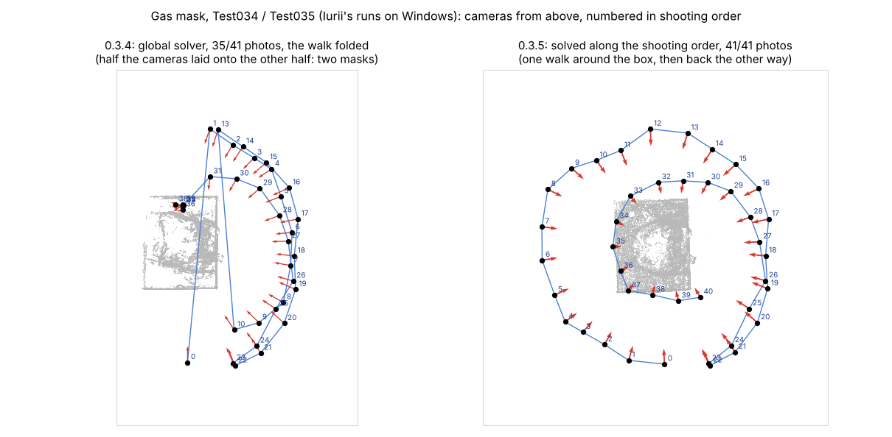

*The gas-mask set from above, cameras numbered in shooting order. Left: the global solve of
0.3.4 laid half of the walk onto the other half, and the cloud held two masks. Right: solved
along the shooting order, one walk around the box and then back the other way, closer.*

1. It turns the cameras using only the photo pairs taken a few shots apart, about 100° of
   walking (COLMAP's rotation averaging); views of opposite sides are never in it. Pairs with
   few matches are left out of this step unless the photos were taken one after the other.
2. It compares every matched pair with those cameras. A pair's own geometry says how much the
   camera turned between its two photos; a pair from look-alike sides says almost nothing when
   the cameras turned by half a circle, so a pair off by more than 57° is left out.
3. It solves again, with both solvers, with every other pair, and keeps the best result.

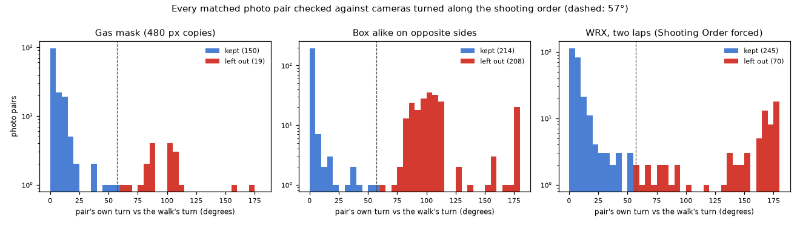

*Step 2 on three photo sets. Most pairs agree with the walk within 20°; the pairs left out (red)
are off by 60° to 180°, mostly pairs that matched one side of the object to the other.*

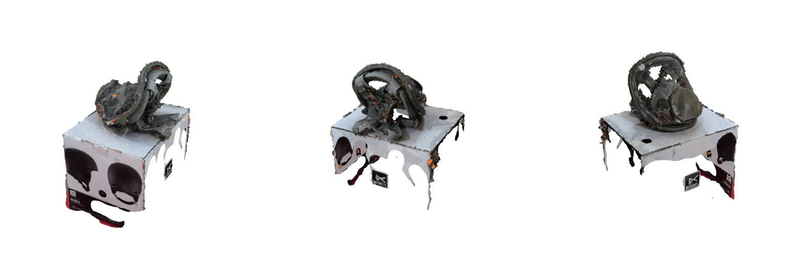

*The gas-mask set (41 phone photos) solved along the shooting order and reconstructed at Normal
on the GTX 1650 Ti laptop: one mask on the box.*

The panel shows how many pairs were left out and gives examples. On the photos tried this
worked through a walk that turns back and on two laps at different distances. The repair is not
used when the cameras cannot be turned reliably from the nearby pairs (on the synthetic scene,
with repeated objects, they cannot; the usual result is kept).

**When the walk still folds: the fold turned back (0.3.11).** The repair above needs the nearby
pairs to hold the whole walk together. On a set of 260 photos of a Mi-8 helicopter, with several
photos taken from each spot (matches made here from 1443 × 1080 copies), they did not: the rotations
placed 126 of the 260 photos and the repair was skipped. Both solvers had laid the starboard side
over the port side. The number "85" and a red star are painted on both sides and read the same way
from either side, so 141 photo pairs matched a port view to a starboard view. Now, when the best
result still folds, the part of the walk between its folds is turned back half a turn about the
vertical, as a guess: a side laid over the opposite side faces the same way as the cameras there,
and half a turn makes it face its own side again. Every photo pair is checked against those cameras
as in step 2, and the pairs that link the turned part with the rest from farther apart in the walk
than the band of step 1 are left out as well: the turned part joins the rest only along the walk.
The rotation check alone cannot judge views that face along the object's plane of symmetry (front
views from either side, whose look-alike rotation is nearly the true one); on the Mi-8 photos 12
such pairs passed it, and the incremental solver then laid 28 starboard photos over the port side
again. With them left out, the global solver placed 256 of the 260 photos and the incremental solver
246, both without a fold and with every port and starboard camera on its own side. **Re-solve From
Cameras** (above) does the same with cameras you turn yourself, for the folds this guess gets wrong.

### Joining two scans: two videos, two days (0.3.13; Complete Joining 0.3.14; video cameras 0.3.15)

Two sources of one object, such as two videos filmed from opposite sides on different days, or a
video and a photo set, are reconstructed each on its own, and each solve comes out in coordinates
of its own (where it stands, how it is turned and how large it is are arbitrary). The two scans
are joined in Blender by **control points**: the same spots marked on both. The joined result is
a scan of its own, which is cropped, aligned and meshed like any other.

1. Reconstruct each source. *Stop to Crop* is enough: the dense clouds are what is joined.
2. Select the scan to move (any object of it) and choose the scan to join it onto under **Onto**
   (box *Join onto another scan*, at the crop stage and under *Align and scale*; with two scans
   in the scene the other one is already chosen).
3. Mark the same spots on both scans, three or more, with the same numbers. Shift+right-click on
   the cloud or mesh puts the 3D cursor on the surface, and **1** to **8** put a point there. A
   point placed on the active scan shows a dot, a point placed on both a tick. Small spots both
   sources show clearly, spread over the object and not on one line, work best. On two sides of a
   helicopter: the nose turret, the front of a nose sensor, the top of the rotor hub, fittings on
   top of the tail boom (a wheel or a door is seen from its own side only).
4. **Join** moves the active scan onto the other: scale, rotation and position, by least squares.
   The panel lists each point's distance after the join. A point lying far off the others (a
   wrong click, or two spots that are not the same) is marked and named in the message: place it
   again and press Join again. Points that lie almost on one line (all of them on the nose and
   the tail boom, say) leave the turn about that line uncertain, and the panel says so: add one
   away from it, such as the top of the rotor hub.
5. **Refine** improves the join where the two clouds overlap (iterative closest points, with
   scale). Pairs of points farther apart than a limit are left out: parts only one scan has, and
   parts that moved between the shoots, such as rotor blades parked at other angles. The control
   points stay in the fit. The scan is moved only when the clouds come clearly closer (their
   median distance down by a quarter at least). Two videos of opposite sides overlap too little
   for that: nearest points there are mostly not the same spots, and the fit would slide without
   bringing the clouds closer. The join by the points is then kept, and the message says so.
6. **Complete Joining** makes one scan of both, as joined: both runs' undistorted photos and
   cameras and both dense clouds, in the coordinates of the scan joined onto. No depth maps are
   computed again. The joined scan comes in at its crop stage, in a collection of its own
   (*first+second*) where the scan joined onto is: one point cloud, the cameras of both sources,
   and a crop box with the axes of that scan's crop box that holds both scans' crop boxes (each
   video's cloud often covers one side only, and either box alone could cut the other side off;
   a scan whose box was deleted adds nothing to it). Where both scans saw the same surface,
   each point of the joined cloud also gets the other scan's photos: without that, OpenMVS's
   meshing could run without end on such a cloud. A source made from a video brings its
   tracked camera along (0.3.15): the joined scan has one for each video
   (`first+second_1_video_camera_<video name>`), moved by the join, so each one shows its own
   footage against the joined scan. The first source's camera becomes the scene camera, and
   the scene's frame range holds both videos. The two scans are hidden; the eye in the Outliner
   shows them again. The run's folder is `<first run>_join_<second run's folder name>`, next to
   the first run.
7. On the joined scan, as on any scan at its crop stage: fit the crop box to the object (move,
   turn and scale it), **Align Ground**, set the scale by the anchors, then **Build Mesh**.
   Mesh, refinement, Even Out Photos, texture and Blend Seams run with the panel's settings, and
   the mesh comes in under the joined scan.

Pressed again with nothing changed, Complete Joining reuses everything and keeps the joined
scan's box and alignment; a new join (points moved, Join, Complete Joining) makes the joined scan
again. It refuses when either scan was moved since the join (aligned to the ground, say, which
moves one scan's points away from the other's): press Join again first. A source solved again
since the join has its cameras elsewhere, so Build Mesh on the joined scan then refuses and asks
for the join to be made again, and so does Track Every Frame on that source's video camera. Re-solve does not apply to a joined scan, which has no camera
solve of its own: re-solve a source, then join again.

Why not automatically: matching features across the two sources was tried on two videos of a
helicopter, one of each side, filmed on different days. The only matches between the videos lay
on parts that look alike from both sides (the rotor head, markings painted on both sides), and
both a joint solve and a fit through those matches laid one side over the other. A symmetric
object fits its own mirror image as well as the truth, so no automatic check tells such a join
from the right one; the points say which side is which (DEVELOPMENT.md, section 4).

What the joined scan keeps from each source: anything that moved between the shoots appears in
both places (each cloud keeps its blades where they were parked), and where the light differed
(overcast and sunny) the texture takes each part from the photos that see it best: Blend Seams
evens out the brightness across the seams, the sunny side's shadows stay. Refinement reads both
runs' photos, so it needs the memory of both: with *Refine Mesh: Auto* a joined run on a computer
with little RAM may skip it (the log says so). Gaussian splats are not trained for a joined run. A
third source is joined onto the joined scan in the same way.

### Gaussian splats

With *Gaussian Splats* on, after texturing Photogram3D trains 3D Gaussian splats with Brush 0.3.0
on the undistorted photos and the solved cameras. Brush runs on the GPU through DirectX 12 or
Vulkan (NVIDIA, AMD or Intel); it is downloaded the first time (159 MB, checked against its
SHA-256). Only the splats inside the crop box are kept, so a new box and Build Mesh crop the
trained splats again without training. The number of splats is capped by the GPU memory (4.3
million on 8 GB, 1.7 million on 4 GB). The result (`splats/splats.ply`, the usual 3DGS layout) is
imported under the scan's root. In Blender 5.2 it shows as a point cloud with the splats'
colours, opacities and sizes (up to 2 million points); Blender 5.3, which reads 3DGS files
itself, is tried first when you run it. The file opens in any splat viewer too. Training time on
a real GPU was not measured here (on this machine's software Vulkan, 2,000 steps at 320 px took
20 minutes).

### Texturing

OpenMVS 2.4.0 has a bug in seam leveling, the step that evens out colour differences where
texture patches from different photos meet. It reads the 8-bit photos as if their pixels were
three 32-bit floats, so it takes its seam colours from the wrong place and as meaningless numbers.
The colour corrections it computes from them are garbage. They paint black and rainbow blotches
over the texture, and near the bottom edge of a large photo the read runs past the end of the
image and TextureMesh crashes. The fix is in OpenMVS's development branch (October 2026) but not
yet in a release.

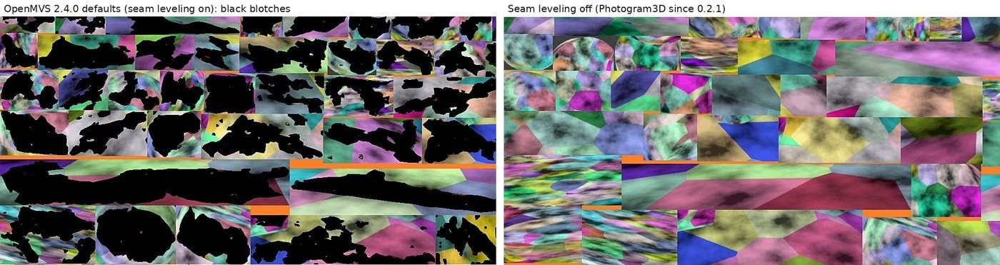

*The synthetic scene's texture atlas with OpenMVS 2.4.0's default settings (left) and with seam
leveling off (right).*

Photogram3D 0.2.1 therefore runs TextureMesh with both seam-leveling passes off. The texture is
then the photos as taken: where neighbouring photos were exposed differently, a patch edge shows
as a step in brightness. A phone sets the exposure of every photo by itself: the 260 photos of a
Mi-8 helicopter were exposed between EV 5.6 and 10.2 (the middle 80% within 2.0 stops), and the
scan's texture showed light and dark patches.

Since 0.3.12, **Blend Seams** evens these steps out after TextureMesh, with the method OpenMVS's
own leveling implements (Waechter, Moehrle and Goesele, *Let There Be Color!*, ECCV 2014): a
smooth correction of brightness and colour over each patch, found for the whole mesh at once so
that both sides of every seam meet. A reflection or a shadow that only one side shows counts
less. The texture TextureMesh made is kept beside the blended one.

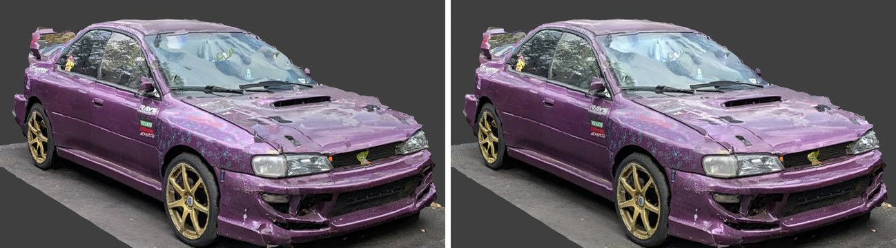

*The WRX scan's texture as TextureMesh made it (left) and with Blend Seams (right), seen through
one of the solved cameras.*

Measured along every edge where two patches meet (brightness on either side, in stops):

| Texture | Median step | 90% of the steps below |
|---|---|---|
| Synthetic scene, every patch exposed differently (0.5 stops) | 0.48 → 0.04 | 1.16 → 0.15 |
| WRX scan (42 photos) | 0.43 → 0.23 | 1.64 → 0.97 |
| Mi-8 helicopter, 260 phone photos (Draft, from 1443 × 1080 copies) | 0.53 → 0.26 | 2.23 → 1.16 |
| The same with *Even Out Photos* on | 0.48 → 0.25 | 2.12 → 1.12 |

On the synthetic scene, blending brought the texture back to within 0.055 stops (median) of the
original from the 0.30 stops of the different exposures. Where nothing was exposed differently,
it changed the texture by 0.026 stops (median): seams that differ because the photos see the
surface a little differently are blended too. Differences that depend on the viewpoint, such as
reflections on glossy paint, are evened at the seams but stay inside the patches. *Even Out
Photos* takes exposure, white balance and vignetting out of the photos themselves before
texturing, so the patches start closer to each other. On the Mi-8 photos it found 3.15 stops
between the darkest and the brightest photo, yet took the median step only from 0.53 to 0.48
stops: what is left there differs with the viewpoint, not with the exposure of a whole photo,
and only the blending reaches it. Locking the exposure while shooting still helps most.

If texturing still fails (for example, out of memory), Photogram3D tries once more with half-size
photos, then keeps the untextured mesh. When a single patch is larger than the chosen *Texture
Size*, OpenMVS stops instead of splitting it. Photogram3D then uses the next texture size that
holds a whole photo (8K for 4624 px photos) and says so in the panel.

## Two test laptops: what runs where

The add-on was tested on two Windows laptops, both with 16 GB of RAM: an AMD Ryzen 9 5900HX with
an NVIDIA GeForce RTX 3070 Laptop GPU (8 GB), and an AMD Ryzen 7 4800H with a GeForce GTX 1650 Ti
(4 GB). **Normal** is the recommended preset on both; Detect Hardware sets it.

- **COLMAP (CUDA build)** runs feature extraction and matching on both GPUs. The GTX 1650 Ti
  (compute 7.5) and the RTX 3070 (8.6) are both covered by its kernels (sm_75 … sm_120). The
  CUDA runtime is linked into colmap.exe, so only the NVIDIA driver is needed; keep it current
  (CUDA 12).
- **OpenMVS:** the official Windows CUDA download contains kernels for compute 8.9 only (RTX 40
  series) and no PTX fallback. Its GPU code cannot run on either laptop. That is why the dense
  step uses the CPU build (8 cores / 16 threads on both machines). This is about that one binary,
  not about these GPUs in general.
- **COLMAP (NVIDIA GPU) depth maps** move the whole depth-map step onto the GPU. COLMAP computes
  every depth map twice (a photometric pass, then a geometric-consistency pass against up to 20
  neighbouring photos), and the panel shows both passes. On the RTX 3070 at Ultra this was
  *slower* than the CPU: 62 min against 46 (see the Windows results below). On the 1650 Ti
  (4 GB), dense images are capped at 2000 px. While it runs, it needs about 250 MB of free disk
  per photo at 3200 px (about 10 GB for 42 photos), freed once the cloud is fused. Single GPU
  steps took up to 3 s in its consistency pass on the RTX 3070 (1.5–2 s in the first pass), and
  Windows did not reset the driver: RTX cards let Windows pause long GPU work, so its 2-second
  limit (TDR) did not stop them. If Windows does report that the display driver stopped
  responding, use smaller images (Normal) or switch back to OpenMVS.
- **OpenMVS + COLMAP (CPU + GPU) depth maps** keep both chips busy in the first pass. On the WRX
  photos at Ultra the CPU did 19 photos and the GPU 23, the first pass took 14.5 min instead of
  27.4 and the whole depth-map step 33 min instead of 46 (the GPU-only path took 62). Next to the
  busy GPU the CPU took 25% longer per photo than alone (the two share the laptop's power and
  cooling); the GPU kept its 33 s per photo. On the 1650 Ti (4 GB), COLMAP's first pass fits up
  to about 3100 px, so Normal and High use both chips and Ultra and Full run on the CPU alone (the
  panel says so). If COLMAP fails, the CPU takes over the photos it had not finished and the run
  carries on.

## Scan Tools panel

- **Polish Surface:** feature-preserving denoising (normal filtering + vertex update, Sun et al.
  2007). *Keep Edges* protects creases. Works on the active mesh with undo.
- **AI Polish:** see below.
- **Set Real Scale:** in Edit Mode select two vertices whose real distance you know (a wheelbase,
  a ruler on the ground) and enter it. The whole reconstruction (mesh + cameras) is scaled.

## AI Polish (local, offline after the first run)

What it does, for the active scan:

1. **Predict normals.** MoGe-2 (Microsoft Research, MIT license) predicts a surface-normal map for
   each undistorted photo (up to *Photos*, default 60, spread over the set). This runs in a separate
   process, so a driver problem cannot take Blender down.
2. **Fuse.** Every vertex is projected into those photos with the solved cameras. Occluded and
   back-facing samples are dropped (z-buffer + back-face test), and the remaining predictions are
   averaged, weighted toward photos that see the surface head-on.
3. **Safety checks.**
   - The network's axis convention is checked against the scan itself. If its normals disagree
     with the scan (median cos < 0.5), nothing is changed.
   - Vertices seen by fewer than 2 photos are left alone, as are vertices where the photos
     disagree with each other or are more than 50° away from the scan.
4. **Polish.** Vertices move so the faces follow the fused normals; *Influence* sets how much
   (0 = no change). Mesh borders stay fixed and UVs are untouched, so the texture still fits.
5. **Review.** The result is added as a **shape key** ("Photogram3D AI"). Drag *Result Mix* to
   compare or blend, then **Apply** or **Discard**.

First use downloads:

- the runtime: ONNX Runtime DirectML 1.24.4 + Pillow, ~32 MB from PyPI, installed into the tools
  folder;
- the model: Small 141 MB (default) or Base 419 MB (in preferences), from the MoGe authors'
  Hugging Face repository.

DirectML runs on any DirectX 12 GPU, so no CUDA or cuDNN download is needed. It asks Windows for
the *high-performance* GPU, which selects the NVIDIA card rather than the integrated Radeon. If
the GPU fails, it falls back to the CPU (or set *AI Device: CPU*).

What to expect:

- AI Polish works best where stereo is noisy but the true surface is smooth or simply curved.
  Car paint, glass-like plastic and weakly textured panels are the target.
- It refines orientation and removes bumps. It cannot create geometry that is missing, and it
  won't recover detail finer than the network sees (about 650–800 px across each photo).
- Single-image networks can be confidently wrong on unusual shapes. The safety checks catch gross
  disagreement, not subtle bias, so compare with the shape key before applying.

## Capture tips

The test photos and videos were taken with a Pixel 7a phone.

- Lock focus and exposure (in Pixel Camera: touch and hold the subject), and keep the zoom
  at 1×.
- Use 70–80% overlap. For a car that means a photo every 8–10° (36–45 per lap), not 14–20°.
  Shoot two or three laps at *different* heights (one at chest height looking slightly down, one
  high looking down 30–40° at the roof and bonnet, one low for the sills and wheels), plus
  close-ups of detail.
- Prefer overcast light. Direct sun and reflections of the sky on glossy paint are what make
  stereo noisy, which is where AI Polish helps, but better light helps more.
- For video, walk slowly (about half a metre per second) and keep the phone steady. *Auto*
  picks the frames; filming in landscape gives each frame more overlap with the next.

## Troubleshooting

- **Logs** (button in the panel) contains one log file per step. When a step fails, the panel says
  where it stopped, quotes the tool's message and says in plain words what it most likely means
  and what to do: a full disk, too little RAM or GPU memory, a missing Windows library, files
  locked by a sync program, a photo or video that cannot be read, photos that share too few
  features, a tool that crashed. The same explanation is written at the end of the step's log.
- **Several copies of the object, spikes:** the camera solve folded. Photos of one side were
  matched to the other side, which is common on symmetric subjects like cars. Photogram3D detects
  this, tries the other solver, then solves along the shooting order and, if the walk still
  folds, turns the folded part back (*Symmetric objects* above); the log says which solver was
  used, how many folds it found and how many photo pairs were left out. A run that folded is
  checked again, and solved again if the check of this version finds the fold and the repairs of
  this version have not been tried on it, the next time you press Reconstruct on it with
  *Resume* on: features and matches are reused, the depth maps, mesh and texture are made again
  for the new cameras (a new scan root; align and crop again). That covers runs made with 0.3.4
  or earlier, runs whose fold the check of 0.3.9 let pass when the frames at the fold were dropped
  (fixed in 0.3.10), and folded runs of 0.3.10 (0.3.11 turns the fold back). If a warning
  remains, it names the photos between which the walk breaks: turn the misplaced cameras there
  the way they should face and use **Re-solve From Cameras**, or select them and use **Re-solve
  Without Selected**, or shoot again: more overlap, and a textured, asymmetric surface under the
  object (a newspaper, a map) that shows in every photo.
- **Many folds reported between photos taken from one spot** (0.3.10): with several photos taken
  from each spot, the check took the small steps between them for the typical step, and every
  walk to the next spot looked like a jump; on photos stored on their side (portrait shots of a
  phone), it also took a horizontal direction for up. Both are fixed in 0.3.11; on the Mi-8
  photos, 2 of the 8 folds reported were real. Solving with only the
  photos taken close together in time is not enough on its own (on the WRX photos it split the
  walk in two, and on the synthetic scene it gave a fold-free model with half its cameras wrong);
  that is why those photos are only used to turn the cameras and judge the pairs, and the final
  solve uses every pair that passes.
- **"Build Mesh would have to compute the cameras again":** a setting the camera solve depends on
  (quality, solver, AI features, photo options) or the photos changed after the crop stage. New
  cameras would move the cloud away from the crop box and your alignment, so Build Mesh stops.
  Set the setting back, or press Reconstruct for a new dense cloud and crop box.
- **"Only 42 3D points per photo":** the photos share few features (dark, plain or shiny
  surfaces). Well matched sets have 150 or more (the WRX 260). Finer features help (*High* or
  *Ultra* detect them at 3200 px instead of Normal's 2400), *AI Features* help with weak texture,
  and a textured background helps most. With so few points OpenMVS also finds no partner photos
  for many photos and computes no depth map for them (24 of 37 on the gas mask), so the cloud has
  holes.
- **Black blotches and rainbow streaks in the texture (0.2.0 and earlier):** a bug in OpenMVS
  2.4.0's seam leveling, not your photos (see *Texturing* above). 0.2.1 turns seam leveling off.
  Press Reconstruct with *Resume* on and only the texturing step runs again.
- **"TextureMesh.exe failed (exit 0xC0000005: access violation)":** the same bug, on large
  photos. 0.2.1 avoids it. If TextureMesh still fails, Photogram3D retries with half-size photos,
  and if that fails too it finishes with the untextured mesh, so *Import Result* always has
  something to import (the panel says which case happened).
- **Light and dark patches in the texture (0.2.1 to 0.3.11):** the photos were exposed
  differently, and with seam leveling off each patch kept its photo's brightness. 0.3.12 blends
  the seams (*Blend Seams*, on). For a finished run, press Build Mesh (Reconstruct, for a run
  made without the crop stage) with *Resume* on: only the blending runs. With *Even Out Photos*
  on as well, the photos are evened out and the texture is made again from them (in an Ultra run
  of 260 photos the texture took 40 minutes; the depth maps, which turning it on redid before
  0.3.12, four hours).
- **Two point clouds, and photos loaded twice (`IMG_1.jpg.001`), after a run was solved again
  (0.3.11):** the earlier solve's scan stayed in the scene and each import loaded the photos
  again. 0.3.12 takes the earlier scan out (a mesh made from it stays, hidden, in its collection
  marked *(earlier solve)*) and reuses the photos already loaded; delete the extra cloud of an
  earlier import by hand. Solving the cameras again needs new depth maps, so it takes as long as
  the first run from the depth maps on; only features and matches are reused.
- **Texture looks wrong in Blender but the texture files look right (0.2.1 and earlier):** the
  .blend still held images from an earlier import of the same project. Blender's OBJ importer
  reuses an image already loaded from the same path and keeps its old pixels, so the new UVs
  showed the previous run's atlas. 0.2.2 loads the texture pages fresh for every import. In a
  file imported with an older version, save and reopen the .blend (images are re-read from
  disk), or reload each `scene_textured_material_*` image in the Image Editor (Alt+R).
- **The dense step crashes (0xC0000005) as soon as it starts, in a project that already had depth
  maps (0.3.0 and earlier):** DensifyPointCloud, and COLMAP's GPU depth maps too, reuse every
  depth map they find in the project folder, whatever resolution made it. Switching *Quality*
  between High and Ultra keeps the camera solve, so the old maps stayed and were loaded into a
  run at another size. 0.3.1 deletes depth maps made with other settings before the step runs.
  With 0.3.0, delete `mvs\depth*.dmap` in the output folder first, or use a new output folder.
- **Output folder in Google Drive, OneDrive or Dropbox:** OpenMVS writes one depth map per photo
  (about 150 MB each at Ultra's 3200 px) and replaces each one twice, at the end of its two
  consistency passes. It does not check whether the delete and rename worked, so a file the
  sync client has open at that moment silently keeps an older map or loses it. Pause syncing for
  the run, or choose a local output folder. If a sync client holds files Photogram3D itself has to
  delete, the step stops with a message saying so.
- **A moved project starts over or does not import (0.3.1 and earlier):** the project remembered
  its camera solve by absolute path (`colmap\sparse\chosen.txt`), and `photogram3d_result.json`
  holds absolute paths. After a move, Reconstruct solved the cameras again and redid every later
  step, which empties the `mvs` folder with the finished mesh, and Import Result did not find the
  mesh. 0.3.2 stores the solve relative to the project, re-roots the old absolute form, and reads
  the result file relative to the folder it is in. If a .blend shows pink textures after the
  move, use *File › External Data › Find Missing Files* on the new `mvs` folder.
- **CPU + GPU: "COLMAP stopped early":** the GPU half failed (for example, a driver reset or no
  memory left on the GPU). OpenMVS computes the photos COLMAP had not finished, so the cloud is
  complete. The reason is in `NN_densify_gpu.log` in the Logs folder.
- **A part of the object missing from the dense cloud, though the cameras saw it (0.3.13 and
  earlier):** a part at the edge of the frames, such as a helicopter's tail on a video filmed
  along the cockpit, fell outside the region OpenMVS guessed from where the cameras aim, and the
  cloud was trimmed to that region. *Dense Region: Full* (the default since 0.3.14) keeps it;
  Resume makes the cloud again.
- **Switching *Depth Maps* in the same output folder** reruns the dense step and everything
  after it, which replaces the finished mesh and its textures in the `mvs` folder. To compare
  options, use a new output folder for each (the camera solve takes about 1.5 min), or pack the
  textures into the .blend first (*File › External Data › Pack Resources*).
- **Few images registered:** add overlap, or enable *AI Features*.
- **CPU + GPU used no GPU maps ("0 on the GPU", 0.3.3 and earlier):** COLMAP and OpenMVS rounded
  the depth-map size of some photos differently. The gas mask photos undistort to 2401 × 3200; at
  1600 px COLMAP made 1201 × 1600 maps (1200.5 rounded up) and OpenMVS expects 1200 × 1600
  (rounded to even), so every GPU map was rejected. 0.3.4 picks the nearest size both tools agree
  on (1599 px there) and says so in the log.
- **Out of memory:** use Draft, lower Max Faces or Texture Size, and close other programs.
- **Paths:** COLMAP and OpenMVS can fail on folders with non-Latin characters. Photogram3D warns
  about this when you press Reconstruct.
- **Using your own builds:** set paths to colmap.exe, the OpenMVS folder or ffmpeg.exe in the
  add-on preferences.

## What has been tested

Development environment: Linux, 2 CPU cores, 7.8 GB RAM, no GPU. It ran Blender 5.2.2 (as a Python
module) with COLMAP 4.2.1 and OpenMVS 2.4.0 built from their release tags without CUDA.

**Full pipeline on a synthetic scene with known geometry.** The input was 50 rendered photos
(960×720) of a textured, car-sized object (4.8 m diagonal) from three camera rings.

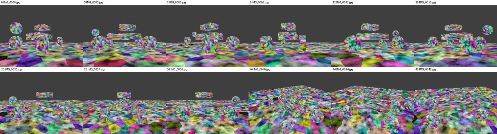

| Check | Result |
|---|---|
| Cameras | 44 of 50 kept. 6 weakly connected images were dropped automatically. All kept cameras are within 2.2 mm of the truth (median 0.8 mm), view directions within 0.05°, up axis within 0.4° |
| Final mesh | 801k faces, textured, imported with its cameras |
| Distance to the true surface | median 0.5 mm, 90% 2.6 mm |
| Surface-normal error | median 1.25° |
| Completeness | 83% of the true surface within 1 cm |
| Time | about 40 min on 2 slow cores, 31 min of it in depth maps |

**Findings that changed the add-on:**

- **Mis-registered cameras.** The global solver placed 4 of 50 cameras wrongly (up to 1.1 m off)
  on this deliberately symmetric, repetitive object; the incremental solver placed 8 wrongly. The
  bad images share far fewer 3D points with the rest, so images below 30% of the median are now
  dropped before the dense steps (never more than 20% of the set). The incremental solver's
  mistakes fold the walk back on itself, which the path check now catches; *Auto* then switches
  to the cleaned global result (44 cameras, all within 2.2 mm). In a second run with freshly
  computed matches both solvers folded at first; after cleaning, the global result was
  consistent and was chosen (44 cameras: 43 correct, median error 0.8 mm; one 0.66 m off).
- **No focal-length calibration step.** COLMAP suggests `view_graph_calibrator` for frames without
  EXIF focal length. Here it estimated a focal length 67% too long and the solve collapsed. Without
  it, the global solver refined the default guess to within 0.1%, so it is not used.
- **Refinement depends on image size.** RefineMesh at OpenMVS's 640 px floor (with its automatic
  pre-decimation) left 124k faces at 0.93 mm, against 0.53 mm without refinement. The refinement
  resolution now follows image size and RAM, and *Auto* skips it below 1000 px.

**Real photos: the Subaru WRX set (42 Pixel 7a photos, two laps).**

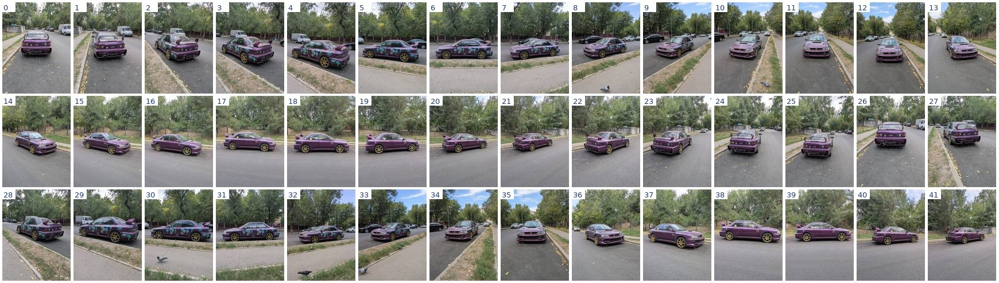

The first Windows run used the global solver. It folded the two laps onto each other (5
impossible jumps between shots taken 4 s apart), producing three copies of the car and spikes.
On the same COLMAP database, the new step detects the fold and switches to the incremental
solver: all 42 photos placed, 0 folds, 4,817 points, reprojection error 1.12 px (folded solve:
1.45 px, which shows that the error figure alone does not reveal a fold). Matching only
neighbouring shots was also tried; on this set it split the walk in two (and on the synthetic
scene it gave a fold-free model with half its cameras wrong), so it is not used.

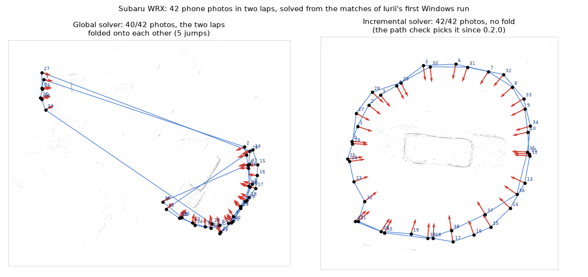

The 0.2.0 run on Windows (5900HX, HIGH, full-resolution 3472×4624 photos) then went through
without a fold: *Auto* chose the incremental solver, 42 of 42 photos, 11,013 points; depth maps
at 1922×2560 in 28.5 min; a 4.0M-face mesh; refinement to 757k faces in 8.4 min (peak 7.8 GB).
TextureMesh crashed with an access violation right after choosing the views (41,195 patches).

The same photos reduced to 1080 × 1438, run on the development machine with 0.3.7 on the CPU at
Normal: 41 of 42 photos placed with no fold, the mesh built in a crop box around the car, 44,746
faces with one 2048 px texture, 32 minutes on 2 cores (details in
[section 3 of DEVELOPMENT.md](DEVELOPMENT.md#3-folded-camera-solves-the-path-check)).

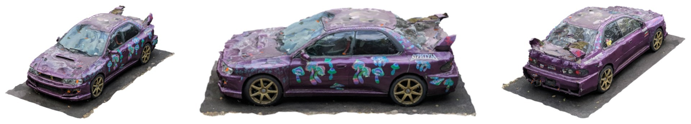

**Texturing: the OpenMVS 2.4.0 seam-leveling bug.** On the synthetic scene with OpenMVS's
default settings, 10–13% of the textured texels came out pure black at 960×720, and 42.5% when
the same photos were scaled to 16 MP (with red, green and blue blobs as well). With seam leveling
off, no texel was black at either size, and at 16 MP building the atlas took 15 s instead of
2 min 43 s. Under Valgrind, seam leveling read memory outside the photos (`TImage::sample`
passes the colour type as the pixel type); with it off there were no invalid reads. The black
and rainbow blotches in the first WRX texture had the same cause, not the fold. The fix is one
line in OpenMVS's development branch (commit `610562a`, 14 October 2026). Retries, the
untextured fallback and an undersized *Texture Size* were tested with a TextureMesh wrapper
that crashes on demand and with OpenMVS's own "patch does not fit" stop, including
Windows-style output where only the log file can be read. The UVs were checked by rendering an
imported four-page atlas through three reconstructed cameras with the texture as emission: the
renders match the photos (mean difference 3 of 255 levels, correlation 0.99; 57 levels against
a different photo).

**Crop box, ground and scale (0.3.0), on the synthetic scene.** Reconstruct stopped after the
dense cloud (430k points) and imported the cloud, 44 cameras and a box around 98% of the points.
Rendered through two of the cameras, the cloud matched the photos (luminance correlation 0.90 and
0.94). With the box turned 30° and shrunk to 44% of the cloud, Build Mesh reused every earlier
step and meshed only inside it: every mesh vertex was inside the turned box and the mesh filled
it, which confirms how the box is written for OpenMVS. The final mesh joined the same collection
without a second set of cameras. Ground markers on three floor points put the floor at Z = 0
(median 1.3 mm, spread 3 mm, on a scene about 6 m across) with the cameras above it. Anchors on
two camera centres, set to their true distance, made every camera-to-camera distance match the
ground truth (median error 0.5 mm, largest 2.2 mm). A new import into an empty file arrived with
the same alignment and scale.

A box rebuilt from the saved file (a new session) differs from it in the last digits, because
Blender keeps object matrices in 32-bit floats; so did 19 of 20 random boxes read back after a
root transform like Align Ground or Set Scale. Written as is, that would have changed the meshing
step's signature and rebuilt the mesh for nothing. Build Mesh now keeps the saved box when the
difference is only round-off; a real move is written. The box is read from its eight corners, so
applying its transform (Ctrl+A), which moves the shape into the mesh, leaves it where it was;
Reset Box restores the cube as well.

**Ultra's finer refinement, on the synthetic scene.** RefineMesh with faces up to 16 square
pixels instead of 32 left 272k faces instead of 124k (105k instead of 46k on the object), in the
same time (6 min 21 s against 6 min 55 s) and with 4% more peak memory. The surface error
did not change (median 0.97 mm against 0.93 mm), but these 960 px photos are refined at
OpenMVS's 640 px floor, where refinement already costs accuracy (0.53 mm unrefined). Whether the
finer faces show more detail on 16 MP photos has not been measured.

**GPU depth maps (0.3.1), with a stand-in for CUDA.** COLMAP's patch_match_stereo needs CUDA,
so it was replaced by a stand-in that writes, in COLMAP's file format and with its log lines,
depth and normal maps converted from OpenMVS's depth maps of the same photos. Everything after it
ran for real: InterfaceCOLMAP converted the 44 maps while importing the scene, DensifyPointCloud
fused them without estimating any on the CPU (430k points in 5 s), and the crop stage, meshing in
the box and texturing followed. The mesh was the same as the CPU path's mesh from the same depth
maps (115k vertices, median 0.59 mm from the true surface), and a second Build Mesh reused the GPU
step. The first version fused with COLMAP's own stereo_fusion. From the same depth maps it kept
167k points at a median 1.9 mm, against OpenMVS's 430k at 0.8 mm (every point's view list was
correct in both), so OpenMVS now does the fusion.

**CPU + GPU depth maps (0.3.2), with the same stand-in.** The stand-in served OpenMVS's own
first-pass maps of the test scene, 5 s per photo, next to the real DensifyPointCloud.

- *Splitting the step is harmless.* With OpenMVS alone, the CPU path's single run and the
  split used here (a first run stopped as its consistency pass starts, then a second run) gave
  the same cloud: 429,843 and 430,335 points, median distance to the true surface 0.770 and
  0.771 mm, 90% within 4.69 and 4.73 mm. Two runs of the CPU path differ by as much. A first
  run told to skip the consistency passes instead (`--geometric-iters 0`) keeps fewer weak
  matches for them to refine and was slightly worse (0.778 mm, 4.76 mm), so it is not used.
- *Sharing.* OpenMVS took 18 of the 44 photos and the stand-in 26, and no photo was done
  twice. OpenMVS's first run was stopped at the first line of its consistency pass, and the
  second run refined and fused all 44 photos (88 refinements, as in the CPU path). No
  placeholder, map or temporary scene was left behind, and the progress bar only moved forward.
  The cloud matched the CPU path's: 435,745 points, median 0.775 mm, 90% within 4.71 mm.
- *Build Mesh in the box* reused every earlier step. The mesh was as accurate as the CPU path's
  (median 0.587 mm against 0.588, 90% within 4.86 mm against 4.90).
- *Cancel and resume.* Cancelled after 16 photos (7 on the CPU, 9 on the GPU), Reconstruct
  kept those maps and computed only the other 28 (11 and 17), with the same cloud (median
  0.769 mm, 90% within 4.73 mm).
- *COLMAP failing.* The stand-in crashed (exit code 3) as it started its fourth photo. The step
  said so in the panel, OpenMVS took the other 40 photos, the three finished GPU maps were
  used, and the photo COLMAP had claimed was computed on the CPU in the second run.
- *Unfiltered GPU maps.* COLMAP's first pass leaves a guess at every pixel, right or wrong. The
  stand-in filled the pixels its source maps left empty (36% on average) with random depths and
  normals and did 34 of the 44 photos. OpenMVS's consistency passes removed the guesses: the
  cloud matched the CPU path's (435,087 points, median 0.771 mm, 90% within 4.75 mm).
- *Real logs.* The lines both tools printed in the Windows runs on the WRX photos (COLMAP 4.2.1
  and OpenMVS 2.4.0) were replayed through the sharing code: all 42 photos were recognised in
  both, claimed for the right tool, and the start of the first consistency pass was caught at
  its first line. This caught a bug before release: COLMAP 4.2.1 frames the line as
  `=== Processing view 1 / 42 for NAME ===`, and the trailing `===` had become part of the
  photo name, so no photo would have been recognised as the GPU's.

**Two scans joined by points (0.3.13, 0.3.14).** The synthetic scene's run against a copy of it
put in other coordinates (scale 0.6, turned 70° about a slanted axis, moved), as a second source's
solve would come out. Five points marked on both scans, each click up to 0.5% of the scan's size off:
**Join** brought the same points within 0.29% of the size of each other, and **Refine** within
0.014% (7 iterations, 94% of the points kept). With the scans sharing a fifth of the object, the
points marked there: 0.18%, then 0.023%. A point marked on another spot was named. Fewer than three
points, or three on one line, are refused, and so are a scan scaled unevenly by hand and a scan
moved since the join. For joining into one scan the test uses two real sources since 0.3.14: the
run's photos split into the even and the odd ones, each half with its own dense cloud, the odd
half in other coordinates. With each half's crop box around a different end of the object,
**Complete Joining** brought in one scan with the 368,341 points and the 44 cameras of both and a
box holding both ends (the whole object), and **Build Mesh** on it took 38 s for the mesh and 65 s
for the texture here; the mesh came in where the first scan is, on the two clouds (median 0.025%
of the size), from one end of the object to the other. Pressed again, both reused every step. In
the run's own crop box the joined mesh lay on the mesh the run had made from all its photos
(median 0.084%, 90% 0.135% of the size).

**Two videos of a helicopter, one of each side (0.3.13).** An AW-249 filmed along its starboard
side under an overcast sky (22 s) and along its port side in sunshine (17 s), its rotor blades
parked at other angles. Reconstructed at Normal with Auto frames and *Stop to Crop*: 32 of 33
frames placed and 342,585 dense points, and 30 of 30 and 276,903. Five spots marked on both (the
nose turret, the front of the lower nose sensor, the top of the rotor hub, two fittings on top of
the tail boom): after Join they were 0.23–0.33% of the scan's size apart, the rotor hub 0.93% (a
parked blade crosses it in the second video), and the two videos' cameras were on opposite sides
(166° apart, against 40° when the videos were matched automatically). Refine kept that join: the
clouds of two sides came no closer (0.740% → 0.757%, median), in 16 s. Build Joined Mesh inside a
box drawn around the helicopter on the joined clouds took 5 minutes here (62 photos, 619,488
points; 621,526 faces), and Blend Seams took the steps across the texture seams, many of them
between overcast and sunny photos, from 0.30 to 0.04 stops (median). The joined mesh left 8.4% of
its surface without a photo, against 15.7% for the second video alone in the same box. This test
found three faults,
fixed before release: a right point named as misplaced when the others lie nearly on one line,
Refine sliding the join away from the points, and Refine taking 330 s (DEVELOPMENT.md, section 4).

**The helicopter's tail, and Complete Joining (0.3.14).** The second AW-249 video looks along the
cockpit, with the tail far off at the edge of the frames. Its dense cloud of 0.3.13 ended before
the tail: OpenMVS's own region of interest (now *Dense Region: Automatic*) trimmed 60,277 of the
337,180 points, and beyond the last fitting on the tail boom none was left, though COLMAP had
placed about 450 points there. With *Full* the same camera solve gave 334,083 points, 11,134 of
them beyond that fitting (the tail boom, the fin and the tail rotor), in 20 minutes against 25.
Both videos were then reconstructed again with 0.3.14 (362,098 and 327,023 points; the first
video's region had trimmed 14,143) and joined as a user would: five points, Join (0.196% of the
scan's size apart), Refine (kept the join: two sides), then **Complete Joining**. The joined scan
came in at its crop stage in a collection of its own (*1+2*), with one cloud of 689,121 points
and the 62 cameras of both videos, and both videos' scans were hidden. The box drawn around the
helicopter for 0.3.13 ended far short of the tail now in the cloud, so it was lengthened to the
tail's end; Build Mesh then took 7 minutes here (mesh 43 s, texture 353 s, Blend Seams 23 s:
steps across the seams 0.28 → 0.04 stops, median), 713,470 faces.

**The joined scan's video cameras (0.3.15).** The synthetic video's run joined with a copy of
itself in other coordinates (scale 0.6, turned 70°, moved), each with a camera track on every
frame: the joined scan got a tracked camera for each video, and on every frame tested the second
one, moved by the join, was where the first one was (7·10−8 of the scene's size
apart), both on the photo cameras of their frames. Track Every Frame on the second camera kept
that, and the scene's frame range held both videos. The AW-249 scan joined with 0.3.14, which had
no video camera, got both from **Add Video Cameras** (`1+2_1_video_camera_1` and `_2`, keyed on
the 32 and 30 frames each video's run solved), each on the joined scan's photo cameras of its
frames and with its video behind it.

**A fold against missing photos (0.3.13, 0.3.14).** COLMAP's global solver draws at random. On
the Mi-8 photos its solve with the fold turned back placed 256 or 257 photos without a fold in the
tests of 0.3.12, and twice 258 in those of 0.3.13, with five photos off the walk: the path check
found the fold, but counted as ten missing photos it still outscored the incremental solve (246
photos, no fold), which the camera step then passed over with a warning. In 0.3.13 a fold counted
as a tenth of the photos placed in sets of more than 100 (26 here), and the solve without the fold
was used. A video of the AW-249 (69 frames) in a test of 0.3.13 showed a tenth to be too little:
every solve folded once, 11 frames laid over the other side, and with those turned back 58 frames
were placed without a fold, which lost to the folded 69 (59 against 58). Since 0.3.14 a fold
counts as a fifth of the photos placed in sets of more than 50 (14 for the video, 52 for the Mi-8
set), and the solves without the fold are used.

**A run solved again, imported again (0.3.12).** The crop stages of three solves of one run of
the synthetic scene, with another run of the same photos beside them. The second solve's import
took the first solve's scan out (its cloud, 44 cameras, crop box and a marker), loaded none of the
44 photos twice, and read again the three the run had rewritten. The final import of the second
solve joined its scan. The third solve's import kept the second solve's mesh, hidden, in its
collection marked *(earlier solve)*, and took the rest out. The other run was never touched.

**Even Out Photos after the depth maps (0.3.12).** On the synthetic photos with their own
exposure, white balance and vignetting, the undistorted photos the depth maps read kept their
shading (exposure spread 0.25 in log units, corners at 0.67–0.82 of the centre), and the
evened-out copies made from them for the texture had none left (spread 0.000–0.004, corners at
1.00–1.01). The steps of a run with it on end with *mesh, even, texture, blend, finish*.

**Blend Seams (0.3.12).** The figures are in *Texturing* above. The step keeps TextureMesh's pages
and .mtl unchanged beside the blended ones, is skipped by *Resume*, puts TextureMesh's texture back
when turned off and blends again when turned back on. A blend that fails (here, a texture page
that could not be read) leaves the texture as TextureMesh made it, with a warning. A new texture
removes the blended pages. On this machine (two cores, with other work running), the WRX texture
(44,746 faces, one 2048 px page) took 4 s, a synthetic texture of 801,449 faces (one 4096 px page)
60 s with at most 0.6 GB of memory, and one of Ultra's size (4.8 million faces, six 8192 px
pages) 7 minutes with at most 1.7 GB. The Mi-8 photos at Draft (299,597 faces, one 4096 px page)
took 18 s; turning *Even Out Photos* on for that finished run then redid only the evening (146 s),
the texture (304 s) and the blending (16 s).

**The GAZ-66 walk that 0.3.9 folded (0.3.10).** A 60 s walk round a GAZ-66 came out as two
trucks with 0.3.9 (60 frames, AI Features); 0.3.8 had solved it right (31 frames). The 0.3.9
cameras, read from the scene of that run, fold between frames 029369 and 029729, where five frames had been
dropped as weakly connected: a step of 17.9 median steps across six shots and a backward turn of
138° round the truck. The check of 0.3.9 divided the step by the six shots (3.0, under its
threshold of 5) and skipped the turn check, because the walk's net turn was only 70°. The new
check finds the fold both ways (the step's allowance is now 15, and the turn is measured the way
most steps turn), and the 0.3.8 cameras of the same walk still pass. The 60 frames of that run
were given features and matches as in that run (ALIKED at 1600 px with Photogram3D's runner,
LightGlue on all 1,770 pairs, 1,662 of them verified) and solved again. The global solve folded
again, with four of the same frames at the fold dropped; the check found three folds, one of them
across the dropped frames, which the check of 0.3.9 missed. The incremental solve placed all 60
frames and turned 309° round the truck without a backward step, as the right 0.3.8 solve had, and
it was used. (On this database the global solve also broke at two more places, which 0.3.9's
check would have caught: COLMAP's solves change with small differences in the matches.) A 0.3.9
run continued with *Resume*, with those folded cameras as its solve, was found folded and solved
again: 60 of 60 frames, no fold.

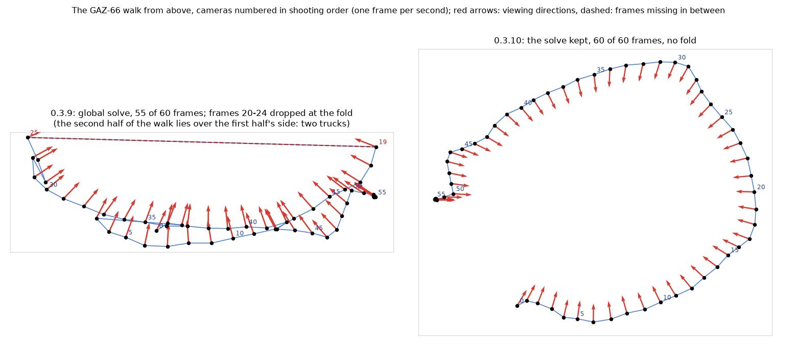

*The GAZ-66 walk from above, cameras only, numbered in shooting order. Left: the 0.3.9 solve
of that run; the frames after the dropped ones (dashed) lie over the side the first frames saw.
Right: the same 60 frames solved by 0.3.10.*

**The path check on made-up walks (0.3.10).** Cameras on a circle round an object, one shot per
6°: the GAZ-66 fold with its own numbers was found, by the old check not; a mirror-image fold was
found at its junction; right walks passed with a block of 10 or 20 shots missing, a pause of 10
shots, a stretch walked back and forth, two laps, half a lap and a walk along a wall. The 92
solved models of the test runs gave the same verdict as with 0.3.9, except one partial
incremental model of the gas mask (24 of 41 photos, never the chosen one), now found folded.

**The Mi-8 photos that 0.3.10 folded (0.3.11).** 260 phone photos of a Mi-8 helicopter, one
walk round it with several photos from most spots, stored on their side (EXIF orientation 6),
solved with Ultra on Windows by 0.3.10: it used an incremental solve of 237 photos with the
starboard side laid over the port side, and warned of 8 folds. Its cameras, read from the scene of
that run, fold in 2 places (between 173752 and 173802, and between 174402 and 174429); the other 6
were steps to the next spot, taken for jumps because half of all steps were the few centimetres
between photos from one spot (median of all steps 0.21, of the steps between spots 0.41). The
0.3.11 check finds just the 2. Matches made again here from 1443 × 1080 copies (SIFT, 2,426
verified pairs, 141 of them port to starboard) folded the same way: 0.3.10's camera step chose an
incremental solve of 233 photos with the port and starboard cameras looking the same way (30°
apart, against 149° in a right solve), and its solve along the shooting order was skipped (the
nearby pairs turned only 126 of the 260 cameras). 0.3.11's camera step turned 85 cameras back,
left out 151 pairs that disagreed with them (129 port to starboard) and 14 far links (12 port to
starboard), and used a global solve of 256 photos without a fold, every port and starboard
camera on its own side; the incremental solve beside it (246 photos) agreed. A 0.3.10 run of
those matches continued with *Resume* was solved again the same way, and continued once more was
left as it was (`test_mapping_mi8.py`).

**Re-solve From Cameras (0.3.11)** on the box printed alike on opposite sides (40 rendered
photos, true cameras known): the 20 cameras of the global solver's fold, turned by 200° about the
vertical (half a turn and 20° off) and moved round the box, as a hand might. The new run left
out 208 pairs that disagreed with them and 1 far link, and both solvers placed 40 of 40 photos
without a fold; the incremental solve used was within 3.0 mm of the true cameras (median 1.4 mm),
and turned by 170° instead, median 1.5 mm. In Blender, on the WRX photos stored on their side, the
cameras read back match the solve within 0.02°, and six cameras turned with *R Z 180* were
exactly the six the new run's guide lists as turned.

**The path check on made-up walks, again (0.3.11).** A walk of 100 shots with 1 to 4 shots from
each spot: right, it passes (0.3.10 reported 39 folds); folded, it is found at the junction. A
WRX solve of 21 photos with its last 7 cameras turned 175° is still found, by the turn at the
fold. The 126 solved models of the test runs gave the same verdict as with 0.3.10, except 12
right solves of the Mi-8 photos (two of them one side each), which 0.3.10 flagged with 1 to 16
folds, by the steps from one spot and the horizontal "up". In an earlier run it also flagged a
right solve of the WRX photos stored on their side (all 42 cameras within 1.5% of the ring's size
of the right WRX solve), by the horizontal "up".

**A bent global solve (0.3.10).** The rendered walk below failed once on its camera solve: the
global solver's result changes with the random draws of COLMAP's match check, and three
databases made from the same 21 frames gave a right solve (2 mm off the true cameras), a folded
one (6.6 m off, which the path check caught) and one bent by up to 1.3 m along the walk, with no
jump or backward turn to see (6,624 points, 0.59 px reprojection error). The incremental solver
was right on each (3 mm, about 7,610 points, 0.29 px). For a video of up to 300 frames both
solvers now run and the better solve is kept; on the rerun the global solve dropped three frames
in a row and the incremental solve, 21 of 21, was used. In the 0.3.11 tests a fourth database
gave a global solve bent by up to 1.4 m that had more points than the right incremental one
(7,936 against 7,670), and the scan of the solve kept sat 65 px off the footage. It had fewer
observations (31,152 against 32,344) and a higher reprojection error (0.55 against 0.30 px), so
solves that place as many photos are now compared by their observations first; over the solves
of all the test runs that changed the choice for this walk only.

**Test AI Speed when a part fails (0.3.10),** with stand-ins, since there is no Windows here.
A pip that installed an ONNX Runtime crashing while loading (a segmentation fault in place of
the laptop's access violation): the setup said "loading onnxruntime failed", Python's
faulthandler put the stack of the crash in the log, and the next candidate was installed; when
none loaded, the setup stopped with that reason and left nothing behind. Without the runner, the
test timed the CPU with COLMAP itself (about a second per photo at 480 px and per pair here),
showed DirectML as not working with the reason, and suggested the CPU. A runner whose GPU test
aborted after one photo size had worked was tried once more at that size and shown as crashed,
and the CPU was still timed by the runner. A runtime without DirectML (the setup's last resort)
is shown as such on Windows. NVIDIA's real NVRTC package was added to an install made the 0.3.9
way: 76 MB downloaded and checked, 2 DLLs (97 MB) unpacked next to cuDNN, nothing else
downloaded. In NVIDIA's cuDNN 9.27 for Windows, `cudnn_graph64_9.dll` loads `nvrtc64_%d_0.dll`
and otherwise reports "Could not open libnvrtc for runtime linking".

**The camera track's second round (0.3.10).** The rendered walk below, tracked from only its
first three solved frames (every second frame): the first round placed 166 of 253 frames, and
the second placed the other 87 from the points of the 48 placed frames next to them, in 8 s;
the second round of 0.3.9 (points from all 166 placed frames, adjusted over all of them) took
26 s for the same frames. The scan sat as far from the footage either way: median 0.90 px against
0.92 px, at most 3.7 px at the far end of the walk, which only chains of frames anchor here. In
the GAZ-66 run of 0.3.9 that second round took 11 of the track's 26 minutes, for 91 frames.
All 52 test scripts passed on the 0.3.12 code.

**Upright cameras for portrait photos (0.3.9).** The 42 WRX photos (portrait, stored upright)
were stored the way a phone stores a portrait shot, turned a quarter left and tagged with EXIF
orientation 6, five turned the other way and tagged 8, one tagged 3 and two left as stored.
COLMAP's database gave every photo its turn (34 photos 3 quarter turns, 5 one, 1 two). For every
imported camera, the solved points seen through it (Blender's own projection,
`world_to_camera_view`, on the camera's frame) fell where COLMAP's projection puts them on the
photo turned upright, within 0.001 px (single precision), and 1.08 px from the photo's own
feature points (median). The turned cameras of the upright photos had world up at the top of
their frame (the up component of their up axis at least 0.966); with COLMAP's own alignment that
component was about 0, the scene lay on its side. The alignment without the photos' turns
reproduced COLMAP's own to 4e-07. **Turn Cameras Upright** on cameras imported the 0.3.8 way gave
the same cameras as a new import (to 8e-07), and pressed again it changed nothing. The scene's
frame followed the scene camera, portrait and landscape.

**A camera on every frame of a video (0.3.9).** A walk round a car-sized object was rendered as a
hand-held video: 20 s at 25 fps (500 frames, 960×540), 150° round the object with a walking
bounce and hand shake, the true camera recorded for every frame, and the video stream starting
0.1 s after the container's zero, as when an audio track starts first. The reconstruction kept
one frame per second (*Per Second*: 21 frames, about as far apart as Auto keeps them on a walk).
Through the compositor, Blender showed video frame n at scene frame n + 1 counted from the video
stream's start, with and without the 0.1 s offset; the frames were named and keyed that way (up
to 0.3.8 the offset would have shifted them by 3 frames). The track placed 500 of 500 frames and
kept the 21 solved frames exactly where they were. How far the scan sat from the footage was
measured with points on the object, their true picture positions against the same points through
the tracked camera: median 0.35 px, 95% within 0.46 px, at most 0.48 px. The same camera keyed
only on the solved frames, interpolated by Blender in between as up to 0.3.8, was off by 10.0 px
(median), 18.8 px (95%) and up to 26.0 px: the drift. On this machine's two cores without a GPU
the track took 357 s for 500 frames (features and matching most of it, both of which run on the
GPU on Windows with an NVIDIA GPU); *Every 2nd Frame* placed 264 frames in 184 s, and **Track
Every Frame** keyed an imported camera that had keys on the solved frames only.

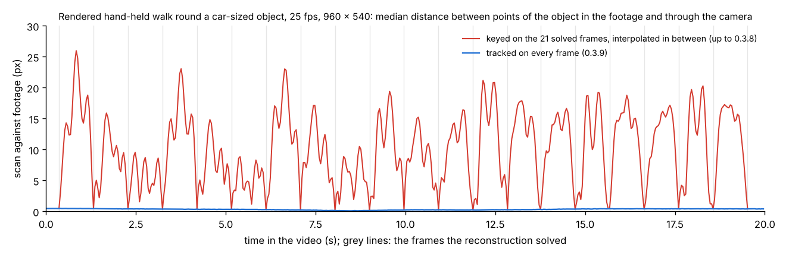

*The rendered hand-held walk: points of the object in the footage against the same points
through the tracked camera. Keyed on the solved frames only (red), the scan meets the footage at
each solved frame (grey lines) and drifts away between them; tracked on every frame (blue), it
stays within half a pixel.*

**Auto on real walks round vehicles (0.3.9),** from the logs of five phone videos (35 to 77 s of
walking round a GAZ-66, a GAZ-63, a UAZ-469, a UAZ-3303 and a tank). Four ended at Auto's floor
of one frame every 2 s or its minimum of 30 frames (31 frames for 60.5 s, 31 for 48.5 s, 30 for
35.3 s, 37 for 71.7 s). In each of them the global solve folded the walk, and in the end 31 of
31, 25 of 31, 27 of 30 (still with a fold) and 35 of 37 frames were placed. The GAZ-63 walk got
152 frames for 76.5 s and solved cleanly (150 of 152, about 113,000 points). On the rendered walk
above, the whole picture's shift measured 0.64 of the rate at which the view turned, since the
object in the middle of the frame hardly moves; the 75th percentile of nine overlapping half-size
parts measured 0.91. On pans of a texture the measure stayed exact from 0.3 to 2.4 frames per
second (a part resolves shifts up to half its size, so on fast pans the whole picture's larger
shift is taken). Auto now uses the parts and keeps at least one frame per second. On the test
pans it kept 34 frames instead of 30: 1.0 s apart while the camera stood still, 12% of the frame
apart in the fast stretch, and closer in the slow ones, where one frame per second gives more.

**AI Features on the GPU of any make (0.3.9),** with ONNX Runtime's CPU provider in place of
DirectML: the DirectML build exists for Windows only, and there is no GPU here, so the runner ran
the same code with another provider. On five WRX photos at 640 px (one stored on its side with an
EXIF orientation, one with spaces in its name) the runner's ALIKED keypoints agreed with COLMAP's
own (98.7% within 1 px, 98.9% on the photo stored on its side; descriptors with a cosine of at
least 0.99998), its LightGlue matches with COLMAP's (4,163 against 4,146), and after COLMAP's
geometric check so did the inliers (3,965 against 3,945). Through the pipeline, 14 WRX photos
were solved from the runner's features and matches (14 of 14 placed, no fold), a second
Reconstruct reused both steps, and a runner that failed handed over to COLMAP on the CPU, with a
note in the log. With *Automatic* on a computer not tested yet, the run tested it first, chose
the CPU (there is no GPU here) and placed 6 of 6 photos; the next run used the stored result.
Test AI Speed measured 5.5 s per photo for ALIKED at 1280 px and 4.5 s per photo pair for
LightGlue on this machine's CPU. The NVIDIA download was tested with stand-in packages in the
layout of NVIDIA's real ones (read from PyPI): the DLLs and license texts are unpacked, a wrong
checksum is refused, and on Windows COLMAP finds the libraries after its own folder. NVIDIA's
real packages were also installed once: 1.3 GB downloaded and checked, 13 DLLs (1.9 GB) unpacked.
All 44 test scripts passed on the 0.3.9 code.

**Auto video frames (0.3.8).** Test videos panned a 640 × 360 window over a large random texture
with a known speed profile: still for 3 s, slow, four times faster, still for 3 s, then slowly
back, with a little hand shake, five stretches of blur (up to 1.2 s long) and a dark moment. Auto
kept 30 frames. In every moving stretch they were evenly spaced along the movement (11–12% of the
frame apart, at both speeds), about 1.9 s apart while the camera stood still, and none was
blurred or dark: in the 1.2 s blur it took the sharp frames just before and after. The measured
movement came out 12% above the window's travel, the hand shake's share. Without the blur measure
it kept 30 frames and still no dark one. A fast 12 s pan gave 94 frames at 12% of the frame
apart, and with *Max Frames* 40 exactly 40 frames, spread evenly further apart. *Per Second* and
*Every Frame* picked the same frames as before. Through the whole pipeline, the 50 rendered
photos of the synthetic scene played as a 10 fps video: Auto kept 30 frames (2 of them added
where the picture jumped further than a spacing from one frame to the next) and 25 to 29 were
placed in repeated runs: COLMAP's solvers are not deterministic on this repetitive scene with
such jumps (one run took a fold-free global solve without 5 weak frames, another the incremental
solve after the global one folded). Building again reused the frames; switching to *Per Second*
extracted them again. All 41 test scripts passed on the 0.3.8 code.

**AI Features on the CPU (0.3.7),** on the WRX set reduced to 1080 × 1438, on the 2-core, 8 GB
development machine (ALIKED at 1280 px there, 2 LightGlue models at once). Without NVIDIA's
libraries the GPU was not tried and the log said why. Features took 110 s and matching 52 min,
reported in 25 blocks of photos. All 42 photos were placed, with no fold and 14,084 3D points;
SIFT at 1600 px placed 41 with 3,689 points. All 40 test scripts passed on the 0.3.7 code.

**Symmetric objects, runs and photo preparation (0.3.5).**

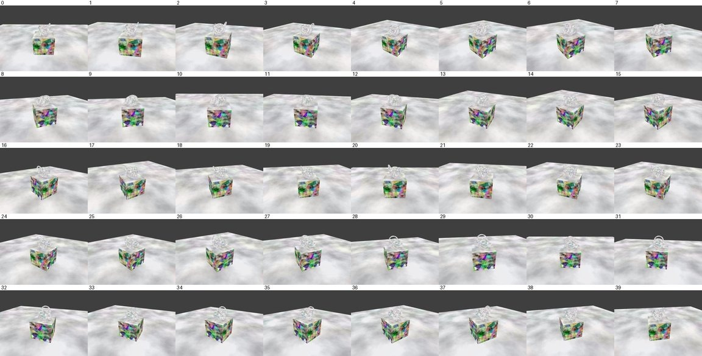

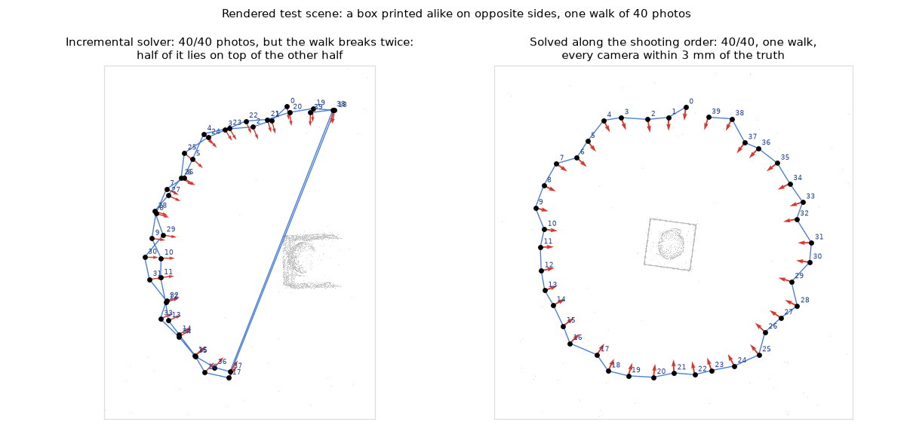

- *A box alike from opposite sides.* 40 photos rendered on one walk around a 0.5 m box whose
  front and back are printed alike, as are its left and right, with a faintly textured object
  on top (`make_symmetric_scene.py`). Both COLMAP solvers folded half the walk onto the other
  half (two breaks each, like the gas-mask set). Solved along the shooting order: 208 photo
  pairs between opposite sides were left out, and all 40 cameras came out within 3.0 mm of the
  truth (median 1.4 mm).
- *The gas-mask set,* from the phone's JPEG copies reduced to 480 × 639 (the DNGs were not
  available here; the full photos give about as many features, 1,300–2,500 per photo at 2400 px).
  The incremental solver placed 24 of 41 photos, the global solver 37 with two breaks. Along the
  shooting order, 19 pairs were left out, mostly front views matched to back views; the solve
  placed all 41 photos without a fold, as one walk around the box and then back the other way,
  closer. Four photos of the dark right side share few points and would have been dropped as
  likely misplaced; they turn like the photos taken next to them (1.5–5° off, against 10–26° for
  the misplaced photos of the synthetic scene), so they stay. One pair with 24 matches said the
  camera turned 76° where its neighbours said 43°; with it, COLMAP's rotation averaging cut the
  walk in two, which is why weak pairs are kept out of the first step.
- *On Windows* (the gas-mask set's 41 phone JPEGs at full size, Normal, GTX 1650 Ti laptop):
  the incremental solver placed 31 photos with a fold, the global solver 38 with two. Along the
  shooting order 29 pairs were left out and all 41 photos were placed without a fold: one mask.
  COLMAP read the focal length from the photos (3341 px). The CPU and the GPU shared the first
  depth-map pass (25 and 16 photos at 1600 px), weak partners were allowed (43 points per photo),
  and the mesh in the box was refined to 165k faces with an 8K texture, about 20 min from the
  features to the texture.
- *The WRX photos* with *Shooting Order* forced: 70 pairs between the car's two sides were left
  out. Judged against the 0.3.4 solve of the same photos (no fold), 68 pairs contradict it, and
  313 of 315 pairs got the same verdict both ways. All 42 photos were placed without a fold, the
  cameras within 1.5% (median) of the walk's radius of the 0.3.4 solve. With *Auto* the WRX and
  the synthetic scene are solved exactly as in 0.3.4.
- *The synthetic scene* with *Shooting Order* forced: from the nearby pairs alone the cameras
  could not be turned reliably (30 of 50 placed, one sudden turn), so no pair was judged and the
  usual result was kept (44 cameras, median 0.8 mm).
- *Build Mesh after Re-solve Without Selected.* In a run solved without 3 photos, Build Mesh
  reused every step up to the cameras and kept the run's list. With the solver changed after the
  crop stage, Build Mesh stopped with the explanation and changed nothing. Reconstruct with that
  setting solved the cameras again, gave the run a new solve id and dropped the old crop box.
- *Solve ids in Blender.* The crop stage of a second solve of a run got its own root, without
  the alignment made for the first solve; the mesh of the first solve joined the first solve's
  aligned root; runs made before 0.3.5 (no ids) behave as before.
- *Focal length of DNG photos.* A DNG without a 35 mm focal length, with a JPEG twin that has
  one: COLMAP read 721.1 px for the converted DNG, the same as for the JPEG (before, no prior).
- *Even Out Photos.* The synthetic photos with their own exposure and white balance (spread 0.26
  in log units) and darkened corners (0.67–0.81 of the centre): after the step, a spread of 0.000–
  0.003 and corners at 1.00–1.01; the undistorted photos that the depth maps and the texture use
  measured the same.
- *Max Photo Size.* At 1600 px, 2880 × 2160 photos became 1600 × 1200 with their EXIF, 960 × 720
  ones were left alone; another limit converted again, 0 brought the photos back as they are;
  video frames of a 1280 × 720 clip came out at 640 × 360 with 640 px.
- *Gaussian splats.* Brush 0.3.0's Linux build on a software Vulkan driver (no GPU here), on the
  synthetic scene's 44 undistorted photos at 320 px: after 2,000 steps the 4 held-out photos
  were matched at 23.8 dB PSNR (SSIM 0.88; 22.2 dB at 1,000 steps). Through the pipeline, a
  finished, cropped run trained 9,769 splats in 300 steps (every earlier step reused) and kept the
  6,957 inside the crop box; a rerun only cropped again, and a smaller box with Build Mesh made a
  new mesh and cropped the same splats to 823 without training (0.3.5 trained them again there;
  fixed in 0.3.6).

**Video, runs, crop box and tracked camera (0.3.4).**

- *Frames by number.* Test videos whose every frame shows its own frame number as a block
  pattern: each written file was read back and showed the frame its name says. From 12 s at
  250 fps (3,000 frames), 15 frames per second gave the 180 sharpest (one per 1/15 s window,
  none of the blurred ones) in two FFmpeg runs, every frame of 2–5 s gave frames 500–1249, and
  all 3,000 frames picked one by one took 14 s, the longest command 3,293 characters (0.3.3 put
  every frame into one command, which stops fitting Windows' 32,767-character limit at about
  2,700 frames). At 29.97 fps, 3–13 s at 2 per second gave 20 frames from 3.24 s to 12.75 s.
  Without B-frame-safe reading the last frame of a range was lost, and an early version matched
  frames with a tolerance taken from the gap between picked frames instead of the video's frame
  interval; both were caught by the numbered frames.
- *Containers and codecs.* H.265 in MKV, ProRes 422 HQ and DNxHR HQ in MOV, VP9 in WebM, AV1 in
  MP4, MPEG-4 in AVI and a 10-bit HLG H.265 clip: every frame of a 1 s range and the sharpest
  per window from each.
- *End to end.* A video of the 50 synthetic views (10 fps) through every step: 42 frames solved,
  the crop stage imported a free, unrotated box keeping 98.5% of the cloud, Align Ground fitted
  the untouched box again (98.3%), a moved box stayed on the same part of the scan through Set
  Scale and Reset, Build Mesh parented it without moving it, and the final import joined the
  run's root. The tracked camera had 42 keyframes at frames 2–50 at 10 fps and matched each
  solved frame's camera to 5 × 10⁻⁷; its clip carried COLMAP's lens. A second run got its own
  folder, root (`P3D_spiral_2`), collection (`Photogram3D_2 spiral`) and box.
- *Blender's lens conventions,* measured by undistorting a test image with one bright dot in the
  compositor's Movie Distortion node against COLMAP's models: the principal point counts y from
  the bottom, and Blender's Brown model takes OpenCV's tangential terms as p1 = p2 and p2 = −p1
  (0.1–0.6 px apart at any position; with the terms as named, 4–19 px). Blender 5.2 turns phone
  videos upright from their rotation tag exactly as FFmpeg does.
- *Photo formats.* A folder with JPEG, 8- and 16-bit PNG, TIFF, TGA, WebP, BMP, PSD, HEIC, AVIF,
  EXR and DNG photos, one shot also as RAW + JPEG: the libraries were installed with pip, the
  JPEG twin was skipped, and the conversions matched their sources (0.4–1.0 of 255 on average;
  the EXR and the DNG, developed with one exposure, at a median of 117–118 of 255 and a
  correlation of 0.98 with the source picture). COLMAP read the focal length from the converted
  photos' EXIF exactly as from the original JPEG. Twins were tried with dotted names too
  (`scan.001.dng`, `scan.001.jpg` and `scan.002.jpg` are two shots).
- *Phone lens shading.* LibRaw ignored a DNG's gain maps (the developed picture did not change
  with them), so Photogram3D applies them itself, as Adobe's DNG SDK does. A flat grey scene behind
  a lens whose corners lose 60% of red and 35% of blue, as a mosaic with a black level: with the
  four maps (one per Bayer position) the corners came out at 1.003 of the centre's brightness
  with no tint (red/green 1.000), without them at 0.66 and tinted (0.83); a map with impossible
  gains was ignored.
- *Spread photos.* On a solve of 600 frames 1.2° apart on two rings, 20° kept 35 photos and 5°
  kept 110, with 99.2% and 99.9% of the 3D points still seen by two kept photos.
- *Re-solve Without Selected.* A run forked from the synthetic scene's reused its features and
  matches and placed 46 photos without the 3 left out; the match database copy had no pair with
  them, and the original run was not touched.
- *CPU + GPU size agreement.* COLMAP's and OpenMVS's resize arithmetic, copied into a C++ program,
  disagreed on 1,002 of 6,606 sizes; Photogram3D's copies of both matched the C++ program on all of
  them, and the size it picks agreed for every set tried (1599 px for the gas mask photos,
  unchanged for the wall and the WRX). The stand-in GPU in the CPU + GPU tests now makes its maps
  at COLMAP's own size.
- *Error explanations,* on a real AI Features crash log from Windows and on typical tool messages (disk
  full, RAM, GPU memory, missing DLL, locked files, unreadable video, no initial pair, no depth
  pairs, crashes).

**Ground on three wheels, Full and the disk check (0.3.3).** The three ground points were put
at the contact points of three wheels of a car-sized rectangle (2.52 × 1.46 m) seen in 20 random
scan frames, in five orders, with each of the four axes. Every time the ground came out at Z = 0,
Ground 1 to 2 along the chosen axis, the origin in the middle of the four wheels and the cameras
above; points a few centimetres off still counted as a rectangle. Other triangles keep the
centre of the three points, and *Keep Z Rotation* gives exactly the 0.3.2 alignment. *Full*
changes only the depth-map size (4624 px for the WRX photos, 3200 px with Ultra), and the CPU + GPU
option accepts it on an 8 GB GPU while the 4 GB 1650 Ti stays at High and below. The disk check
stops the step when the free space is below the estimate, warns below one and a half times it,
and counts maps already in the folder as free.

**A moved project (0.3.2).** A finished project with the pre-0.3.2 absolute paths was moved to a
folder whose old place no longer existed. Import Result found the mesh (230k faces), the 44
cameras and the saved alignment straight away, and Reconstruct in the new place reused every
step (features through texture). Old absolute paths in Windows form (`D:\GDRIVE\Мой диск\...`)
are re-rooted the same way.

**Depth maps left from an earlier run (0.3.1).** DensifyPointCloud at 960 px, run in a project
that held 640 px depth maps, crashed within seconds (a segmentation fault, Linux's form of
0xC0000005). Through Photogram3D, the same project re-run at 800 px removed the 44 old maps and
finished, with every map at 800 × 600. A run cancelled after 12 new maps, with one of them cut
short to imitate a kill during a write, resumed by deleting that one and reusing the other 11:
121 depth-map estimates instead of 132. The completeness check passed every finished map and
rejected every cut-short or mislabelled copy; the same check for COLMAP's map files was tested
on made-up files only. When old depth maps cannot be deleted, the step stops and says why.

**Refinement memory.** The WRX run's 7.8 GB for 168.6 MP of refinement images (about 46 bytes
per pixel) showed that the refinement memory budget of 0.2.x was too generous: on 16 GB, 100
photos of 12 MP would have been refined at 2000 px, needing about 14 GB. The budget is now 13 MP
of images per GB of RAM, which keeps RefineMesh near 60% of RAM: that set is refined at 1000 px
on 16 GB and at 2000 px on 32 GB. The WRX set is unchanged (2312 px on 16 GB).

**AI Polish with a stand-in network.** The real MoGe-2 weights could not be downloaded in the
development environment. A stand-in ONNX model with MoGe-2's exact inputs and outputs returned the
true normals, either clean or with realistic errors (about 8° smooth regional error, 4° per-pixel
noise and a per-photo tilt). This tests everything except the network's own accuracy.

| On the final mesh | Distance median | Normal error median |
|---|---|---|
| As reconstructed | 0.53 mm | 1.25° |
| AI Polish, noisy normals | 0.58 mm | 1.04° |
| With 5 mm bumps added (glossy-paint stress case) | 2.65 mm | 15.5° |
| → Polish Surface (classic) | 1.81 mm | 9.0° |
| → AI Polish, noisy normals, influence 0.6 | 1.46 mm | 6.8° |
| → AI Polish, noisy normals, influence 1.0 | 1.16 mm | 4.7° |

The stand-in run also confirmed:

- OpenCV and OpenGL normal conventions are detected.
- Wrong normals (real photos fed to the stand-in) are rejected at an agreement of 0.11.
- The pip runtime install works.
- Apply and Discard on the shape key are exact.

**Other checks:**

- Resume skips unchanged steps.
- The cloud-sync warning recognises Google Drive (also as *My Drive* or *Мой диск*), OneDrive,
  Dropbox, iCloud Drive and Yandex Disk folders, and ignores look-alikes such as
  `onedrive_export`.
- On Windows, OpenMVS writes its output to a private console that cannot be piped. Photogram3D now
  follows each app's own log file instead. The progress parsers were replayed on the real Windows
  logs of the WRX run (densify: 118 steady updates, "depth map 60/120").
- On a 200-frame video with half the frames blurred, all 51 selected frames were sharp.
- The Windows installer was run against the real COLMAP (CUDA and non-CUDA) and OpenMVS release
  zips. Layout, filtering and manifest are correct. The CUDA colmap.exe needs only the NVIDIA
  driver.
- The package was built and validated with Blender's extension tool. It was installed, enabled,
  reloaded and uninstalled in Blender 5.2.2, and every panel was drawn with all properties and
  operators verified.

**On Windows (WRX set, 5900HX + RTX 3070 laptop, 16 GB).** All steps ran. With 0.2.1, TextureMesh
(seam leveling off) made 20 pages of 4K from 41,157 patches in 1 min 28 s (peak 5.5 GB).

With 0.3.0 on *Ultra* and the crop box around the car:

| Step | Time | Peak memory | Result |
|---|---|---|---|
| Features, matching, camera solve, undistortion | about 1.5 min | | 42/42 photos, 10,925 points, no fold |
| Depth maps (CPU, 2402 × 3200) and fusion | 45 min 50 s | 7.4 GB | 5.43M points |
| Mesh inside the box (1.8M points) | 59 s | 2.9 GB | 2.07M faces |
| Refinement (2312 px, faces up to 16 px²) | 5 min 42 s | 6.8 GB | 215k faces |
| Texture | 22 s | 5.9 GB | one 8K page (3,497 patches) |

The first depth-map pass took 27.5 min (39 s per photo on average, 16–53 s), the two
consistency passes about 8 min each (11.5 s per photo). Refinement first cut the 2.07M faces to
207k, the most it reduces a mesh (by ten times), so the final face count was set by refinement,
not by the depth maps. Every step stayed below half of the 16 GB.

With *COLMAP (NVIDIA GPU)* (0.3.1) and *OpenMVS + COLMAP (CPU + GPU)* (0.3.2) on the RTX 3070,
same photos and preset (the 0.3.2 run had its own folder, so its camera solve and box were made
again):

| Step | CPU (0.3.0) | GPU (0.3.1) | CPU + GPU (0.3.2) |
|---|---|---|---|
| Depth maps | 45 min 50 s, fusion included | 61.6 min in COLMAP, then 1 min to import and fuse | 33 min 10 s, fusion included |
| First pass | 27.4 min, 39 s per photo | 23.8 min, 32 s of GPU work + 2 s of reading and writing per photo | 14.5 min: CPU 19 photos (25% slower each than alone), GPU 23 (33 s each) |
| Consistency, per photo | 11.5 s per pass, two passes | 51 s, one pass | 11.5 s per pass, two passes |
| Dense cloud | 5.43M points (271M depth values fused) | 1.90M points (36M depth values) | 4.03M points (275M depth values) |
| Inside the box | about 1.8M points, mesh 2.07M faces | about 1.4M points, mesh 1.90M faces | about 1.5M points, mesh 1.87M faces |
| After refinement | 215k faces, 5 min 42 s, 6.8 GB | 200k faces, 5 min 30 s, 7.6 GB | 202k faces, 5 min 20 s, 7.6 GB |

The GPU path was slower: COLMAP's one consistency pass (51 s per photo) took more than twice
as long as OpenMVS's two together (23 s), and its first pass is only a little faster than the
CPU's. Its filtered depth maps also kept far fewer depth values, mostly off the car. The CPU + GPU
option uses COLMAP only in the first pass and keeps OpenMVS's quicker consistency passes and its
dense maps: it fused as many depth values as the CPU path in 28% less time. The three textured
meshes look alike.

**Not tested here (no Windows, NVIDIA GPU, display or Hugging Face access):**

- the Visual C++ installer;
- the *Full* preset on real photos: its time, memory and disk (estimated above from the Ultra
  runs) and whether it shows more detail;
- either GPU option on the GTX 1650 Ti, and DirectML (for AI Polish and for AI Features);
- the real MoGe-2 network, so how much AI Polish helps on real photos is unmeasured;
- the crop stage in an interactive viewport: drawing the cloud and putting the 3D cursor on it
  with Shift+right-click (the panels, operators and import were tested without a display), and
  how the see-through crop box and the tracked camera's video background look there;
- RAW files from real cameras and phones (only synthetic DNGs were developed here; LibRaw reads
  the others), including a real phone's gain maps, and the pip install of the image libraries on
  Windows (the same wheels exist for it);
- whether Ultra's finer refinement shows more detail than High on the same photos (its time
  and memory on 16 GB are in the table above);
- Brush on a real GPU and on Windows (its training time, and the GPU-memory cap on 4 GB), and
  Blender 5.3's own import of the splats (5.3 is not out yet);
- *AI Features* on a real GPU, with DirectML and with NVIDIA's libraries, and Test AI Speed
  there: how fast they are, and which photo size fits in 4 and 8 GB;
- Auto's new movement measure and floor on the real phone videos (the 0.3.8 Auto was run on
  them; the new measure was checked on a rendered walk and on pans);
- the camera track on a real video and on the GPU: its time on the test laptops, and how the
  tracked camera lines up with real footage (rolling shutter, which COLMAP does not model, may
  show in fast pans);
- turning the cameras of real portrait DNG and JPEG photos upright (the photos were stored the
  phone's way from the WRX photos here).

## Third-party software (downloaded at runtime, not bundled)

| Component | License |
|---|---|
| COLMAP 4.2.1 (with GLOMAP) | BSD 3-Clause (COLMAP itself; bundled libraries have their own) |
| OpenMVS 2.4.0 | AGPL-3.0 |
| FFmpeg 8.1 (BtbN GPL build) | GPL-3.0 |
| MoGe-2 (Microsoft) | MIT (code and published weights; the ONNX export page lists no license) |
| ONNX Runtime (DirectML) | MIT |
| NVIDIA cuBLAS, cuDNN, CUDA runtime (*GPU (NVIDIA libraries)*, downloaded only on request) | NVIDIA's license (free to use, not open source) |
| Pillow | MIT-CMU |
| pillow-heif (with libheif) | BSD 3-Clause (libheif: LGPL-3.0) |
| rawpy (with LibRaw) | MIT (LibRaw: LGPL-2.1 or CDDL-1.0) |
| OpenEXR | BSD 3-Clause |
| Brush 0.3.0 (Gaussian splats, only when used) | Apache-2.0 |
| ALIKED and LightGlue models (*AI Features*, downloaded by COLMAP) | BSD 3-Clause (ALIKED), Apache-2.0 (LightGlue) |
| Microsoft Visual C++ Redistributable | Microsoft license |

Everything Photogram3D uses is free to use: the open-source tools above, plus the system parts
they rely on (Microsoft's Visual C++ runtime and DirectML, NVIDIA's driver and the CUDA runtime
inside COLMAP) and, only when they are asked for, NVIDIA's CUDA libraries. Topaz Photo AI, which
0.3.5 could call, was removed in 0.3.7 because it is not free.